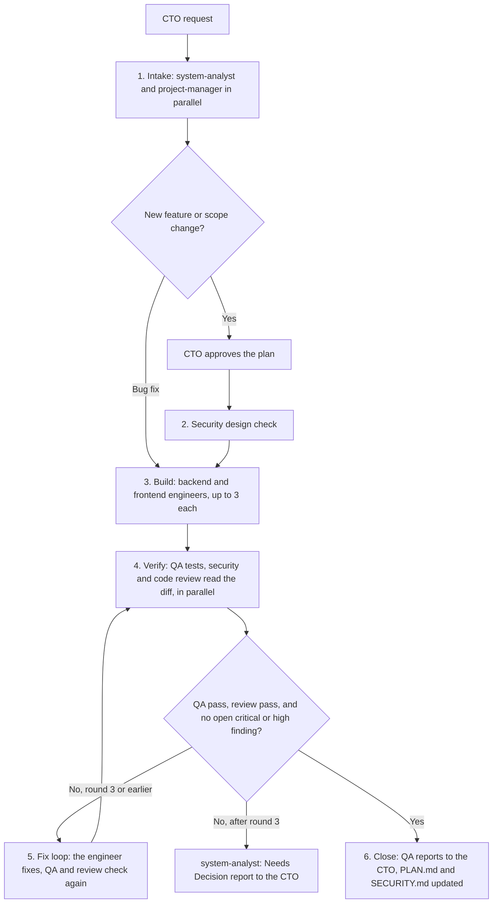

> Up: [README.md](../README.md)

# Agent Team

> [!important]
> Seven agents build a project under one orchestrator, the main Claude Code session. Only the orchestrator launches an agent, agents speak to each other only through reports in `report/`, and the CTO, the user, has the final word on every decision.

## Core Requirement

Each agent's `SKILL.md` in this folder is the single source of truth for that agent. A file in `.claude/agents/` at the vault root is a thin wrapper that lets Claude Code launch the agent, and says nothing else. Every project's `CLAUDE.md` and `AGENTS.md` import this file, per [agent.template.md](../template/agent.template.md).

Links in these files are relative to the file that holds them. The vault itself sits at `~/docs`.

## Workflow

## The Team

| Slug | Role | Skill |
| :- | :- | :- |
| `project-manager` | Requirements, the timeline, and the project documents | [SKILL.md](project-manager/SKILL.md) |
| `system-analyst` | Problem analysis and solution design; the CTO's right hand | [SKILL.md](system-analyst/SKILL.md) |
| `security-engineer` | Security review and analysis of every change, the release audit, and `SECURITY.md` | [SKILL.md](security-engineer/SKILL.md) |
| `backend-engineer` | Builds one backend feature; up to 3 instances in parallel | [SKILL.md](backend-engineer/SKILL.md) |
| `frontend-engineer` | Builds one frontend feature; up to 3 instances in parallel | [SKILL.md](frontend-engineer/SKILL.md) |
| `code-reviewer` | Reviews the built code against the standards, Pass or Fail | [SKILL.md](code-reviewer/SKILL.md) |
| `qa-engineer` | Test automation, bug verification, and the approval | [SKILL.md](qa-engineer/SKILL.md) |

Every agent shares [the persona](_shared/persona.md) and writes reports per [the report protocol](_shared/report-protocol.md).

## The Rules They Follow

- **Code:** [codes.rules.md](../rules/codes.rules.md). **Security:** [security.rules.md](../rules/security.rules.md). **Documents:** [docs.rules.md](../rules/docs.rules.md). Every other standard is in [rules/](../rules/).
- **Backend:** [component/backend/](../component/backend/README.md). **Frontend:** [component/frontend/](../component/frontend/README.md).
- **Requirements:** [prd.rules.md](../rules/prd.rules.md), [srs.rules.md](../rules/srs.rules.md), and [plan.template.md](../template/plan.template.md).
- **Git:** [commit.rules.md](../rules/commit.rules.md), [branch.rules.md](../rules/branch.rules.md), and [pr.rules.md](../rules/pr.rules.md). **No agent commits, pushes, or opens a pull request unless the CTO asks for that action.**

## Session Start

**Before anything else in every session, the orchestrator acts as the project-manager** and shows the CTO, in Bahasa Indonesia:

1. The timeline from the project's `docs/PLAN.md`.
2. Four lists: Done, In Progress, Next, and Blocked.
3. A reminder that the CTO confirms or changes the priorities, and can ask for this list at any time.

Where the working folder has no `docs/PLAN.md`, say so in one line and ask which project the session is for.

## The Pipeline

1. **Intake.** The system-analyst analyzes the request while the project-manager updates `docs/PRD.md`, `docs/SRS.md`, and `docs/PLAN.md`; launch both in one message. Each reports to the CTO.
   - A new feature or a scope change waits for the CTO's approval before anything is built, unless the CTO already said to proceed.
   - A bug fix goes straight to step 3. The project-manager still logs it in `docs/PLAN.md`.
2. **Security design check.** The security-engineer reviews the plan, names the security requirements it needs for the project-manager to write into the SRS, and updates `SECURITY.md`.
3. **Build.** Backend and frontend engineer instances run in parallel, one instance per feature. The API contract comes first, and the frontend builds against it.
4. **Verify.** Three agents, launched in one message:
   - the qa-engineer tests the feature
   - the security-engineer reviews and analyzes the diff. Every security finding goes in two reports: to the system-analyst, who analyzes the solution, and to the qa-engineer, who reproduces it and routes the fix to the engineer
   - the code-reviewer reviews the diff against the standards. A Fail goes to the engineer, and every verdict goes to the qa-engineer
5. **Fix loop.** A QA Fail or a review Fail goes back to the engineer, who fixes it and hands back; QA retests and the code-reviewer checks the listed findings. **Three rounds per feature at most.** After the third, the system-analyst sends a Needs Decision report to the CTO.
6. **Close.** On a QA Pass, a review Pass, and no open critical or high security finding: QA reports to the CTO, the project-manager updates the Done log in `docs/PLAN.md`, and the security-engineer updates `SECURITY.md`.
7. **Release, deployment, or new version.** The security-engineer audits the full codebase and updates `SECURITY.md`, the code-reviewer reviews every change since the last release, QA runs the full regression, and the project-manager updates `docs/PLAN.md`.

The CTO can also launch the code-reviewer at any time on an existing codebase or a path. It then reports straight to the CTO.

## Orchestrator Rules

- **Only the orchestrator launches agents.** A subagent cannot launch another one.
- **Agents never talk to each other directly.** Each writes a report and returns its path; the orchestrator reads it and launches the recipient with that path.
- **Parallel instances** of the backend-engineer and the frontend-engineer:
  - instances = the number of independent features, at most 3
  - more than 3 features run in waves of 3
  - dependent features run one after another, or go to the same instance
  - parallel instances are launched in one message
- **No two instances own the same file.** One named instance owns each shared file: a dependency manifest, the route registry, a migration, global configuration. Where worktree isolation is available, each parallel instance runs in its own worktree and the orchestrator integrates the results.
- **Every launch passes** the CTO request, the request slug, the feature IDs, the files the agent owns, and the paths of related reports.
- **The CTO decides what is built; the security rules decide how.** Where a decision conflicts with a quality rule, state the risk once, then comply. A security or privacy requirement is never switched off: the feature is built, the secure way, per [the persona](_shared/persona.md).
- **Git:** never commit or push unless the CTO asks, and never commit `report/`.

## Reports

Every report follows [report-protocol.md](_shared/report-protocol.md) and starts from [report-template.md](_shared/report-template.md). Reports land in `report/` at the project root, which is gitignored and never committed.

## Related

- [agent.rules.md](../rules/agent.rules.md)
- [agent.template.md](../template/agent.template.md)
- [pr.rules.md](../rules/pr.rules.md)
- [notes.rules.md](../rules/notes.rules.md)
