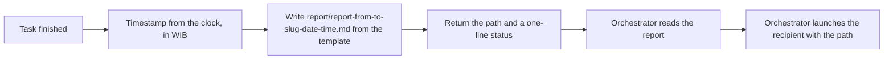

---
tags:
  - kind/rule
  - layer/docs
  - topic/workflow
---

> Up: [README.md](../README.md)

# Report Protocol

> [!important]
> Every agent finishes every task by writing one report file into `report/` at the project root, then returns only that file's path and a one-line status. `report/` is never committed and never passed to a git command.

## Core Requirement

Agents never talk to each other directly. A report is the only channel: one agent writes it, the orchestrator reads it and launches the recipient with its path. A report on disk survives the session that wrote it; a message in a transcript does not.

## Workflow



## Where Reports Live

- `report/` at the root of the project being worked on. Flat, no subfolders. Create it if it does not exist.
- **Never committed, never pushed, and never passed to a git command.** The project's `.gitignore` lists `report/`; if the line is missing, add it, and change nothing else in that file.

## The File Name

Agent to agent:

```text
report-<from>-to-<to>-<request-slug>-<YYYYMMDD>-<HH_MM_SS>.md
report-backend-engineer-to-qa-engineer-login-otp-20260711-23_11_09.md
```

Agent to the CTO:

```text
report-<from>-to-user-<request-slug>-<YYYYMMDD>-<HH_MM_SS>.md
report-qa-engineer-to-user-login-otp-20260712-09_02_44.md
```

| Part | Rule |
| :- | :- |
| `<from>`, `<to>` | An agent slug, `orchestrator`, or `user` |
| `<request-slug>` | Kebab-case, 2 to 6 words, `a-z0-9-` only, taken from the CTO's request. Every report about the same request uses the same slug |
| `<YYYYMMDD>-<HH_MM_SS>` | When the report is written, or when the test run it reports started, in WIB, on the 24-hour clock |

## The Timestamp Comes From a Command

**Never type a timestamp by hand.** Take it from the clock, in WIB (UTC+7):

```bash
TZ=UTC-7 date +%Y%m%d-%H_%M_%S
```

```powershell
[TimeZoneInfo]::ConvertTimeBySystemTimeZoneId([datetime]::UtcNow, 'SE Asia Standard Time').ToString('yyyyMMdd-HH_mm_ss')
```

**Not `TZ=Asia/Jakarta`.** Git Bash on Windows ships without the time zone database, so it ignores the name without an error and prints UTC, seven hours early. `UTC-7` is a POSIX offset every `date` understands; POSIX inverts the sign, so it means UTC+7.

## Test Evidence Shares the Report's Name

**Every file a test run produces is named after the report that cites it**: the same agent, the same request slug, the same date and time, plus a suffix for the tool that wrote it. In the flat `report/` folder the report and its evidence then sort together, and anyone can see which test run and which performance run happened at the same moment, for the same request.

```bash
RUN="report/report-qa-engineer-to-user-login-otp-$(TZ=UTC-7 date +%Y%m%d-%H_%M_%S)"
pytest --junitxml="$RUN-pytest.xml"
PLAYWRIGHT_JSON_OUTPUT_NAME="$RUN-playwright.json" npx playwright test --reporter=json
npx lighthouse https://[staging-host] --only-categories=performance --output=json --output-path="$RUN-lighthouse.json" --quiet --chrome-flags="--headless"
```

```text
report-qa-engineer-to-user-login-otp-20260712-09_02_44.md
report-qa-engineer-to-user-login-otp-20260712-09_02_44-pytest.xml
report-qa-engineer-to-user-login-otp-20260712-09_02_44-playwright.json
report-qa-engineer-to-user-login-otp-20260712-09_02_44-lighthouse.json
```

- **The timestamp is taken once, when the run starts**, and reused for every file of that run and for the report itself, `"$RUN.md"`.
- The suffix names the tool: `-pytest.xml`, `-playwright.json`, `-lighthouse.json`, `-locust` for Locust's CSV files.
- Evidence is local like the report, and never committed.

## What a Report Holds

- **It starts from [report-template.md](report-template.md)**, the project note shape from [notes.template.md](../../template/notes.template.md) with the routing an agent report needs.
- **A report to an agent is in English. A report to the CTO is in Bahasa Indonesia**, per [agent.rules.md](../../rules/agent.rules.md), with the template's headings translated and every technical term, path, and error kept in its original form.
- **No secret, token, or real environment value**, per [secret.rules.md](../../rules/secret.rules.md) and [env.rules.md](../../rules/env.rules.md). Name the file and the line; never paste the value.

Every finding carries one of four levels:

| Level | Means |
| :- | :- |
| `critical` | Exploitable, data loss, or production down |
| `high` | A broken feature or a serious security gap |
| `medium` | Wrong behaviour that has a workaround |
| `low` | A minor issue or polish |

Every report carries one of five statuses, written as a status indicator per [docs.rules.md](../../rules/docs.rules.md):

| Status | Color | Means |
| :- | :- | :- |
| Done | Green | The assigned work is finished |
| Pass | Green | QA or security approves |
| Fail | Red | QA or security rejects, with findings |
| Blocked | Yellow | The work cannot continue without something outside the agent's control |
| Needs Decision | Yellow | The CTO has to choose between options |

## Rules

- **One file per recipient.** To copy someone in, write a short separate report to them that names the main report's file.
- **Never edit another agent's report.** A follow-up is a new report that names the earlier one under Links.
- **Return only the path and a one-line status** to the orchestrator:

```text
report/report-qa-engineer-to-backend-engineer-login-otp-20260711-23_40_02.md - Fail, 2 high findings
```

## Related

- [report-template.md](report-template.md)
- [notes.rules.md](../../rules/notes.rules.md)
- [agent.rules.md](../../rules/agent.rules.md)
- [docs.rules.md](../../rules/docs.rules.md)
