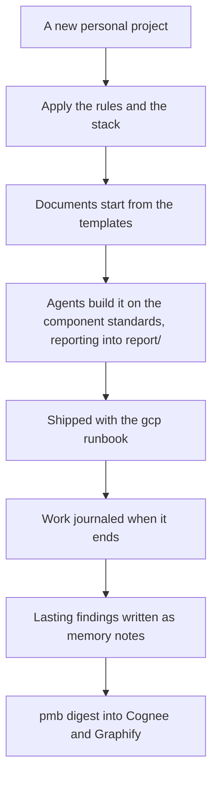

# Project Standards

> [!important]
> Every personal project applies these standards. A new project follows them from the first scaffold.

The source of truth for how I build things: one set of standards across every project, and a shared memory every AI model can read.

## Overview

A project accumulates decisions nobody wrote down. Six months later the conventions are gone, the reasoning is gone, and the next project starts from scratch with slightly different habits. This repository is the fix: the conventions live in one place, every project follows them, and no project invents its own.

The rules here are deliberately short. A standard that costs more to follow than the mistake it prevents is a standard that gets abandoned, so each one earns its place: it exists because forgetting it has actually cost something. Every rule says why, because a rule with no reason attached is dropped the first time it is inconvenient.

Alongside them sits a portable AI memory. An assistant with no memory relearns the same context every session; an assistant whose memory lives inside one vendor's product is a memory you lose when you switch models. So the memory is plain markdown on this machine, indexed by tools that can be rebuilt and replaced. **It is never pushed**: the standards here are shared, the memory of real projects is not.

The whole repository is an Obsidian vault. Open the folder and the graph is already wired.

## Workflow

## Repository Contents

| Contents | Description |
| :- | :- |
| [rules/](rules/) | How code, commits, documents, and secrets are handled. Every project follows these |
| [ai/](ai/) | Machine learning and deep learning standards, kept separate because AI projects fail differently |
| [component/frontend/](component/frontend/README.md) | UI component standards on HeroUI, the frontend performance budgets, and the Playwright tests |
| [component/backend/](component/backend/README.md) | Backend performance on FastAPI and SQLAlchemy, and the pytest tests against PostgreSQL |
| [cloud/gcp/](cloud/gcp/) | The Cloud Run deploy standard, the runbook, and the build templates |
| [template/](template/) | Documentation templates: the READMEs, API, model card, PRD, plan, the community files, and the agent entry point |
| [journal/](journal/) | One record per project per day: what was wrong, what was found, and what changed as a number |
| [agents/](agents/README.md) | The seven agent skills, their shared persona, and the report protocol |
| [commands/](commands/) | The `/custom-agents` slash commands that run one agent or the whole team, copied to `~/.claude/commands/` |
| [.claude/agents/](.claude/agents/) | Thin wrappers that let Claude Code launch each agent. Hidden in Obsidian, which skips every folder whose name starts with a dot |

### What Stays on This Machine

**Four folders live in the vault on disk and are never pushed.** They are gitignored, so a fresh clone does not have them, and nothing in this repository links into them.

| Folder | Holds | Why it stays local |
| :- | :- | :- |
| `memory/` | The AI memory: notes, kept scripts, and the index that lists them | It names real projects, decisions and environments |
| `graph/` | Code maps and graph exports a digest generates | It maps real files and functions, and every digest rebuilds it |
| `pattern/` | Lessons lifted from real incidents, generalized | It is a working notebook, not a standard |
| `report/` | Reports the agents write to each other and to the owner | They are working files, gitignored in every project, never committed |

On a new machine, `/pmb-init brain` scaffolds `memory/` again, and a digest rebuilds `graph/`. **Nothing backs these folders up**, so copy them somewhere you control. The rules for the memory are [[memory.rules.md]].

## Rules

Grouped by when you reach for them, not by importance. A rule is not optional because it sits in a later group.

**How work moves:**

| Document | Owns |
| :- | :- |
| [[branch.rules.md]] | The two branch shapes, trunk and promotion, and which one a project declares |
| [[commit.rules.md]] | Conventional Commits, an `exp` type for experiments, and what never enters a commit |
| [[pr.rules.md]] | When a pull request is worth opening, what an experiment must record, and when an AI may open or merge one |
| [[docs.rules.md]] | What every project documents, how it is written, the tag taxonomy, and the Obsidian conventions |
| [[journal.rules.md]] | The journal written when a piece of work ends, its four questions, and the numbers it must carry |
| [[notes.rules.md]] | The project note: one brief, digits-only numbering, and a Done When table a tester can tick |
| [[badge.rules.md]] | shields.io badges: the two kinds, the product name, and Title Case on every state |
| [[callout.rules.md]] | The callout types, where one is required, and where it is forbidden |

**What you build:**

| Document | Owns |
| :- | :- |
| [[codes.rules.md]] | YAGNI, KISS, DRY, readability, Python 3.13, conda and `.venv`, and the ML practices that differ |
| [[database.rules.md]] | PostgreSQL and SQLAlchemy, which cases take the ORM and which take raw SQL, and the restore nobody tested |
| [[data.rules.md]] | Four data classes: the schema is readable, rows need explicit approval, and protected data is never read |
| [[env.rules.md]] | Why a real environment file is never read, what belongs in a table instead, and the notebook cell |
| [[path.rules.md]] | Every path relative to a named anchor, and the three path namespaces that never mix |
| [[secret.rules.md]] | Which values are secrets, where each one lives, and why a frontend holds none |
| [[security.rules.md]] | The OWASP checklist, the stack controls it turns into, personal data, and the audit trail |
| [[auth.rules.md]] | One identity source, one identity key, one swappable abstraction, and the non-human account |
| [[repository.rules.md]] | One deployable per repository, git hygiene, and what every project documents |
| [[stacks.rules.md]] | The stack every project starts from, and what needs a written exception |
| [[api.rules.md]] | The REST contract: the route shape, the error shape, pagination, and tool endpoints |
| [[agent.rules.md]] | When an agent writes a memory note, and how many |
| [[analytics.rules.md]] | Which chart a shape of data earns, the guardrails against distortion, and the no-3D gate |
| [[prd.rules.md]] | The PRD every project carries, written before the code, and the non-goals that bound it |
| [[srs.rules.md]] | The numbered, checkable requirements that follow the PRD and precede the code |
| [[media.rules.md]] | Document and media upload, covering PDF and photo |
| [[automation.rules.md]] | Scheduled and triggered work: one folder, deployed apart, tested before release, with a force stop |
| [[report.automation.md]] | What an automated report delivers: the header, the caption, the file type, the numbers, and the colours |
| [[pwa.rules.md]] | The PWA layer of a frontend: manifest, icons, and offline behavior |

**What you build for the web:** the 23 component standards on HeroUI, the frontend performance budgets, and the Playwright tests, each with what it owns, are listed in [component/frontend/](component/frontend/README.md).

**What you build behind it:** the backend performance and testing standards, and the rules every backend follows, are listed in [component/backend/](component/backend/README.md).

**How the agents work:**

| Document | Owns |
| :- | :- |
| [[agents/README.md]] | The seven agents, the session-start status, the pipeline from request to release, and the orchestrator's rules |
| [[persona.md]] | The one persona every agent shares, and where the CTO's word stops at a security requirement |
| [[report-protocol.md]] | `report/`, the file name, the WIB timestamp, the levels, and the statuses |
| [[report-template.md]] | The notes shape every report is written in |
| [[custom-agents-all.md]] | `/custom-agents-all` runs the whole team, `/custom-agents-<slug>` runs one agent, and `/custom-agents` lists them |

**What you build with AI:**

| Document | Owns |
| :- | :- |
| [[ai.rules.md]] | Every AI project: conda-forge environments, reproducibility, data, experiments |
| [[ml.rules.md]] | Tabular and classical: pipelines, splitting, leakage, imbalance |
| [[dl.rules.md]] | Deep learning: PyTorch from conda-forge, determinism, the training loop |

**How it ships:**

| Document | Owns |
| :- | :- |
| [[deploy.rules.md]] | Cloud Run as the default target and when another platform replaces it, what runs where, the allocation, the registry retention, and the cost |
| [[deploy.cloud.md]] | The copy-and-paste Cloud Run runbook, from project setup to rollback |

## Templates

Every documentation file starts from one of these, per [[docs.rules.md]]. Keep the section order.

| Template | Used for |
| :- | :- |
| [[backend.template.md]] | The README of a backend repository |
| [[frontend.template.md]] | The README of a frontend repository |
| [[project.template.md]] | A single-repository project `README.md` |
| [[api.template.md]] | An `API.md` documenting endpoints |
| [[model.template.md]] | A `MODEL.md` model card: data, seed, metrics, failure modes |
| [[agent.template.md]] | A project's `CLAUDE.md` and `AGENTS.md`, pointing agents at the map and the rules |
| [[notes.template.md]] | A project note in `docs/notes/`: one brief, its items, and its acceptance table |
| [[prd.template.md]] | The `docs/PRD.md` every project carries, written before the code |
| [[plan.template.md]] | The `docs/PLAN.md`: the timeline, the features with owner and status, and the done log |
| [[license.template.md]] | The `LICENSE` file: `Proprietary`, or the full MIT text |
| [[code-of-conduct.template.md]] | The `CODE_OF_CONDUCT.md` every repository carries |
| [[security.template.md]] | The `SECURITY.md`: the private channel for a vulnerability, and the response times |
| [[contributing.template.md]] | The `CONTRIBUTING.md`: setup, branches, commits, and pull requests |
| [[cloudbuild.service.template.yaml]] | The build pipeline for a backend service |
| [[cloudbuild.frontend.template.yaml]] | The build pipeline for a static frontend |
| [[cloudbuild.job.template.yaml]] | The build pipeline for a scheduled job |
| [[cleanup-policy.template.json]] | The registry retention policy, identical for every project |

## Memory

A memory every model can read, because it is files rather than a vendor's store.

| Layer | Tool | Holds |
| :- | :- | :- |
| Substrate | Obsidian vault, markdown | Everything. The source of truth |
| Structural | Graphify | An AST map of a codebase, so an agent stops grepping the tree |
| Semantic | Cognee | A knowledge graph and vector index built from the markdown |

**The markdown is the only durable store.** The other two are indexes over it: delete either and rebuild it from the files. **It stays on this machine and is never pushed**, per [[memory.rules.md]]. That is what makes the memory portable and readable by any model, and what makes switching embedding model or graph database a reindex rather than a migration.

Both are built by `plugmybrain`, whose command is `pmb`.

| Document | Owns |
| :- | :- |
| [[memory.rules.md]] | The write and recall protocol every model follows, and why the memory stays local |
| [[memory.codes.rules.md]] | Reference code kept beside a note that explains it |
| [[note.template.md]] | The shape of a note, for each of the four types |

## Stack

| Layer | Choice |
| :- | :- |
| Language | Python 3.13, English identifiers and English documentation |
| Backend | FastAPI with Pydantic v2, `uvicorn`, `psycopg` v3 |
| Frontend | React 19 on Vite with TypeScript, HeroUI 3 on Tailwind CSS v4, TanStack Query, Tabler icons, Google Sans, light and dark themes |
| Environment | Conda (Miniconda) for machine learning, `.venv` for plain Python |
| Database | PostgreSQL 18 with SQLAlchemy 2.x and Alembic; SQLite for a local single-user tool |
| Tests | pytest, and Playwright for end-to-end flows |
| Deploy | Cloud Run by default, built by Cloud Build, images in Artifact Registry; another platform when the owner names one |
| Vault | Obsidian, with Graphify and Cognee over the same files, built by `plugmybrain` |

## Using It With a Model

Point the assistant at this repository and give it [[CLAUDE.md]] or [[AGENTS.md]] as its entry point. Both import this file, the memory protocol, and the [[agents/README.md|agent team]], so the rules, the memory, and the agents load together.

Nothing here is model-specific. A different assistant reads the same markdown and arrives at the same context, which is the entire reason the memory is files.

## Index

### Rules

- [[agent.rules.md]]
- [[analytics.rules.md]]
- [[api.rules.md]]
- [[automation.rules.md]]
- [[auth.rules.md]]
- [[badge.rules.md]]
- [[branch.rules.md]]
- [[callout.rules.md]]
- [[codes.rules.md]]
- [[commit.rules.md]]
- [[data.rules.md]]
- [[database.rules.md]]
- [[docs.rules.md]]
- [[env.rules.md]]
- [[journal.rules.md]]
- [[media.rules.md]]
- [[notes.rules.md]]
- [[path.rules.md]]
- [[pr.rules.md]]
- [[prd.rules.md]]
- [[pwa.rules.md]]
- [[report.automation.md]]
- [[srs.rules.md]]
- [[repository.rules.md]]
- [[secret.rules.md]]
- [[security.rules.md]]
- [[stacks.rules.md]]

### Deploy

- [[deploy.rules.md]]
- [[deploy.cloud.md]]
- [[cloudbuild.service.template.yaml]]
- [[cloudbuild.frontend.template.yaml]]
- [[cloudbuild.job.template.yaml]]
- [[cleanup-policy.template.json]]

### Components

- [[component/frontend/README.md]]
- [[component/backend/README.md]]
- [[performance.frontend.md]]
- [[testing.frontend.md]]
- [[performance.backend.md]]
- [[testing.backend.md]]
- [[uix.component.md]]
- [[animation.component.md]]
- [[button.component.md]]
- [[calendar.component.md]]
- [[card.component.md]]
- [[darkmode.component.md]]
- [[dashboard.component.md]]
- [[dropdown.component.md]]
- [[header.bar.component.md]]
- [[header.page.component.md]]
- [[layout.component.md]]
- [[loading.component.md]]
- [[log.component.md]]
- [[login.component.md]]
- [[notification.component.md]]
- [[pagination.component.md]]
- [[refresh.component.md]]
- [[scrollbar.component.md]]
- [[search.component.md]]
- [[sidebar.component.md]]
- [[skeleton.component.md]]
- [[table.component.md]]
- [[title.header.component.md]]

### AI

- [[ai/README.md]]
- [[ai.rules.md]]
- [[ml.rules.md]]
- [[dl.rules.md]]

### Templates

- [[backend.template.md]]
- [[frontend.template.md]]
- [[project.template.md]]
- [[api.template.md]]
- [[model.template.md]]
- [[agent.template.md]]
- [[notes.template.md]]
- [[prd.template.md]]
- [[plan.template.md]]
- [[license.template.md]]
- [[code-of-conduct.template.md]]
- [[security.template.md]]
- [[contributing.template.md]]

### Memory

- [[memory.rules.md]]
- [[memory.codes.rules.md]]
- [[note.template.md]]

### Memory Notes and Reference Code

Every note and every kept script is indexed in `memory/README.md`, grouped by type and carrying its title. That index is local, like the notes it lists, per [[memory.rules.md]]. That index is the one place they are listed, so this file does not repeat it and the two cannot drift.

### Agents

- [[agents/README.md]]
- [[persona.md]]
- [[report-protocol.md]]
- [[report-template.md]]
- [[agents/project-manager/SKILL.md]]
- [[agents/system-analyst/SKILL.md]]
- [[agents/security-engineer/SKILL.md]]
- [[agents/backend-engineer/SKILL.md]]
- [[agents/frontend-engineer/SKILL.md]]
- [[agents/code-reviewer/SKILL.md]]
- [[agents/qa-engineer/SKILL.md]]

### Configuration

- [[CLAUDE.md]]
- [[AGENTS.md]]

## Keeping It Honest

A standard nobody follows is worse than no standard, because it makes a codebase look governed when it is not.

- When the code and a rule disagree, fix one of them in the same session. Never leave both.
- **A rule broken three times is a rule that is wrong.** Change the rule, do not keep losing the argument with yourself.
- **A rule reasoned about one component breaks where a page stacks two.** Draw the stacked page before adding one.
- These documents follow their own rules, including [[docs.rules.md]] and [[badge.rules.md]]. A badge here is as current as one in a project README, or this file is not credible.
