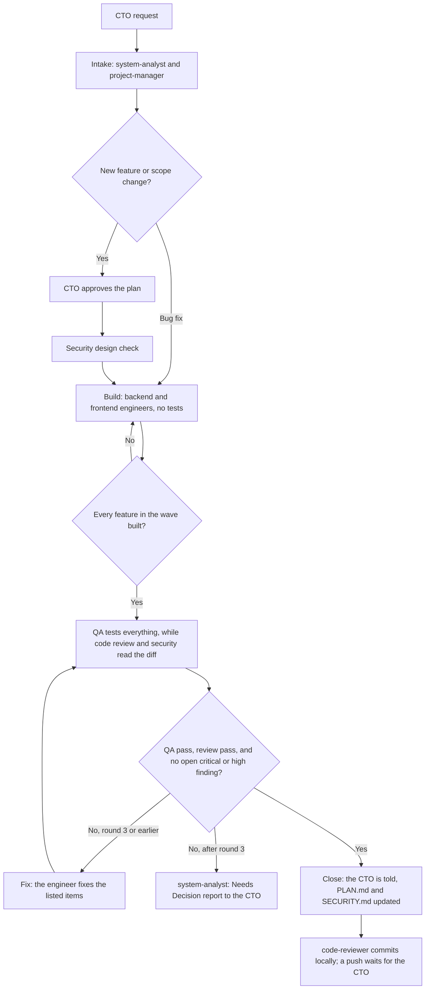

> Up: [[README.md]]

# Agent Team

> [!important]
> Seven agents build a project under one orchestrator, the main Claude Code session. Each agent finishes its list, writes a report naming the next agent, and the orchestrator launches that agent at once. Engineers only build, QA does all of the testing, and the CTO, the user, decides what is built.

## Core Requirement

Each agent's `SKILL.md` in this folder is the single source of truth for that agent. A file in `.claude/agents/` at the vault root is a thin wrapper that lets Claude Code launch the agent, and says nothing else. Every project's `CLAUDE.md` and `AGENTS.md` import this file, per [[agent.template.md]].

Every `[[wikilink]]` in these files names a file in the vault at `~/docs`, found by its file name, or by its path where two files share a name, such as [[agents/qa-engineer/SKILL.md]].

## Workflow

## The Team

| Slug | Role | Skill |
| :- | :- | :- |
| `project-manager` | Requirements, the timeline, and the project documents | [[agents/project-manager/SKILL.md]] |
| `system-analyst` | Problem analysis and solution design; the CTO's right hand | [[agents/system-analyst/SKILL.md]] |
| `security-engineer` | Security review and analysis of every change, the release audit, and `SECURITY.md` | [[agents/security-engineer/SKILL.md]] |
| `backend-engineer` | Builds one backend feature, and only builds; up to 3 instances in parallel | [[agents/backend-engineer/SKILL.md]] |
| `frontend-engineer` | Builds one frontend feature, and only builds; up to 3 instances in parallel | [[agents/frontend-engineer/SKILL.md]] |
| `code-reviewer` | Reviews the built code against the standards, Pass or Fail, and commits closed work locally | [[agents/code-reviewer/SKILL.md]] |
| `qa-engineer` | Every test, the automation, and the approval | [[agents/qa-engineer/SKILL.md]] |

Every agent shares [[persona.md]] and writes reports per [[report-protocol.md]].

## Who Builds and Who Tests

- **Engineers build, and only build.** The backend-engineer and the frontend-engineer write no test, run no test suite, open no browser, and start no server to check their work. Their last step is `ruff format .` or `npm run build`, then the handoff.
- **QA tests everything, in one pass per wave**: unit, integration, end to end, and performance, once every feature in the wave is built.
- **The code-reviewer and the security-engineer read the code.** Neither runs a test suite.
- **The orchestrator never tests, builds, or re-checks an agent's work.** It reads the report and launches the next agent. A doubt about the work is a task for QA, not a check the orchestrator runs itself.

A wave is the set of features built at the same time: up to three per engineer type, per the orchestrator rules below.

## Delegation: Who Goes Next

**Every report ends with a Next Action naming the next agent.** The orchestrator reads it and launches that agent at once, passing the report's path, without asking the CTO. A subagent cannot launch another subagent in Claude Code, so the orchestrator is the hand that passes the work on; the agents decide where it goes.

| When this is done | Launched next |
| :- | :- |
| Intake: the plan and the analysis | The CTO approves a new feature or a scope change first. A bug fix goes straight to its engineer |
| The CTO approves | `security-engineer`, for the design check |
| The design check | `project-manager`, to write the security requirements into the SRS, then the engineers of the first wave |
| A backend API contract | `frontend-engineer`, for the feature waiting on it |
| Every feature in the wave built | `qa-engineer`, `code-reviewer`, and `security-engineer`, in one message |
| A security finding | `system-analyst`, for the solution, and `qa-engineer` |
| A solution that needs no decision | `qa-engineer`, who routes the fix to the engineer |
| A QA Fail or a review Fail | The engineer who built it |
| An engineer's fix | `qa-engineer`, and `code-reviewer` when the Fail was a review's |
| A QA Pass | `project-manager` and `security-engineer`, to close; the QA report goes to the CTO |
| The close, by both | `code-reviewer`, to commit the closed work locally |
| The commit | The engineers of the next wave, or the CTO when the plan is done |

**Three things stop the chain and wait for the CTO:**

1. A new feature or a scope change, before anything is built.
2. A Needs Decision report.
3. A push, a pull request, or a merge. A local commit is not one of them: the code-reviewer makes it at every close.

A critical security finding is reported to the CTO at once, and the chain carries on with the rest of the work.

## The Rules They Follow

- **Code:** [[codes.rules.md]]. **Security:** [[security.rules.md]]. **Documents:** [[docs.rules.md]]. Every other standard is in `rules/`.
- **Backend:** [[component/backend/README.md]]. **Frontend:** [[component/frontend/README.md]].
- **Requirements:** [[prd.rules.md]], [[srs.rules.md]], and [[plan.template.md]].
- **Git:** [[commit.rules.md]], [[branch.rules.md]], and [[pr.rules.md]]. **Only the code-reviewer commits, locally, at a close. No agent pushes, opens a pull request, or merges unless the CTO asks for that action.**

## Session Start

**Before anything else in every session, the orchestrator acts as the project-manager** and shows the CTO, in Bahasa Indonesia:

1. The timeline from the project's `docs/PLAN.md`.
2. Four lists: Done, In Progress, Next, and Blocked.
3. A reminder that the CTO confirms or changes the priorities, and can ask for this list at any time.

Where the working folder has no `docs/PLAN.md`, say so in one line and ask which project the session is for.

## The Pipeline

1. **Intake.** The system-analyst analyzes the request while the project-manager updates `docs/PRD.md`, `docs/SRS.md`, and `docs/PLAN.md`; launch both in one message. Each reports to the CTO.
   - A new feature or a scope change waits for the CTO's approval before anything is built, unless the CTO already said to proceed.
   - A bug fix goes straight to step 3. The project-manager still logs it in `docs/PLAN.md`.
2. **Security design check.** The security-engineer reviews the plan and names the security requirements it needs, which the project-manager writes into the SRS.
3. **Build.** Backend and frontend engineer instances run in parallel, one per feature, and only build. The API contract comes first, and the frontend builds against it.
4. **Verify.** Once every feature in the wave is built, three agents start in one message:
   - the qa-engineer writes and runs every test for the wave, in one pass
   - the code-reviewer reviews the wave's diff against the standards
   - the security-engineer reviews and analyzes the wave's diff; every finding goes to the system-analyst, who analyzes the solution, and to the qa-engineer, who reproduces it and routes the fix
5. **Fix loop.** A QA Fail or a review Fail goes back to the engineer, who fixes only the listed items and hands back; QA retests, and the code-reviewer re-checks its own findings. **Three rounds per feature at most.** After the third, the system-analyst sends a Needs Decision report to the CTO.
6. **Close.** On a QA Pass, a review Pass, and no open critical or high security finding: QA reports to the CTO, the project-manager updates the Done log in `docs/PLAN.md`, and the security-engineer updates `SECURITY.md`. Then the code-reviewer commits the closed work locally, one commit per feature and one for the close documents. The push waits for the CTO.
7. **Release, deployment, or new version.** The security-engineer audits the full codebase and updates `SECURITY.md`, the code-reviewer reviews every change since the last release, QA runs the full regression, and the project-manager updates `docs/PLAN.md`.

The CTO can also launch the code-reviewer at any time on an existing codebase or a path. It then reports straight to the CTO.

## Orchestrator Rules

- **Only the orchestrator launches agents.** A subagent cannot launch another one.
- **Agents never talk to each other directly.** Each writes a report and returns its path; the orchestrator reads it and launches the agent its Next Action names, per "Delegation: Who Goes Next" above.
- **Never test, build, or re-check an agent's work yourself.** Read the report and pass the work on.
- **Parallel instances** of the backend-engineer and the frontend-engineer:
  - instances = the number of independent features, at most 3
  - more than 3 features run in waves of 3
  - dependent features, per the Depends on column of `docs/PLAN.md`, run one after another, or go to the same instance
  - parallel instances are launched in one message
- **No two instances own the same file.** One named instance owns each shared file: a dependency manifest, the route registry, a migration, global configuration. Where worktree isolation is available, each parallel instance runs in its own worktree and the orchestrator integrates the results.
- **Every launch passes** the CTO request, the request slug, the feature IDs, the files the agent owns, and the paths of related reports.
- **The CTO decides what is built; the security rules decide how.** Where a decision conflicts with a quality rule, state the risk once, then comply. A security or privacy requirement is never switched off: the feature is built, the secure way, per [[persona.md]].
- **Git:** the code-reviewer commits locally at every close. Nobody pushes, opens a pull request, or merges unless the CTO asks, and a report is never committed.

## Reports

Every report follows [[report-protocol.md]] and starts from [[report-template.md]]. Reports land in `~/docs/report/<project>/`, the vault's report folder, never in the project. The vault's `.gitignore` lists `report/`, so a report is never committed.

## Commands

The team is called with a slash command, and a task may be typed in Bahasa Indonesia or in English. The sources live in `commands/` in the vault, and a copy in `~/.claude/commands/` makes them work in every project; copy a file again after changing it.

| Command | What runs |
| :- | :- |
| `/custom-agents [agent]` | Lists the seven agents and their commands, or shows one agent in detail. Launches nothing |
| `/custom-agents-<agent> <task>` | That one agent only, such as `/custom-agents-qa-engineer`. Its Next Action is reported, not launched |
| `/custom-agents-all <task>` | The whole team, from intake through the delegation chain to the local commit, stopping only at the three gates |

## Related

- [[custom-agents-all.md]]
- [[agent.rules.md]]
- [[agent.template.md]]
- [[pr.rules.md]]
- [[notes.rules.md]]
