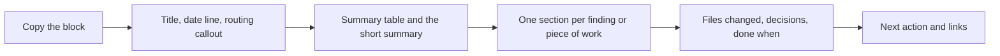

---
tags:
  - kind/template
  - layer/docs
  - topic/workflow
---

> Up: [[agents/README.md]]

# Report Template

> [!example]
> Copy the block below into a new file in `report/`, named per [[report-protocol.md]]. Replace every `[bracketed]` passage, and remove a section that does not apply rather than leaving it empty.

The block is the project note shape from [[notes.template.md]], plus the routing an agent report needs: who it is from and for, the request, and a status. Fill the items the way [[notes.rules.md]] says: digits only, steps someone else can repeat, and the real error quoted verbatim.

## Workflow



## The Block

````markdown
# [The subject in one phrase]: [detail if needed]

*[2026-07-11 23:11:09 WIB] - [handoff, test result, security finding, analysis, decision request, or status] - [source: feature F-001, commit `abc1234`, branch `dev`]*

> [!info]
> **From** `[backend-engineer]` **to** `[qa-engineer]`. **Request:** `[login-otp]`, [the CTO request in one line]. **Feature:** [F-001, or none]. **Status:** <code style="color: green">[Done]</code>

| No | Item | Location | Level |
| :-: | :- | :- | :- |
| 1 | [One sentence: what was found or done and its effect, with the key part in **bold**] | `[path/to/file.py:42]` | [critical, high, medium, or low] |
| 2 | [One sentence for the second item] | `[path/to/file.tsx:7]` | [low] |

[Summary in at most three lines: what was done or checked, what was not, and why.]

## 1. [Title of the first item]

**Steps:**

1. [The command, the request, or the screen path, with the real value used]
2. [The next step]

**What happened:** [What was seen. An error is quoted verbatim: `TypeError: ...`]

**What is correct:** [The expected result, with its real number or state.]

**Recommendation:** [The exact change, and who makes it.]

**Suspected, not yet confirmed.** [The file and function suspected, and why. Replace with **Cause:** once proven.]

## 2. [Title of the second item]

**What happened:** [...]

**Recommendation:** [...]

## Files Changed

| File | What changed |
| :- | :- |
| `[path/to/file.py]` | [One line] |

## Decisions Needed

| No | Decision | Decided by |
| :-: | :- | :- |
| 1 | [The question holding the work, with the options] | [user] |

## Done When

| No | Case | Expected result |
| :-: | :- | :- |
| 1 | [Steps of item 1] | [A result anyone can tick without asking, with its number] |

## Next Action

| Owner | Step |
| :- | :- |
| `[qa-engineer]` | [The exact next step] |

## Links

| For | Where |
| :- | :- |
| [Earlier report] | `[report-qa-engineer-to-backend-engineer-login-otp-20260711-22_05_13.md]` |
| [Requirement] | `[docs/SRS.md FR-AUTH-03]` |
| [Test evidence, named after this report] | `[report-qa-engineer-to-user-login-otp-20260712-09_02_44-lighthouse.json]` |
````

## Related

- [[report-protocol.md]]
- [[notes.template.md]]
- [[notes.rules.md]]
