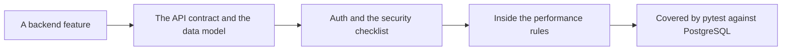

> Up: [[README.md]]

# Backend Standards

> [!info]
> The backend standards in one place: the performance and testing rules in this folder, and the rules elsewhere in the vault that every backend follows. The stack itself is in [[stacks.rules.md]].

## Workflow

## In This Folder

| Document | Owns |
| :- | :- |
| [[performance.backend.md]] | N+1, columns, the pool, caching, timeouts, streaming, monitoring, and the load test, on FastAPI and SQLAlchemy |
| [[testing.backend.md]] | `pytest` in `test/` mirroring the app, a real PostgreSQL in a container, the security cases, and the daily run |

## Elsewhere in the Vault

| Document | Owns |
| :- | :- |
| [[api.rules.md]] | The route shape, the error shape, pagination, and tool endpoints |
| [[database.rules.md]] | The ORM or raw SQL, the schema, the queries, and the migrations |
| [[auth.rules.md]] | One identity source, the token, the session cookie, and single sign-on |
| [[security.rules.md]] | The checklist every change is reviewed against |
| [[media.rules.md]] | Document and photo upload |
| [[automation.rules.md]] | Scheduled and triggered work |
| [[deploy.rules.md]] | Cloud Run, the allocation, the region, and the connection budget |

## Related

- [[stacks.rules.md]]
- [[codes.rules.md]]
- [[component/frontend/README.md]]
