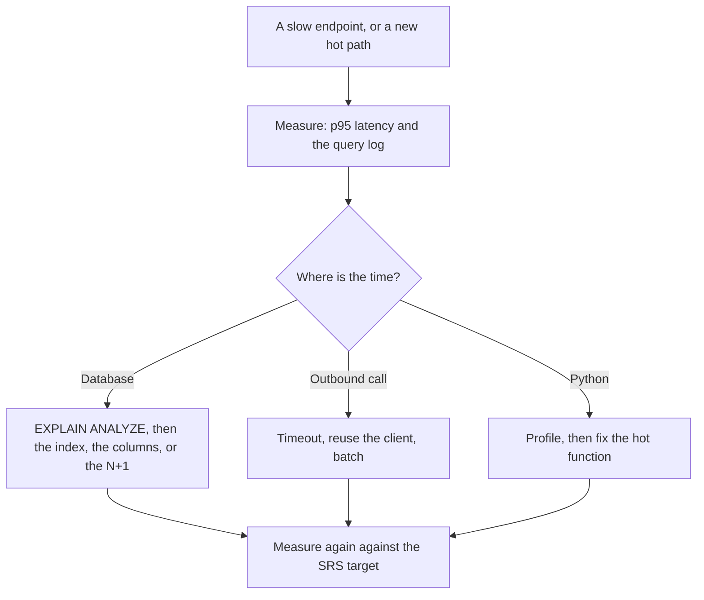

---
tags:
  - kind/rule
  - layer/backend
  - topic/performance
---

> Up: [[README.md]]

# Backend Performance Standard

> [!important]
> Measure before optimizing. Every list is paginated, every query fetches only its columns with no N+1, every outbound call has a timeout, and every cache has a way to go stale on purpose.

## Core Requirement

A backend is slow in a small number of ways, and almost all of them are the database: a query per row, a missing index, a column nobody reads, a pool that runs out. This file names the technique for each one on this stack, which is FastAPI with Pydantic v2, SQLAlchemy 2, `psycopg` v3, and PostgreSQL 18 on Cloud Run, per [[stacks.rules.md]].

Each project writes its latency targets into `docs/SRS.md` as `NFR-PERF` requirements, per [[srs.rules.md]]. A target nobody wrote down is `To be confirmed`, never assumed.

## Workflow



## Database

[[database.rules.md]] owns the queries, the indexes, and the pool. These are the techniques that apply them on this stack.

- **No N+1.** Load a relationship with the query, `selectinload` for one-to-many and `joinedload` for many-to-one. Set `lazy="raise"` on a relationship so an accidental lazy load fails in a test instead of firing one query per row in production.
- **Only the columns the response needs.** `select(User.id, User.name)`, or `load_only(User.id, User.name)` on an ORM query. Never `SELECT *`.
- **Index what the real queries filter, join, and sort on**, and check with `EXPLAIN (ANALYZE, BUFFERS)` that the plan uses it.
- **A small pool, sized to the instance count.** `max-instances x (pool_size + max_overflow)` must fit inside the server's `max_connections`, per [[deploy.rules.md]]:

```python
engine = create_engine(DATABASE_URL, pool_size=5, max_overflow=5, pool_pre_ping=True, pool_recycle=1800)
```

- **No unnecessary JOIN.** Denormalize only a read path that a measurement proved hot.
- **Turn on the slow query log** with the `log_min_duration_statement` flag, and read `pg_stat_statements` or Cloud SQL Query Insights for the queries that cost the most in total.
- **Keep autovacuum on**, and delete data past its retention period on a schedule.
- **A read replica or sharding only when measured load requires it.** Design so either can arrive later, per [[database.rules.md]].

## API Responses

- **Paginate every list**: `limit` 20 by default and 100 at most, per [[api.rules.md]].
- **Compress responses** with `app.add_middleware(GZipMiddleware, minimum_size=1000)`.
- **Limit payload size.** Cloud Run accepts a request of up to 32 MiB, which is far more than an endpoint needs; check `Content-Length` against the endpoint's own limit and answer `413` above it.
- **Compute only what the response returns.** A field nobody reads is a query somebody pays for.

## Caching

- **HTTP caching first:** `Cache-Control` and an `ETag` on a read whose data allows it, and `Cache-Control: no-store` on anything personal, per [[security.rules.md]].
- **In-process caching for what is identical for every user**: reference data, configuration, a slow lookup. `functools.lru_cache` for a value that never changes while the process lives; a cache with a time to live for anything that does.
- **Cache-aside is the default pattern**: read the cache, fall back to the database, store the result. Read-through and write-through belong to a shared cache, which this stack does not run.
- **Every cache has an invalidation rule**, a time to live or a delete on write. Cloud Run runs several instances, each with its own copy, so a delete on one instance leaves the others stale until their time to live expires.
- **A shared cache such as Redis is another service** to run, patch, and pay for. Add one only when a measurement shows the in-process cache falls short, with a written decision per [[stacks.rules.md]].

## Asynchronism

- **Never block the event loop.** A blocking call, such as a sync driver or `requests`, inside an `async def` endpoint stalls every request on that worker. Declare that endpoint with `def`, and FastAPI runs it in a thread pool.
- **Heavy or slow work leaves the request path**: a scheduled job with APScheduler or a Cloud Run job, per [[stacks.rules.md]] and [[automation.rules.md]].
- **`BackgroundTasks` only for something that takes a moment.** It runs after the response is sent, and on Cloud Run with request-based CPU allocation the CPU is throttled once the response is gone, so a long task crawls or stalls.
- **A message broker only with a written decision.** The stack builds no event bus at this stage.

## Scaling

Cloud Run scales horizontally and balances the load itself. The allocation, the instance limits, and the concurrency are set by [[deploy.rules.md]], and are not repeated here.

## Code

- **Profile before optimizing.** `python -m cProfile` for a function, `py-spy` for a running server. Optimize the endpoint that is called most, or the one that is slowest, first.
- **Stream anything large**: `StreamingResponse` for a big download or an export, and an upload read in chunks.
- **Every outbound call has a timeout, and reuses one client** for HTTP keep-alive:

```python
http = httpx.Client(timeout=httpx.Timeout(10.0, connect=3.0))
```

- **Retry only an idempotent call**, only on a `429` or a `5xx`, at most three times, with exponential backoff and jitter, honouring `Retry-After`.
- **Batch.** One `insert()` with a list of rows, not a loop of single inserts; one call for many records where the remote API allows it.
- **The right data structure.** A `set` or a `dict` for a membership test inside a loop, not a list.
- **Another language or another service only when profiling proves the need**, and still one deployable per repository, per [[repository.rules.md]].

## Network

- **One region, close to the users**: the region [[deploy.rules.md]] names, with the database in the same one.
- **Keep-alive** comes from reusing one HTTP client per process, above.
- **Static assets come from the frontend's static host or a CDN**, never through the API.
- **Prefetch only where it clearly helps**: data the next request needs and the current one already knows about.

## Monitoring

- **Structured logs to stdout**, per [[repository.rules.md]], read in Cloud Logging. Never log personal data or a secret.
- **Watch the request rate, the error rate, and the latency at p50, p95, and p99** in Cloud Monitoring, and alert on the error rate and p95 through a channel someone reads.
- **Logging never waits on the network inside a request.** A handler that ships logs anywhere but stdout goes behind `logging.handlers.QueueHandler` with a `QueueListener`.

## Performance Testing

- **Load-test a critical endpoint before a release** and after any change to a hot path, against staging, and compare its p95 with the SRS target:

```bash
locust -f test/load/locustfile.py --headless -u 50 -r 5 -t 2m --host https://[staging-host] --csv "$RUN-locust"
```

- Keep the load script in `test/load/`, and record the numbers in the QA report.
- `$RUN` is the name of that QA report, so the CSV files share its date, time, and title, per the [report protocol](../../.agents/_shared/report-protocol.md).

## Definition of Done

- Every list endpoint is paginated, and no query selects a column the response does not use.
- No relationship is lazy-loaded inside a loop; the hot ones raise on a lazy load.
- The pool fits inside `max_connections` at the maximum instance count.
- Every outbound call has a timeout, and every cache has an invalidation rule.
- No blocking call runs inside an `async def` endpoint.
- The p95 latency of each critical endpoint meets its SRS target under the load test.

## Related

- [[testing.backend.md]]
- [[database.rules.md]]
- [[api.rules.md]]
- [[deploy.rules.md]]
- [[performance.frontend.md]]
