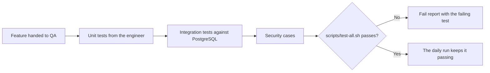

---
tags:
  - kind/rule
  - layer/backend
  - topic/workflow
---

> Up: [[README.md]]

# Backend Testing Standard

> [!important]
> Every backend test is `pytest` in `test/`, mirroring the app's structure, against a real PostgreSQL where the database matters. One script runs them all, and it runs again every night.

## Core Requirement

A backend test proves behaviour through the API a client actually calls, against the database the code actually runs on. A mock of PostgreSQL passes while the real migration, constraint, or query plan fails, so a test that touches data runs against a real PostgreSQL in a container.

The backend-engineer writes the unit tests for the logic it builds. The qa-engineer owns the integration tests, the end-to-end tests, and the automation, per the [agent team](../../.agents/README.md). The general testing rules are in [[codes.rules.md]].

## Workflow



## Tools

| Tool | Use |
| :- | :- |
| `pytest` | Every test |
| FastAPI's `TestClient` | A request through the real routes, validation, and auth |
| `pytest-asyncio` | A test of an `async` function |
| `pytest-cov` | Coverage, read for the gaps rather than chased as a number |
| `testcontainers[postgresql]` | A real PostgreSQL 18 per run |
| `locust` | The load test in [[performance.backend.md]] |

They are development dependencies, kept out of the runtime image, per [[stacks.rules.md]].

## Layout

```text
app/
  orders/
    service.py
test/
  conftest.py
  orders/
    test_service.py
  load/
    locustfile.py
scripts/
  test-all.sh
```

`test/` mirrors `app/`, so the test for a file is found without searching. Point pytest at it in `pyproject.toml`:

```toml
[tool.pytest.ini_options]
testpaths = ["test"]
addopts = "--import-mode=importlib"
```

**Never put an `__init__.py` in `test/`.** Python's standard library already ships a package named `test`, so a second one makes every import depend on path order. The `importlib` import mode needs no `__init__.py`, and lets two folders each hold a `test_service.py` without the `import file mismatch` error.

One fixture starts PostgreSQL once for the whole run:

```python
"""Shared fixtures: one PostgreSQL container for the whole test run."""

import pytest
from testcontainers.postgres import PostgresContainer


@pytest.fixture(scope="session")
def database_url():
    """Start PostgreSQL 18 once and yield its connection URL."""
    with PostgresContainer("postgres:18", driver="psycopg") as postgres:
        yield postgres.get_connection_url()
```

A test reads as the behaviour it proves:

```python
"""Orders API: a list is paginated and capped."""

from fastapi.testclient import TestClient

from app.main import app

client = TestClient(app)


def test_a_limit_above_the_maximum_is_rejected():
    response = client.get("/orders", params={"limit": 500})
    assert response.status_code == 422
```

## What Gets a Test

- **Every acceptance criterion** of the feature, through the API.
- **Every error path** the SRS names: a missing field, a value out of range, a record that does not exist.
- **The security cases** from [[security.rules.md]]: a role that is denied, another user's object, an expired token, an oversized body.
- **Every bug, with a failing test written first.** The test fails before the fix and passes after it, and it stays.

## Running It

```bash
pytest                                   # everything
pytest test/orders                      # one area
pytest -k limit                          # by name
pytest --cov=app --cov-report=term-missing
```

`scripts/test-all.sh` is the one entry point, and the daily run calls nothing else:

```bash
#!/usr/bin/env bash
# Run every backend suite; stop at the first failure.
set -euo pipefail
ruff format --check .
ruff check .
pytest --cov=app --cov-report=term-missing
```

## The Daily Run

Every night at 00:00 WIB, which is 17:00 UTC:

```yaml
# .github/workflows/daily-tests.yml
name: daily-tests
on:
  schedule:
    - cron: "0 17 * * *"
  workflow_dispatch:
jobs:
  test:
    runs-on: ubuntu-latest
    steps:
      - uses: actions/checkout@v4
      - uses: actions/setup-python@v5
        with:
          python-version: "3.13"
      - run: pip install -e ".[dev]"
      - run: bash scripts/test-all.sh
```

- **The install line follows the project's manifest.** `.[dev]` is the optional-dependency group from [[stacks.rules.md]]; a `requirements.txt` project installs that instead.
- **A schedule runs from the default branch only**, and **`bash scripts/test-all.sh` avoids the missing execute bit** a file created on Windows arrives with, as in [[testing.frontend.md]].
- Outside GitHub, the same run is one scheduler line on a machine whose clock is WIB: `0 0 * * * cd /path/to/project && bash scripts/test-all.sh`.
- The result of each daily run goes to the CTO in a QA report at the next session.

## Definition of Done

- Every acceptance criterion and every error path the SRS names has a test that passes.
- Every test touching data runs against PostgreSQL in a container, not a mock.
- Every bug fixed has the test that failed before the fix.
- `scripts/test-all.sh` runs everything, and the daily run calls it.

## Related

- [[performance.backend.md]]
- [[testing.frontend.md]]
- [[codes.rules.md]]
- [[database.rules.md]]
