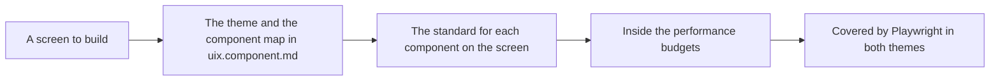

> Up: [[README.md]]

# Frontend Standards

> [!info]
> Every frontend standard in one folder: the UI components on HeroUI, the performance budgets, and the tests. The stack itself is in [[stacks.rules.md]].

## Workflow

## Components

| Document | Owns |
| :- | :- |
| [[uix.component.md]] | HeroUI as the base, the theme contract, Google Sans, the one 8px radius, and the component map |
| [[darkmode.component.md]] | Light and dark, both, in every project, and the one control between them |
| [[layout.component.md]] | The page shell: full width beside the rail, and what may still carry a width limit |
| [[header.bar.component.md]] | The full-width bar: the brand, jump-to search, the theme control, and the bell |
| [[header.page.component.md]] | The page heading: the `h1`, the page's actions, and its description |
| [[card.component.md]] | The HeroUI card, one level only, and a table that runs flush inside it |
| [[button.component.md]] | The six variants, the icon before the label, and one primary action per view |
| [[table.component.md]] | The table itself: wrapper, header, rows, cells, and the row actions |
| [[pagination.component.md]] | Every table: paging rather than scroll, adaptive page size, controls, and the data binding |
| [[dropdown.component.md]] | HeroUI pickers, smart search past seven options, and a long list that scrolls under it |
| [[calendar.component.md]] | Date fields: native or custom, the panel, the full-card grid, and the year clamp |
| [[sidebar.component.md]] | The navigation rail: anatomy, grouping, markers, and the mobile drawer |
| [[login.component.md]] | The sign-in screen, and why every failure reads the same |
| [[loading.component.md]] | The four loading surfaces, and which wait each one serves |
| [[notification.component.md]] | The notification center, and the toast and inline alert for status messages |
| [[log.component.md]] | The activity log: every page, click, sign-in, and data change, to the second |
| [[animation.component.md]] | What moves, for how long, and what reduced motion turns off |
| [[skeleton.component.md]] | The loading state a component shows in its own place, instead of holding the page |
| [[dashboard.component.md]] | Charts: the form before the color, the validated palette, and the export |
| [[search.component.md]] | Filter against search, the matching ladder, and normalization |
| [[scrollbar.component.md]] | A scrollbar is an affordance, and where it must never be hidden |
| [[title.header.component.md]] | The product name: one form, everywhere, never from configuration |
| [[refresh.component.md]] | What survives a reload, and the three things that break it |

## Performance and Tests

| Document | Owns |
| :- | :- |
| [[performance.frontend.md]] | The page weight, load time, and first-byte budgets, and how a Vite and React build meets them |
| [[testing.frontend.md]] | Playwright in `test/e2e/`, the `data-testid` rule, both themes, and the daily run |

## Related

- [[stacks.rules.md]]
- [[auth.rules.md]]
- [[security.rules.md]]
- [[pwa.rules.md]]
- [[component/backend/README.md]]
