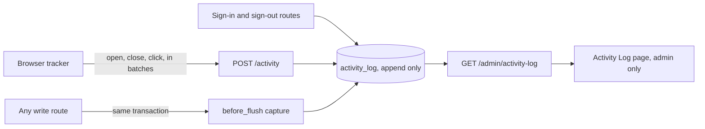

---
tags:
  - kind/component
  - layer/frontend
  - topic/security
---

> Up: [[README.md]] · [[uix.component.md]]

# Activity Log Standard

> [!note]
> A project with sign-in and more than one user records what each person does, to the second, and shows it on an Activity Log page: every page opened and closed, every click, every sign-in and sign-out, and every create, update, and delete with the values before and after.

## Core Requirement

**Every project with sign-in and more than one user records what each signed-in person does, and shows it on an Activity Log page.** Opening a page, leaving it, clicking a menu or a button, adding, changing, or deleting a record, signing in, and signing out each write one entry with the person, the exact time, the page, the target, and a detail of what changed.

The log answers one question after the fact: **who did what, where, and when, down to the second, and what the data looked like before and after.** A price that changed overnight or a record that disappeared must be traceable to a person and a time without asking anyone.

A single-user tool needs no activity log. The moment a second person can sign in, it does, backend and frontend together, per [[security.rules.md]].

## Workflow



**What the person saw and clicked comes from the browser. What happened to the data comes from the server**, in the same transaction as the change, so a create, update, or delete can never be committed without its entry, and an entry can never claim a change that was rolled back.

## What Gets Recorded

Every entry has one `kind`. The set is closed, and a project adds a kind of its own only for an action that is none of these.

| `kind` | Label on the page | Written by | When |
| :- | :- | :- | :- |
| `open` | Opened Page | The browser | The path changes to a page, including the first page after sign-in |
| `close` | Closed Page | The browser | The path changes away from a page, or the tab is closed |
| `click` | Clicked | The browser | A link, button, menu item, tab, option, disclosure, or checkbox is clicked |
| `create` | Created | The server | A record is created |
| `update` | Updated | The server | A record is changed |
| `delete` | Deleted | The server | A record is deleted |
| `sign_in` | Signed In | The server | A sign-in succeeds |
| `sign_out` | Signed Out | The server | A sign-out |

## Time to the Second

**Every entry carries its time to the second, and the page shows the seconds.** A log that says only `14:05` cannot tell which of two clicks in the same minute came first.

- **The column is `timestamptz NOT NULL DEFAULT now()`**, so the database keeps microseconds and the time zone is never lost.
- **A server entry takes the server's `now()`**, never a value from the request.
- **A browser entry carries the moment of the event**, because the tracker sends in batches up to five seconds late. The server keeps it only when it falls between 15 minutes ago and the moment the batch arrives, and stores the arrival time otherwise, so a wrong browser clock cannot move an entry.
- **The API returns ISO 8601 in UTC; the page shows it in the viewer's time zone with seconds.**
- Entries are ordered by time and then by `id`, newest first, so two entries in the same second keep their order.

## The Table

```python
op.create_table(
    "activity_log",
    sa.Column("id", sa.BigInteger(), primary_key=True, autoincrement=True),
    sa.Column("at", sa.DateTime(timezone=True), nullable=False, server_default=sa.func.now()),
    sa.Column("user_id", postgresql.UUID(as_uuid=True), sa.ForeignKey("users.id", ondelete="SET NULL")),
    sa.Column("kind", sa.String(16), nullable=False),
    sa.Column("page", sa.String(300), nullable=False, server_default=""),
    sa.Column("target", sa.String(200), nullable=False, server_default=""),
    sa.Column("detail", postgresql.JSONB(), nullable=False, server_default="{}"),
    sa.CheckConstraint(
        "kind IN ('open', 'close', 'click', 'create', 'update', 'delete', 'sign_in', 'sign_out')",
        name="ck_activity_log_kind",
    ),
)
op.create_index("ix_activity_log_at", "activity_log", ["at"])
op.create_index("ix_activity_log_user_at", "activity_log", ["user_id", "at"])
```

- **`user_id` survives the person being removed as `NULL`**, so the entry stays and the page shows `-` for the person.
- A project kind of its own is added to the check constraint in the migration that introduces it, per [[database.rules.md]].
- **The log is append only.** No route updates or deletes an entry, and no screen offers to.

## The Detail: Create, Update, and Delete History

**The detail of a `create`, `update`, or `delete` entry is the history of the data itself**: which table, which record, and every column with its value before and after. A detail that lists only column names cannot answer what a price was before someone changed it.

```json
{
  "changes": [
    { "table": "product", "id": "1204", "kind": "update", "columns": { "price": [12000, 13500], "status": ["draft", "active"] } },
    { "table": "product_price", "id": "88", "kind": "create", "columns": { "product_id": 1204, "price": 13500 } },
    { "table": "product_photo", "id": "310", "kind": "delete", "columns": { "name": "front.jpg", "position": 1 } },
    { "kind": "more", "count": 37 }
  ]
}
```

- **An `update` holds only the columns that changed**, each as `[before, after]`.
- **A `create` holds every column of the new record; a `delete` holds every column as it was**, so a deleted record can be read back from the log.
- A value that is not JSON, such as a UUID, a decimal, or a date, is written as a string. Text is cut at 300 characters.
- **At most 50 items per entry.** The rest are counted in one closing `{ "kind": "more", "count": n }`, so a bulk import cannot grow one entry without bound.

### How the Server Captures It

The capture is not written route by route. A SQLAlchemy `before_flush` listener reads `session.new`, `session.dirty`, and `session.deleted` and fills the detail of that transaction's entry, so **every write route is covered the day it is added**, including the ones nobody remembered to log.

```python
@event.listens_for(Session, "before_flush")
def _capture_changes(session: Session, _ctx: Any, _instances: Any) -> None:
    changes = [
        c
        for kind, objs in (("create", session.new), ("update", session.dirty), ("delete", session.deleted))
        for obj in objs
        if not isinstance(obj, ActivityLog) and (c := _change(obj, kind))
    ]
```

- Changes flushed before the route adds its entry are held in `session.info` and attached when it does, and dropped on commit or rollback.
- **A write with no person behind it, such as a scheduled job, still writes an entry**, with `user_id` empty and `target` naming the job, per [[automation.rules.md]].

### What Is Never Written in Full

> [!failure]
> Never write a secret or a person's private data into the log as a value. The log is read by administrators, and a log that copies every column is a second copy of the database that nobody secured. A password hash, an API key or its cipher text, a token, and personal data are written as the column name with the value `(hidden)`.

- **The hidden columns are one list of `(table, column)` pairs beside the capture.** A new column that holds a secret or personal data is added to it in the same change that adds the column. [[data.rules.md]] decides what counts as personal data; when in doubt, hide it.
- Tables never captured, such as the log itself, and columns with no meaning to a reader, such as `created_at` and `updated_at`, are listed beside it.

## The Browser Tracker

One module, started once at the app root after the session check.

- **One click listener for the whole document**, in the capture phase, matching `a, button, [role="menuitem"], [role="tab"], [role="option"], summary, input[type="checkbox"]`. A text box and a password box are not in the list, so **what a person types is never read**.
- The target of a click is the element's `aria-label`, then its `title`, then its text, cut to 80 characters.
- **An element or a region marked `data-activity="ignore"` is never recorded.** Use it for a list whose labels are personal data.
- **The page is the path only.** The query string is never sent, because it can hold a search term, and the server strips it again.
- Entries queue and are sent when 20 are waiting, every five seconds, when the tab is hidden, and on `pagehide`, with `keepalive: true` so the last batch leaves when the tab closes.
- **A failed send is dropped without a toast and without a retry.** The log must never interrupt the work it records.
- `close` is written for the previous path on every path change, and for the current path on `pagehide`, with how long the page stayed open.

## The API

| Route | Who | What |
| :- | :- | :- |
| `POST /activity` | Any signed-in user | 1 to 50 items of kind `open`, `close`, or `click`. Answers `204` |
| `GET /admin/activity-log` | The administrator role only | Entries newest first, filtered by `q`, `kind`, `from`, and `to`, paged per [[api.rules.md]] |

- **`POST /activity` never accepts a data or sign-in kind.** Those come only from the server, so a browser cannot forge a change it did not make; such a request is refused with `422`.
- `from` and `to` are whole days in the viewer's time zone, `to` included.

## The Activity Log Page

The page sits in the project's admin area and is visible and routable only for the role that may read the log. It is a HeroUI `Table` with `Pagination`, per [[table.component.md]] and [[pagination.component.md]], filtered by a `SearchField`, a `Select` for the kind, and `DatePicker`s for the range, with every filter in the URL, per [[refresh.component.md]].

| Column | Shows |
| :- | :- |
| Time | The time with seconds, never wrapped |
| Person | The name, with the email under it in the muted ink |
| Kind | A HeroUI `Chip`, `variant="soft"`: `accent` for open, `default` for close, click, and sign-out, `success` for create and sign-in, `warning` for update, `danger` for delete |
| Page | The path in the monospace face, truncated with the full path on hover |
| Target | The label clicked, or the record changed |
| Detail | The history of the change, in words |

- **The Detail cell is written in words, never as raw JSON**, one line per change: `Updated product 1204: price 12,000 to 13,500; status draft to active`, `Deleted product_photo 310: name front.jpg, position 1`, `And 37 more changes`, `Open for 2 minutes 14 seconds`.
- **Three lines show in the cell**; more sit behind a native `<details>` reading `Show all (n)`.
- The page description says what is never recorded: `Typed values are never recorded.`

## Definition of Done

Confirm by actually doing it:

- Open a page, move to another, and close the tab. The log shows open, close with the time it stayed open, and the next open, each with seconds.
- Click a menu, a button, and a tab. Each shows as Clicked with its label, and nothing typed in a text box appears anywhere.
- Create a record, change two of its fields, and delete it. The log shows every column on create, both fields before and after on update, and what the record held on delete.
- Change a hidden column. The detail names the column and shows `(hidden)`.
- Sign out and sign in. The log shows both.
- Send `POST /activity` with kind `delete`. It is refused with `422`.
- Open the page as a user without the administrator role. The menu is absent and the route refuses.

## Do and Do Not

| Do | Do not |
| :- | :- |
| Ship the log, the tracker, and the page together | Ship the tracker without the server capture |
| Store the time as `timestamptz` and show seconds | Show only hours and minutes |
| Capture every write through `before_flush`, in the same transaction | Log route by route and miss the routes nobody remembered |
| Keep `[before, after]` for every changed column | Log only the column names |
| Hide secrets and personal data as `(hidden)` | Copy every column into the log |
| Render the detail in words | Show raw JSON |
| Keep the log append only | Offer to edit or delete an entry |
| Record clicks by label | Read or send what a person types |

## Related Standards

| Document | Owns | Read it for |
| :- | :- | :- |
| [[security.rules.md]] | Logging and the audit trail | Why the log is required, and what an audit must hold |
| [[data.rules.md]] | Protected data | Which columns are hidden |
| [[database.rules.md]] | Tables and migrations | The migration that creates the table |
| [[table.component.md]] | The table | The log table |
| [[refresh.component.md]] | State in the URL | Filters that survive a refresh |

## Deviations

Any intentional deviation is recorded in the vault as a `decision` note naming this standard, the reason, and a plan to return to it, per [[memory.rules.md]]. It is never written into the project README, because this vault is private and a list of departures from it discloses the standards themselves.

## Conflict Resolution

If another instruction conflicts with this standard, follow this priority:

1. Security and privacy requirements
2. Accessibility requirements
3. Direct user instructions
4. [[uix.component.md]]
5. This activity log standard
6. Existing project conventions

## Related

- [[security.rules.md]]
- [[data.rules.md]]
- [[database.rules.md]]
- [[automation.rules.md]]
- [[api.rules.md]]
- [[table.component.md]]
- [[pagination.component.md]]
- [[refresh.component.md]]
- [[uix.component.md]]
- [[memory.rules.md]]
