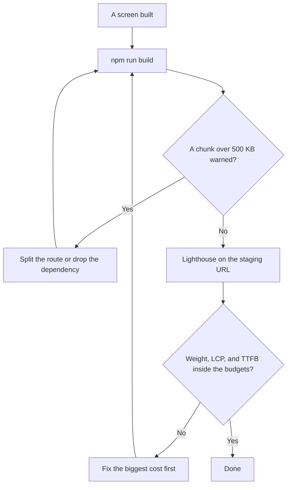

---
tags:
  - kind/rule
  - layer/frontend
  - topic/performance
---

> Up: [[README.md]]

# Frontend Performance Standard

> [!important]
> Every page stays under 1500 KB and loads in under 3 seconds, and a first byte arrives in under 1.3 seconds. A frontend that misses a budget is not done.

## Core Requirement

A slow page is a broken page for the person on a phone and a weak connection, and that person is the one nobody tests with. These budgets make the speed checkable, and the rest of this file is how a Vite and React build on HeroUI meets them.

The stack is in [[stacks.rules.md]]: React 19 on Vite, TypeScript, HeroUI 3 on Tailwind CSS v4, TanStack Query, Google Sans, and a static bundle served by `nginx` on Cloud Run.

## Workflow



## The Budgets

Each project records these in `docs/SRS.md` as `NFR-PERF` requirements, per [[srs.rules.md]], and QA checks them with Lighthouse on its default mobile run.

| Metric | Budget | Lighthouse audit |
| :- | :- | :- |
| Total page weight | Under 1500 KB, aiming under 500 KB | `total-byte-weight` |
| Load time | Largest Contentful Paint under 3 s | `largest-contentful-paint` |
| Time to first byte | Under 1.3 s | `server-response-time` |

```bash
npx lighthouse https://[staging-host] --only-categories=performance --output=json --output-path="$RUN-lighthouse.json" --quiet --chrome-flags="--headless"
```

`$RUN` is the name of the QA report the result belongs to, so the result lands in the gitignored `report/` with the same date, time, and title, per the [report protocol](../../.agents/_shared/report-protocol.md).

## Delivery

- **HTTPS everywhere, and every file over the same protocol.** Cloud Run serves HTTPS; never load an asset over `http:`.
- **Compress every text response.** The `nginx:1.27-alpine` image has gzip and no Brotli module, so gzip it is; a CDN in front adds Brotli.
- **Cache by file name.** Vite hashes every file under `/assets/`, so those are cached for a year; `index.html` is never cached, so a deploy reaches users at once.

```nginx
gzip on;
gzip_types text/css application/javascript application/json image/svg+xml;

location /assets/ {
    add_header Cache-Control "public, max-age=31536000, immutable";
}

location / {
    add_header Cache-Control "no-cache";
    try_files $uri /index.html;
}
```

**An `add_header` inside a `location` replaces every `add_header` from the `server` block.** The security headers from [[security.rules.md]] vanish from that location without any error, so repeat them in each `location` or include them from one snippet.

- **A CDN when traffic earns it.** An internal tool on Cloud Run alone is fine; a public page with real traffic goes behind one.
- **Fewer requests.** One CSS file, route chunks only where a route is big, and no request that returns `404`. Lighthouse lists every failed request under `errors-in-console`.

## JavaScript

- **Minified by the build.** `vite build` minifies by default; never turn it off.
- **Split by route.** A route a user may never open is never in the first download:

```tsx
const Orders = lazy(() => import("./pages/Orders"));
```

- **Nothing blocks rendering.** Vite's entry is a module script, deferred by default. A third-party script carries `defer` or `async`.
- **No inline `<script>` snippets.** They also break the CSP in [[security.rules.md]].
- **Weigh a dependency before adding it** on Bundlephobia, and keep dependencies current with `npm outdated`.
- **Profile a slow interaction** in the Chrome DevTools Performance panel and the React Profiler before changing code.
- **A service worker only where [[pwa.rules.md]] calls for one.**

## CSS

- **Tailwind CSS v4 emits only the utilities the code uses**, and Vite minifies the result. Never ship a hand-written stylesheet beside it that duplicates it.
- **One CSS entry**, importing `tailwindcss` then `@heroui/styles`, per [[uix.component.md]], so the build ships one file.
- **No inline `style` attribute** for anything a token or a utility covers.
- **Critical CSS is measured before it is inlined.** One small Tailwind file rarely blocks long enough to earn a plugin; add one only when Lighthouse names render-blocking CSS.
- **Simple selectors.** A utility is one class; a custom selector nested three deep is a smell.

## Images

- **Pick the format.** SVG for icons and drawings, which Tabler already is; WebP or AVIF for a photo; compress it first with Squoosh.
- **Always set `width` and `height`**, so the layout does not jump when the image arrives.
- **Lazy-load below the fold**, and never the main image above it:

```html


```

- **Serve close to the display size.** A 400 px slot gets a 400 px image, with `srcset` for high-density screens.
- **No Base64 image.** Vite inlines any asset under 4 KB as Base64 by default; set `build.assetsInlineLimit: 0` so every image ships as a cacheable file.
- An uploaded image is served from object storage, per [[media.rules.md]].

## Fonts

- **Google Sans, four weights, `display=swap`, and both `preconnect` links**, exactly as [[uix.component.md]] loads it. Google Fonts serves WOFF2; a self-hosted copy ships WOFF2 only.
- **Every web font together stays under 300 KB**, checked in the DevTools network panel.

## The Rest

- **Keep iframes to a minimum.** Each one is a second page loading inside the first.
- **Cookies stay small:** each under 4096 bytes and fewer than 20 per domain. The session is one `HttpOnly` cookie, per [[auth.rules.md]].
- **Prefetch the likely next screen** on hover or focus: the route chunk with its `import()`, and its data with TanStack Query's `prefetchQuery`.
- `index.html` from Vite is a few hundred bytes, so it needs no HTML minifier.

## Tools

| Tool | Use |
| :- | :- |
| Lighthouse | The budgets, from the command line or DevTools |
| PageSpeed Insights | The same audit against a public URL, with field data |
| WebPageTest | A real device on a real network, and the waterfall |
| Chrome DevTools | Network weight, the Performance panel, coverage |
| Bundlephobia | The size of a dependency before it is added |
| Squoosh | Converting and compressing an image |

## Definition of Done

- The production build raises no chunk-size warning, and every route outside the first screen is lazy.
- Lighthouse on staging shows the page weight, Largest Contentful Paint, and time to first byte inside the budgets.
- Every image has a width and a height, every offscreen one is lazy, and none is Base64.
- Hashed assets are cached for a year, `index.html` is not cached, and every text response is compressed.
- No inline script and no inline style.

## Related

- [[testing.frontend.md]]
- [[uix.component.md]]
- [[stacks.rules.md]]
- [[security.rules.md]]
- [[performance.backend.md]]
