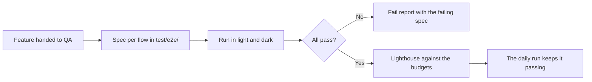

---
tags:
  - kind/rule
  - layer/frontend
  - topic/workflow
---

> Up: [[README.md]]

# Frontend Testing Standard

> [!important]
> Every user flow a feature adds has a Playwright test in `test/e2e/`, found by `data-testid`, run in both the light and the dark theme, and run again every night.

## Core Requirement

A frontend breaks where a user clicks, so it is tested where a user clicks: in a real browser, through the real screens. The test-designer writes these tests and the verifier runs them, per [[AGENTS.md]]. The frontend-engineer makes them possible by giving every element a test will touch a stable `data-testid`.

## Workflow



## Tools

- **Playwright**, `@playwright/test`, for every end-to-end flow, per [[stacks.rules.md]].
- **Vitest only when a unit needs it**: a parser, a formatter, a calculation. A component that only renders is covered by its flow.
- **Lighthouse** for the budgets in [[performance.frontend.md]].

## Layout

```text
test/
  e2e/
    login.spec.ts
    orders.spec.ts
playwright.config.ts
scripts/
  test-all.sh
```

```ts
/** Playwright config: specs in test/e2e, every flow in light and dark. */
import { defineConfig } from "@playwright/test";

export default defineConfig({
  testDir: "./test/e2e",
  use: { baseURL: process.env.BASE_URL ?? "http://localhost:5173" },
  projects: [
    { name: "light", use: { colorScheme: "light" } },
    { name: "dark", use: { colorScheme: "dark" } },
  ],
});
```

Both projects exist because every screen renders in both themes, per [[darkmode.component.md]], and a contrast or visibility bug usually lives in only one of them.

## Selectors Come From `data-testid`

**Every interactive element a test touches carries a `data-testid`**, named `<screen>-<element>` in kebab-case. A selector built from a class or a text label breaks the day the design or the wording changes; a test ID changes only when someone changes it on purpose.

```ts
/** Login: a wrong password reads the same as an unknown user. */
import { test, expect } from "@playwright/test";

test("a wrong password shows the generic error", async ({ page }) => {
  await page.goto("/login");
  await page.getByTestId("login-username").fill("user-0001");
  await page.getByTestId("login-password").fill("not-the-password");
  await page.getByTestId("login-submit").click();
  await expect(page.getByTestId("login-error")).toBeVisible();
});
```

- Where no test ID exists yet, `getByRole` with the accessible name is the fallback, and the missing ID goes in the QA report to the frontend-engineer.
- **No real account and no real personal data in a spec.** Use a placeholder such as `user-0001`, per [[data.rules.md]]. A login the tests need comes from repository secrets the CTO sets.

## Running It

```bash
npm run dev                      # locally, the app first
npx playwright test              # every spec, both themes
npx playwright test --ui         # step through one
npx playwright show-report       # the last run
```

`scripts/test-all.sh` is the one entry point, and the daily run calls nothing else:

```bash
#!/usr/bin/env bash
# Run every frontend suite; stop at the first failure.
set -euo pipefail
npm run lint
npx playwright test
```

## The Daily Run

Every night at 00:00 WIB, which is 17:00 UTC, against the staging deployment:

```yaml
# .github/workflows/daily-tests.yml
name: daily-tests
on:
  schedule:
    - cron: "0 17 * * *"
  workflow_dispatch:
jobs:
  e2e:
    runs-on: ubuntu-latest
    steps:
      - uses: actions/checkout@v4
      - uses: actions/setup-node@v4
        with:
          node-version: 20
      - run: npm ci
      - run: npx playwright install --with-deps chromium
      - run: bash scripts/test-all.sh
        env:
          BASE_URL: ${{ vars.STAGING_URL }}
```

- **A schedule runs from the default branch only.** A workflow that exists only on `dev` never fires while `main` is the default.
- **`bash scripts/test-all.sh`, not `scripts/test-all.sh`.** A file created on Windows reaches git without the execute bit, and the runner stops with `Permission denied`.
- Outside GitHub, the same run is one scheduler line on a machine whose clock is WIB: `0 0 * * * cd /path/to/project && bash scripts/test-all.sh`.
- The result of each daily run goes to the CTO in a QA report at the next session.

## Definition of Done

- Every flow the feature adds has a spec in `test/e2e/`, passing in both themes.
- Every element a spec touches is found by `data-testid`.
- `scripts/test-all.sh` runs the whole suite, and the daily run calls it.
- The budgets in [[performance.frontend.md]] hold on staging.

## Related

- [[performance.frontend.md]]
- [[testing.backend.md]]
- [[darkmode.component.md]]
- [[codes.rules.md]]
