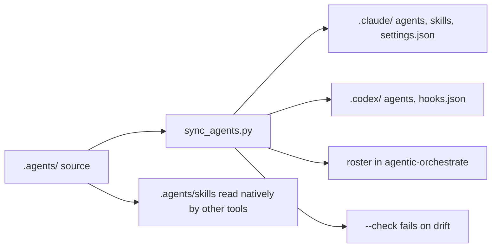

> Up: [[README.md]]

# Agent Harness

> [!important]
> `.agents/` is the only place an agent or a skill is edited. Every tool's folder is generated from it by `scripts/harness/sync_agents.py`, and a generated file is never edited by hand.

The harness is everything around the model that makes its output trustworthy without a person reading every line: the agents, the skills, the hooks, and the checks. The model's weights are fixed; this is the part that can be improved.

## Core Requirement

A rule is enforced at the cheapest layer that can enforce it, in this order: the structure of the code, static checks, runtime verification, prose, and human review last. A rule a script can check is never left as prose.

## Workflow



## Layout

| Path | Holds | Edited by hand |
| :- | :- | :- |
| `.agents/agents/<name>.md` | One agent, in the neutral format below | Yes |
| `.agents/skills/agentic-<command>/` | One skill, in the Agent Skills format | Yes |
| `.agents/hooks.toml` | The hooks, as neutral events | Yes |
| `.agents/targets.toml` | The tools generated for, the tier to model map, and the budgets | Yes |
| `AGENTS.md` | The universal entry point. `CLAUDE.md` imports it | Yes |
| `.claude/`, `.codex/` | Generated agents, skills, and hook configuration | No |
| `.agents/skills/agentic-orchestrate/references/roster.md` | The generated roster the orchestrator routes from | No |
| `harness/generated.json` | The list of generated files, so a removed agent's files are removed too | No |
| `harness/lessons.md` | Evidence-backed lessons, written by the harness-improver | Yes |
| `harness/usage/` | Token and cost logs per run, JSON, gitignored | No |
| `scripts/harness/` | The generator, the adapters, and the checks | Yes |

## The Agent Format

One file per agent, `.agents/agents/<name>.md`, with four frontmatter keys and no others:

```markdown
---
name: verifier
description: One line that says what the agent does and when to launch it.
tier: deep
tools: read, search, run
---
## Job
## Read first
## Do
## Never
## Ask the advisor when
## Output
```

| Key | Rule |
| :- | :- |
| `name` | Kebab-case, unique, and the same as the file name |
| `description` | One line. It decides when the agent is launched, so it names the trigger |
| `tier` | `deep`, `build`, or `fast`. Never a model name; `targets.toml` maps the tier to a model per tool |
| `tools` | The smallest set that does the job, from the vocabulary below |

| Tool | Means |
| :- | :- |
| `read` | Read files |
| `search` | Search file names and contents |
| `edit` | Create and change files |
| `run` | Run commands |
| `web` | Fetch and search the web |
| `delegate` | Launch other agents. Only the orchestrator has it |

- **The body uses the six headings above, in that order.** `## Ask the advisor when` is left out of a `deep` agent, which does not escalate.
- **An agent file is self-contained.** It can be copied alone into another repository and still work: it names the rules it follows by file name, and carries the lines it cannot work without.
- **The body is stable.** No date, no counter, no value that changes between runs, so a tool's prompt cache keeps working.
- **No model name appears anywhere in the file.**

## The Three Tiers

| Tier | For | Default |
| :- | :- | :- |
| `deep` | Research, analysis, architecture, planning, orchestration, independent verification, security, and improving the harness | No |
| `build` | Writing code and tests | Yes |
| `fast` | Mechanical work: formatting, lint fixes, renames, regenerating files, syncing documents | Yes, where it is enough |

A task goes to the cheapest tier that does it well. A `build` or `fast` agent that meets a hard decision asks the `advisor` instead of the whole task moving to `deep`.

## The Skill Format

One folder per skill, `.agents/skills/agentic-<command>/`, following the open Agent Skills format:

```markdown
---
name: agentic-verify
description: What the skill does and when to use it, in one or two sentences.
---
```

- **Every skill name starts with `agentic-`**, and the folder name equals `name`. The command is `/agentic-<command>`.
- **Frontmatter holds `name` and `description` only.** Any other key is an error in tools other than the one that invented it.
- **`SKILL.md` is short and procedural**: numbered steps, the commands to run, and the output. Long material goes in `references/`, a file the skill fills in goes in `assets/`, and code goes in `scripts/`, each loaded only when a step needs it.
- **Every file a skill names exists inside its own folder**, so the folder can be copied alone.
- **Every skill is named once in `AGENTS.md`.** A skill nothing points at is never used.

## What an Agent Returns

An agent writes its report as Markdown, per [[report.rules.md]], and ends its reply with one JSON object and nothing after it:

```json
{"status": "Pass", "report": "~/agentic/report/shop-backend/report-verifier-to-user-login-otp-20260712-09_02_44.md", "summary": "12 checks ran, 0 failed", "next": "user"}
```

| Field | Holds |
| :- | :- |
| `status` | `Done`, `Pass`, `Fail`, `Blocked`, or `Needs Decision` |
| `report` | The path of the report file |
| `summary` | One line: the number that matters, or the first finding |
| `next` | The agent that goes next, `user`, or `none` |

The orchestrator reads the JSON, opens the report only when it needs the detail, and never receives a transcript.

## What an Agent Is Given

The orchestrator passes each agent a brief, and nothing else:

```json
{"task": "login-otp/T-03", "goal": "Reject an expired OTP", "acceptance": ["FR-AUTH-03"], "paths_allowed": ["app/auth/"], "paths_forbidden": ["app/billing/"], "verify": "pytest test/auth -q", "reports": []}
```

`task` is the request slug and the task's ID. For an agent with no `run` tool, such as `system-analyst`, `planner`, or `architect`, the brief adds an eighth key, `report`: the path to write its report to, because that agent cannot take the timestamp from the clock itself. An agent with neither an `edit` nor a `run` tool returns its report in the reply, with `"report": "inline"`.

Never the conversation, never the whole repository. **A verifier or a reviewer gets the requirements and the diff, and never the author's report or reasoning.**

## Budgets

| File | Limit |
| :- | :- |
| `AGENTS.md` | 150 lines |
| An agent file | 120 lines |
| A `SKILL.md` | 150 lines |
| `CLAUDE.md` | 150 lines |
| An agent's description | 400 characters |
| A skill's description | 650 characters |

`sync_agents.py --check` fails past a limit. Text that is loaded on every run is paid for on every run.

## Commands

```bash
python scripts/harness/sync_agents.py                 # generate every target in this repository
python scripts/harness/sync_agents.py --check         # fail on drift, a broken rule, or a budget
python scripts/harness/sync_agents.py --scope user    # install the agents and skills for every project
python scripts/harness/sync_agents.py --roster        # print the roster
python scripts/harness/sync_agents.py --can-create api-docs-writer
python scripts/harness/check_attribution.py --all     # the tracked files, and the commits not yet pushed
python scripts/harness/check_docs.py --all            # the document format rules
python scripts/harness/test_harness.py                # the fast test suite
python scripts/harness/usage.py run.jsonl --label routed   # tokens per agent and per tier from one headless run
```

The `pre-commit` and `commit-msg` git hooks run the sync check, the attribution check, the document check, and the test suite whichever tool wrote the change. Turn them on once per clone:

```bash
git config core.hooksPath scripts/harness/githooks
```

## Hooks

`.agents/hooks.toml` names four events, and each adapter writes them into its tool's own configuration:

| Event | Runs |
| :- | :- |
| `after-edit` | The document check on the changed files |
| `on-stop` | The fast test suite |
| `before-commit` | The attribution check on the staged files and on the commit command |
| `after-agent` | One line in `harness/usage/agents.jsonl` per agent that finished, which is how every advisor consult is counted |

> [!warning]
> A tool with no hooks still gets every check, because the git hooks and `--check` do not depend on the tool. A tool with no setting for commit attribution is covered the same way: the `commit-msg` hook rejects the trailer whoever wrote it.

## Adding a Tool

1. Add `scripts/harness/adapters/<tool>.py` with three functions: `render(agents, skills, target)` returns a mapping of `("agents" or "skills", relative path)` to file content, `render_hooks(hooks, existing)` returns the tool's hook configuration as a JSON object, and `warnings(agents, hooks)` returns one line for each feature the tool lacks.
2. Add a `[targets.<tool>]` table to `.agents/targets.toml` with `agents_dir`, `skills_dir`, and `hooks_file` for the repository, `user_agents_dir` and `user_skills_dir` for the user scope, and a `[targets.<tool>.models]` table that maps `deep`, `build`, and `fast` to model IDs. The table's name is the adapter's file name unless an `adapter` key says otherwise. An empty folder value skips that kind of file.
3. Run `sync_agents.py`. No agent and no skill changes.

Where a tool lacks a feature, the adapter turns it into the closest thing the tool has and prints a warning. It never drops it silently.

| Tool | Agents | Skills | Hooks |
| :- | :- | :- | :- |
| Claude Code | `.claude/agents/*.md` | `.claude/skills/`, copied | `.claude/settings.json` |
| Codex | `.codex/agents/*.toml` | `.agents/skills/`, read in place | `.codex/hooks.json` |
| Cursor, Gemini CLI, OpenCode | No adapter yet | `.agents/skills/`, read in place | No adapter yet |

## Copying One Piece Into Another Repository

- **A skill:** copy its folder into the other repository's `.agents/skills/`, and into `.claude/skills/` for Claude Code.
- **An agent:** copy its file into the other repository's `.agents/agents/` and run that repository's sync, or translate the four frontmatter keys by hand: `tier` becomes the tool's `model`, and `tools` becomes the tool's tool list.
- **The whole harness:** copy `.agents/`, `scripts/harness/`, `harness/README.md`, and `AGENTS.md`, then run the sync and turn the git hooks on. The document check runs only where `rules/docs.rules.md` is present, because that file is what it enforces.

## Improving the Harness

The harness-improver changes the harness only on evidence, in three steps: propose an edit that cites the moment in a real run that motivates it, probe it by running the same task again under the edited harness, and keep only what measurably helped. "Keep it as it is" is a valid result. Every kept or rejected edit is recorded in [[lessons.md]].

## Related

- [[AGENTS.md]]
- [[report.rules.md]]
- [[codes.rules.md]]
- [[docs.rules.md]]
- [[agent.rules.md]]
