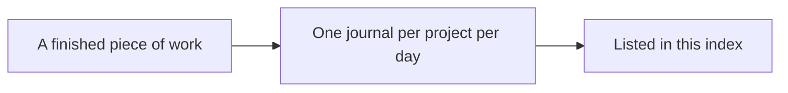

---
tags:
  - kind/journal
  - topic/workflow
---

> Up: [[README.md]]

# Journal

> [!info]
> One journal per project per day, written when a piece of work ends. The shape is [[journal.rules.md]]; this file is the index.

A journal records what was wrong, what was actually found including the wrong turns, what was done, and what changed as a number. It is the raw material a memory note is later distilled from, per [[memory.rules.md]].

## Workflow

## Index

Newest first. **A journal that is not listed here is reachable only by knowing its filename**, so the entry is added in the same commit that writes the journal, per [[journal.rules.md]].

| Date | Project | Hook |
| :- | :- | :- |
| None yet | | |

## Related

- [[journal.rules.md]]
- [[memory.rules.md]]
- [[docs.rules.md]]
