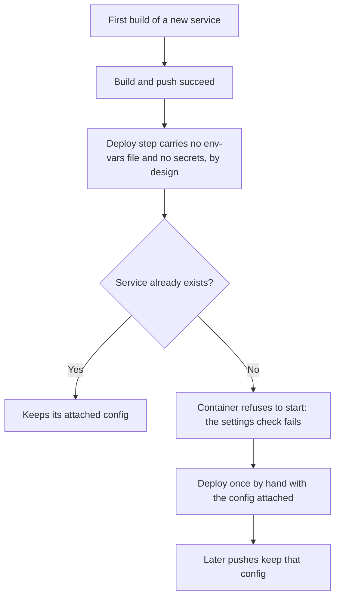

---
tags:
  - kind/pattern
  - layer/infra
  - topic/deploy
---

# The first build on a new service fails at the deploy step

> [!info]
> Bootstrapping reports a build failure on the very first submit, and that is the pipeline working as designed.

The build and push steps succeed and the image lands in the registry. The deploy step fails with a container that did not start and listen on the injected port, and the revision log shows the settings check refusing to start, typically on the database URL.

The cause is that the pipeline deliberately carries no environment-variable file and no secret mounts, which is what makes "the trigger owns the image, the terminal owns the config" safe. On an existing service the deploy command preserves the configuration already attached. **On a service that does not exist yet there is nothing to preserve, so the first revision starts with no configuration at all.**

Continue rather than debug: the image is already pushed, so run the manual deploy once with the environment file and the secret mounts. Every later build succeeds end to end, because the configuration is then attached to the service.

**Mechanism:**

**Why:** the failure reads as a broken pipeline, and the natural response is to inspect the pipeline file, the container definition, and the port binding, none of which are wrong. Neither the pipeline nor the runbook says the first build is expected to fail this way, so the symptom has no written cause anywhere in the repository.

**Applies to:** the first bootstrap of any service on a platform where the deploy command preserves existing configuration.

**Source:** an incident outside this repository. The mechanism is visible in any pipeline whose deploy step omits configuration flags.

## Related

- [[deploy.cloud.md]]
- [[deploy.rules.md]]
- [[secret.rules.md]]
