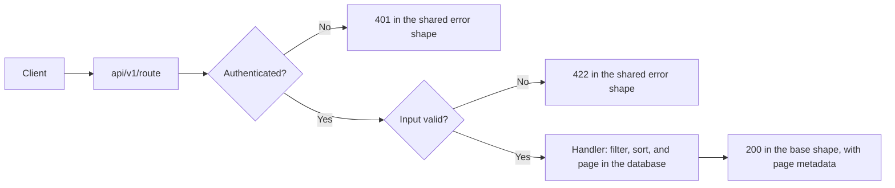

---
tags:
  - kind/rule
  - layer/backend
  - topic/data
---

> Up: [[README.md]]

# API Standard

> [!important]
> Every route is `api/<version>/<route>`. This policy owns that shape, the shared error format, and pagination.

## Core Requirement

When designing, building, or modifying a REST API, follow the rules in this policy.

One consistent style makes integration between services predictable and makes every endpoint safe to expose as a tool to an agent. This standard covers REST. An event bus is a later phase and is not part of it.

## Workflow



## Route Shape

**Every route is `api/<version>/<route>`. There is no exception, and nothing sits outside it.**

```text
api/v1/docs
api/v1/users
api/v1/users/{id}
api/v1/orders/{id}/documents
```

The three parts are fixed:

- **`api`** is the literal first segment on every route the backend serves. A backend serves nothing else.
- **`<version>`** is `v` followed by an integer: `v1`, `v2`. Never a decimal, never a date, never a name.
- **`<route>`** is the resource and whatever follows it, a plural noun in kebab-case: `purchase-orders`, `users`, `orders/{id}/documents`.

Rules:

- **Every route carries the prefix, including the ones that feel like infrastructure.** `api/v1/docs`, `api/v1/openapi.json`, and `api/v1/auth/login` all sit inside it. A framework that mounts `/docs` at the root by default is configured to move it, not left alone.
- **`/health` is the one route outside the prefix**, at the root. Every uptime probe expects it there, it must answer before the app knows its own version, and it is the only route [[security.rules.md]] allows to be public. Nothing else joins it.
- **Never a version anywhere but the path.** Not a header, not a query parameter, not a subdomain. A version in a header is invisible in a log, in a browser address bar, and in a bug report.
- A breaking change ships as `api/v2`, mounted alongside `v1`. Never change the behavior of `v1` silently.

This is what lets one proxy rule, one CORS origin, and one auth dependency cover the whole surface. It is also why a frontend is built with an origin and no path, per [[deploy.rules.md]]: the client holds the origin, every call appends `api/v1/...` itself, and the two halves are joined in exactly one place.

## Base Shape

- The route shape above applies to every endpoint. Everything below is what sits inside it.
- Use JSON for every request and response body, with `Content-Type: application/json`.
- Name a resource as a plural noun in kebab-case, for example `/api/v1/purchase-orders`.
- Use HTTP methods for their intended purpose: `GET` to read, `POST` to create, `PUT` or `PATCH` to update, `DELETE` to remove. Never perform a write or a destructive action through `GET`.
- Reference a person by the one stable identifier the system already uses, and use the same field name in every service. Two services calling it `user_id` and `customer_no` is how a join silently produces nothing.
- Format every timestamp as ISO 8601 with an explicit offset, for example `2026-07-09T14:30:00+07:00`. Never a naive local time.
- Keep OpenAPI generation enabled at all times, mounted at `api/v1/docs` and `api/v1/openapi.json`. In production both are disabled or authenticated, per [[security.rules.md]].

## Error Format

Return every error in the same shape across every service:

```json
{ "error": { "code": "ORDER_NOT_FOUND", "message": "Order does not exist", "detail": null } }
```

- `code` is a stable string a machine can rely on. It must not change once published.
- `message` is for a human reader, in the project's chosen UI language.
- `detail` carries optional structured context, or `null` when there is none.
- Use the HTTP status that matches the failure: `400` malformed, `401` missing authentication, `403` authenticated but not authorized, `404` missing, `409` conflict, `422` validation failure, `500` server error.

> [!warning]
> **Never return HTTP `200` with a body such as `{"success": false}`.** The status must reflect the real outcome, or every client has to parse the body to find out whether the call worked.

## Pagination, Filtering, and Sorting

- Paginate every endpoint that returns a list. Use `?limit=` with a default of 20 and a maximum of 100, and `?offset=` for the starting position. Include the `total` count in the response.
- Filter through one query parameter per column, for example `?status=approved&from=2026-07-01`.
- Sort through `?sort=`, where a `-` prefix means descending, for example `?sort=-created_at`.
- Never return an unbounded result set, per [[database.rules.md]]. An endpoint with no limit works until the table grows.

## Idempotency and Write Safety

- Support an idempotency key, or deduplicate by a content hash, for any write a client may retry: a webhook, a data ingest, a transfer. A retried payment that charges twice is the failure this prevents.
- Require an explicit confirmation step on the client for a destructive action, and record it in the audit trail with the acting identity and a timestamp, per [[security.rules.md]].

## Machine-to-Machine Access and Tool Endpoints

- Authenticate machine-to-machine calls with an `X-API-Key` header, scoped as `resource:action`. Never accept an unscoped or superadmin key.
- An endpoint exposed as a tool to an agent follows every rule here and also carries a clear `summary` and `description` in its OpenAPI definition, because those fields are what the tool definition is built from.
- Keep a tool endpoint's response friendly to a model: concise, with meaningful field names, and without a large blob in the default response. Offer a `?fields=` parameter when a caller needs to narrow it.
- **Treat every model-generated value as untrusted input.** It is derived from something a user typed, so it is never rendered as HTML and never executed, per [[security.rules.md]].

## API Key Lifecycle

Every project that issues machine-to-machine keys serves the same eight routes and no others:

```text
GET    api/v1/api-keys               list, and never carries a key value
POST   api/v1/api-keys               issue, and returns the key
PATCH  api/v1/api-keys/{id}          rename: the label only
POST   api/v1/api-keys/{id}/reveal   return the key again, audited
POST   api/v1/api-keys/{id}/revoke   stop the key working, and keep the row
POST   api/v1/api-keys/{id}/restore  undo a revoke, audited
DELETE api/v1/api-keys/{id}          remove a key that no longer works, audited
GET    api/v1/api-keys/scopes        the scopes a key may be issued with
```

**Revoke and restore are `POST`, not `DELETE`**, because neither removes anything: the row, the secret, and the history all stay. `DELETE` belongs to the one route that does remove the row.

**There is no rotate route.** Revoking a key and issuing a new one does the same thing with an audit trail that says which key served which call, and a rotate that reuses the row makes the log ambiguous at exactly the moment it is being read.

### The Key Format

- A key is a fixed prefix identifying the issuer, then at least 32 characters of `secrets`-generated randomness, such as `proj_` followed by 32 characters from an alphabet with the ambiguous glyphs removed, roughly 186 bits.
- **Remove `0`, `O`, `1`, `l`, and `I` from the alphabet.** A key is copied by hand more often than anyone plans for, and a key that cannot be misread is worth more than the entropy those five characters carry.
- The first 12 characters are stored separately as `key_prefix`, indexed and unique, so a lookup is one index hit rather than a scan over every hash in the table.
- **Never derive a key from a user identifier, a timestamp, or a counter.** It is random or it is not a key.

### What Is Stored

Four columns, four purposes. Two of them hold the key in different forms, and mixing them up is how the reveal path becomes an authentication path.

| Column | Holds | Read by |
| :- | :- | :- |
| `key_prefix` | The first 12 characters, in the clear | The lookup, on every authenticated request |
| `key_hash` | SHA-256 of the whole key | **Authentication**, compared with `compare_digest` |
| `key_cipher` | The whole key, encrypted | **The reveal route only**, and nothing else |
| `expires_at` | The expiry, or `NULL` | The validity check |

- **Authentication always verifies against `key_hash`, never by decrypting `key_cipher`.** A request must not touch the encryption path at all. Decrypting on every call puts a key management round trip in the hot path and the plaintext key in application memory thousands of times a day to answer a question a hash already answers.
- **SHA-256 without a salt is correct here, and a password hash is not.** The key carries 186 bits of entropy and comes from no dictionary, so the work factor a password hash exists to add buys nothing and costs a slow comparison on every request. A password is the opposite case, per [[security.rules.md]].
- The comparison uses `hmac.compare_digest`. A plain `==` leaks the position of the first differing byte through its timing.
- A key is never written to a log, a trace, an error message, or an audit row. The audit records the key's `id` and `key_prefix`, which identify it without carrying it.

### Expiry, Including None

`expires_at` is nullable, and **`NULL` means the key never expires**.

- **The API takes an explicit intent, not a magic number.** Model it as a nullable duration where `null` means never, and reject `0` and `-1` as ways of spelling it; a caller that meant 30 days and sent `0` gets a validation error rather than an immortal key.
- **A key that never expires is a deliberate choice and is recorded as one.** Require the `description` field when the expiry is `NULL`, so the row itself says why, and audit the issue with the acting user.
- **Never make no-expiry the default.** A create request that omits the field gets the project's default duration.
- A no-expiry key is still fully revocable, still scoped, and still bound to a service identity.
- **Track `last_used_at` on every key.** On a key with no expiry it is the only signal there is: a key nobody can tell is still used is a key nobody can safely revoke.
- The list states the expiry plainly. Render `NULL` as `Never expires`, never as an empty cell, a dash, or a far-future date.

### Renaming a Key

`PATCH api/v1/api-keys/{id}` changes the label, and nothing else.

- **The `name` and `description` are the only mutable fields.** The scopes, the linked identity, the expiry, and the secret are immutable. Changing what a key may do is issuing a different key, so the audit trail can say what a key was allowed to do at the time it was used.
- **A rename never changes the secret.** A caller holding the key notices nothing.
- Validate the new name as the create route does: not empty, at most 150 characters, and unique among the active keys.
- Audit the rename with the old name, the new name, and the acting user.
- **The name is a label, never a credential.** Never encode a scope, an environment, or a secret in it.

### Revealing a Key Again

`POST api/v1/api-keys/{id}/reveal` returns the key in full, to the person who asked, once per request.

> [!warning]
> A key that can be revealed is stored reversibly, and that is strictly weaker than a hash-only key. It is accepted because the alternative in practice is worse: when a key cannot be recovered, a lost key is rotated across every client that holds it, and the pressure to avoid that produces one shared key that never rotates at all. The controls below are what make the trade acceptable, and none of them is optional.

- **Encrypted, never hashed, and never plain.** `key_cipher` holds the key under envelope encryption with a key-encryption key in a key management service, per [[security.rules.md]]. A database dump on its own reveals nothing.
- **`POST`, not `GET`.** A reveal is an event that is recorded, not a resource that is read. A `GET` lands in an access log, a browser history, and a proxy cache, and invites an automatic retry.
- **Administrator only, and re-authenticated at the moment of the reveal.** An open laptop is the threat this control exists for.
- **Audit every reveal, successful or refused**, with the acting user, the key `id`, the time, and the source address.
- **Rate limit it hard**, per key and per acting user. A burst of reveals is an incident.
- The response carries `Cache-Control: no-store` and exactly one key. There is no bulk reveal.
- **A revoked or expired key is never revealed.** Return `403` with a stable code.
- A key issued before the project stored `key_cipher` cannot be revealed. Return `409` with a code such as `KEY_NOT_REVEALABLE`, never a `500` and never an empty string.
- The frontend shows the key masked, reveals it on an explicit action, and never places it in a URL or browser storage.

### Revoking, Restoring, and Deleting

- **Revoke sets `revoked_at` and `revoked_by_id`.** The row, the secret, the scopes, and the history stay, which is what makes revoke the first response to a suspicious key: it is the one action that can be taken back. A revoked key is refused at authentication, stays visible in the list, and takes effect on the next request; never cache a key's validity beyond the request that checked it.
- **Restore clears the revoke and changes nothing else**, and is for a revoke made by mistake, never for a key that leaked. A leaked key is deleted and replaced. Only a revoked key is restored, and an expired key is never restored; both return `409`.
- **Only a key that no longer authenticates is deleted**: revoked or expired. A valid key returns `409` and is revoked first, so nothing that still depends on it vanishes in one click.
- **The audit row outlives the key.** The delete's audit detail records the key `id`, `key_prefix`, name, scopes, linked identity, and `last_used_at`, never the secret.
- **No table references a key through a foreign key.** A table that remembers which key made a call records the `key_prefix` it saw, so a delete never fails on a constraint and never cascades into history.

## Definition of Done

- Every route is `api/<version>/<route>`, including `api/v1/docs`, and `/health` is the only route outside the prefix.
- No version appears in a header, a query parameter, or a subdomain.
- OpenAPI generation is enabled and valid.
- Every error follows the standard error format, and every HTTP status reflects the real outcome.
- Every list endpoint is paginated.
- Every machine-to-machine call authenticates through a scoped API key.
- Every reference to a person uses the one agreed identifier.

## Conflict Resolution

If another instruction conflicts with this policy, follow this priority:

1. Security and privacy requirements
2. Direct user instructions
3. This API policy
4. Existing project conventions

A direct user instruction must not override security or privacy requirements. If a request conflicts with this policy, tell the user which standard is affected before proceeding.

## Applies To

- [[database.rules.md]]
- [[security.rules.md]]
- [[repository.rules.md]]
- [[stacks.rules.md]]
- [[path.rules.md]]
