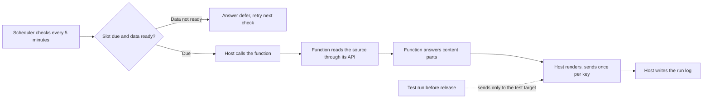

---
tags:
  - kind/rule
  - layer/infra
  - topic/deploy
  - topic/workflow
---

> Up: [[README.md]]

# Automation Standard

> [!important]
> Every automation a project runs on a schedule or a trigger lives in one folder, deploys apart from the main service, answers content rather than sending it, and starts switched off until a person has seen it in a test target.

## Core Requirement

An automation is work a project runs without a person pressing a button each time: a scheduled report, a digest, a sync, a reminder, or a message sent when another system changes. This standard owns where its code lives, how it is deployed and named, how the host calls it, and how it is released. What a report looks like when it arrives is [[report.automation.md]].

Two rules hold for every one of them:

1. **Its code lives in one `automation/` folder of the project that owns the schedule.** Never in a repository of its own, never in a script on a personal machine, and never typed into a web form.
2. **It deploys apart from the main service**, as a Cloud Run function or a Cloud Run job, per [[deploy.rules.md]]. A revision of one automation then ships in a minute, without rebuilding the service and without touching the system it reads.

## Workflow



## Where the Code Lives

```text
automation/
  main.py            one entry point per source folder
  common/            what every folder shares: the run model, page helpers, clients
  sync_billing/      the automations that read the billing service
  digest_tasks/      the automations that read the task service
  API.md             the contract between the host and the functions
```

- **One folder per source the automations read.** An automation sits in the folder of the system whose data it uses, and a folder never imports another folder; what two folders need goes to `common/`.
- **Each folder exports a handler map**, from every slug it answers to its handler, and a test fails when the host's slug list and the folders' maps disagree, so neither side can be forgotten.
- `automation/` is kept out of the main service image, and the service never imports it.
- **A change to an automation is a commit**, reviewed like any other.

## Deployment and Naming

| Part | Pattern |
| :- | :- |
| Folder | `automation/<verb>_<source>/` |
| Entry point | `run_<source>` |
| Function | `[SERVICE]-automation-<source>` |
| URL variable on the host | `AUTOMATION_<SOURCE>_URL` |

- **A function is never public.** Deploy it with `--no-allow-unauthenticated`, and grant the invoker role only to the host's runtime account.
- **A function carries only the values and keys of the source it reads**, through the deploy command, per [[secret.rules.md]] and [[env.rules.md]].
- **A function reads its source through the source's API, never its database.** No function holds a connection string.
- A release deploys only the function whose folder changed. A change to `common/` or `main.py` releases every function.

## How the Host Calls a Function

The host posts one run of one slug, and the function answers what to send.

- **A function never sends.** It answers parts: a page, a text, a document, or an image. The host renders a page to an image or a PDF per [[report.automation.md]], sends it, and writes the run log.
- **A part with a key reaches a recipient once.** The host records the key right after the send and returns recent keys to the function, so a retry never sends twice.
- **A function never waits for data inside a schedule check.** When the data is not ready, it answers `defer`: the slot stays due, no run is logged, and the next check asks again, up to a fixed limit. A wait inside the check holds every other automation behind it.
- **An automation that reads a snapshot another system writes is scheduled after that snapshot.** A slot before it never has data.

## How an Automation Is Released

**Every automation starts switched off and sends nowhere until a person has seen it in a test target.**

1. Add the automation, switched off, through a migration.
2. Set its test target and run it as a test. A test always sends to the test side.
3. Read the result in the test target and in the run history.
4. Set the schedule and the real target.
5. Release it. From then on the schedule sends to the real target.

- **A test never changes production data.** An automation that writes into another system writes that system's staging environment on a test run, and production only on a released run.
- **Every automation has a force stop** that stops a queued or running run before its next message and switches the schedule off. No automation is exempt.
- A scheduled run that sent nothing is not kept in the run log, so a five-minute check does not bury the runs that matter.
- **An automation that takes over from an older sender carries on where it stopped.** Stop the older sender, import its record of what it sent, then release.

## Definition of Done

- The code is in `automation/<verb>_<source>/`, for the source it reads, and imports no other source's folder.
- Its slug is in its folder's handler map and in the host's list, and the test that compares them passes.
- The function is private, invoked only by the host's account, and carries no connection string.
- It was added switched off, ran as a test, and was read in the test target before release.
- A test run wrote no production data of another system.
- It has a force stop, and it defers rather than waits when its data is not ready.
- What it sends meets [[report.automation.md]].

## Conflict Resolution

If another instruction conflicts with this standard, follow this priority:

1. Security and privacy requirements
2. Direct user instructions
3. This automation standard
4. Existing project conventions

A direct user instruction must not override security or privacy requirements. If a request conflicts with this standard, tell the user which standard is affected before proceeding.

## Applies To

- [[report.automation.md]]
- [[deploy.rules.md]]
- [[deploy.cloud.md]]
- [[secret.rules.md]]
- [[env.rules.md]]
- [[commit.rules.md]]
