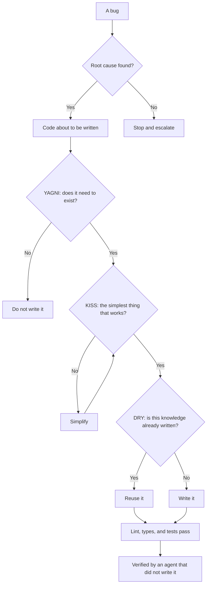

---
tags:
  - kind/rule
  - topic/workflow
---

> Up: [[README.md]]

# Code Standard

> [!important]
> A rule a tool can check lives in that tool's config, and this page names the tool and the setting. The prose here is only what a reviewer has to judge.

## Core Requirement

Code is read far more often than it is written. Write only what the task needs today, write it for the reader, and never hide a failure.

Three tests decide every judgement call, in this order: **YAGNI** (does it need to exist?), **KISS** (is it the simplest thing that works?), and **DRY** (is this knowledge written down once?). Code that does not exist cannot be complex, and code that is not complex rarely needs deduplicating.

What code must achieve lives elsewhere: performance and testing in [component/backend/](../component/backend/README.md) and [component/frontend/](../component/frontend/README.md), and security in [[security.rules.md]].

## Workflow



## YAGNI, KISS, and DRY

A reviewer judges these. No linter can tell a needed abstraction from a speculative one.

- **YAGNI.** Build what the task needs today. No interface for one class, no factory for one product, no option for a value that has never changed, no parameter no caller passes, no branch no caller reaches.
- **KISS.** Stop at the first rung that holds: skip it, reuse what the project has, the standard library, an installed dependency, one function, and never a new dependency for what a few lines of standard library do. Boring beats clever: a function over a class, an early return over a nested `else`, a plain loop over a comprehension nobody reads at a glance.
- **DRY is about knowledge, not characters.** A business rule, a magic number, a validation, a type, or a path convention lives in one place. The test is how many places you would edit if the rule changed.
- **Alike is not duplicate.** Two blocks that look alike but change for different reasons stay apart; two that look different but must change together are merged. A shared helper with a boolean flag per caller is four functions pretending to be one.

## No Slop

A reviewing agent judges these; the linter catches only the mechanical part, listed under "Enforced by a Tool" below.

- **No dead code.** No commented-out code, unused import, variable, or parameter, and no unreachable branch. Delete it; git keeps it.
- **No over-abstraction.** Every abstraction has more than one caller today. A wrong abstraction costs more than writing the thing twice, because it has to be unpicked from every caller.
- **No invented APIs.** Every function, method, option, and flag called exists in the installed version of its library. Check that version's source or documentation, never memory.
- **No speculative generality.** No hook, plugin point, configuration key, or generic parameter for a case nobody has asked for. Add it when the second case arrives and you can see what it needs.

## No Quick Fix

A bug report names a symptom. Reproduce it, trace it to the line that is wrong, and fix it there, once, where every caller passes through. If the cause cannot be found, or the fix crosses a boundary you were not given, stop and report what you found.

> [!warning]
> "That would be a larger change" is a signal to escalate, never a reason to patch. A patch over a cause nobody found is a second bug sitting on top of the first.

Forbidden as a fix, whatever the deadline:

- A zero-delay timer, or any deferral, that makes an ordering bug stop showing.
- A sleep, a retry, or a longer timeout added so a failure stops appearing. A bounded, logged retry is a fix only for a failure that is transient by nature, such as a 429 or a dropped connection.
- A broad catch that turns an error into silence or a default value.
- A skipped, deleted, or loosened test, or an assertion changed to match the wrong output.
- A suppression comment (`noqa`, `type: ignore`, `eslint-disable`, `@ts-expect-error`) in place of the fix.

## Errors

No error is swallowed. Catch an exception only where the code can act on it: recover, add context and re-raise with its cause, or turn it into the error shape at the API boundary, per [[api.rules.md]].

- Catch the narrowest exception you can handle. A catch-all lives in one place, the top-level handler that logs the error and returns the error response. Where ignoring one specific exception is the point, `contextlib.suppress(KeyError)` says so.
- Log an error once, where it is handled, with its context. Never log and re-raise the same error at every layer.
- A promise is awaited, returned, or given a rejection handler. Never left floating.

## Documentation in Code

**A comment exists only for a non-obvious why**: a constraint, a workaround with a link to its issue, an invariant the code relies on, or a value that came from measurement. Never a restatement of the code. If a comment says what the code does, rewrite the code until it does not need one. Every comment, docstring, and identifier is English.

- **Every file opens with a one-line header** saying what it is for, and every public function, class, and component carries a one-line docstring or JSDoc saying what it does, never how its signature reads. A private helper whose name says it all needs none, and a test's name is its documentation.
- **One line by default, three at most.** A comment is a label, not a paragraph. A to-do is one line, `TODO(<owner>): <action>`.
- **No decoration**: no banner, box, or divider of repeated characters, and no changelog. A usage snippet inside a comment keeps its own line breaks, and a template meant to be copied may run its header to ten lines.

```python
"""Sales summary service: aggregates daily sales per branch."""


def daily_total(branch_id: str, day: date) -> Decimal:
    """Return total paid sales for one branch on one day."""
    # Refunds are stored as negative rows, so a plain SUM is correct.
    return repo.sum_paid(branch_id, day)
```

## Readability

- **Names say what a thing is**: `active_users`, not `data`. A boolean reads as a statement, `is_valid`. A function name says what it does, `calculate_total`, not `process`.
- **A function does one thing.** If its name needs "and", it is two functions.
- **Smell tests, judged by a reviewer and never counted by a linter**: a function past one screen (about 40 lines), nesting past three levels, a file past a few hundred lines, a parameter list past four. Each is where a second responsibility hides, but never split a function only to make it short: two functions always called together, in order, are one function with a seam.

## Boundaries and Filenames

**A boundary is a folder a lint rule enforces.** A boundary that lives only in a README does not exist, because nothing fails when it is crossed.

- **Declare each boundary as an import ban.** For example, `src/renderer/` may not import from `src/main/`, not even a type, and a type both sides need lives only in `src/shared/`. ESLint does this with `no-restricted-imports` under a `files` glob; ruff with `TID251` and `banned-api`, lifted by `per-file-ignores` in the one folder allowed through.
- **A filename can carry a rule, and the lint config enforces it by glob.** For example, `*.hot.ts` runs every tick, so it allocates nothing: a `files: ['**/*.hot.ts']` block adds `no-restricted-syntax` selectors for `NewExpression`, `ArrayExpression`, and `ObjectExpression`. A project lists each such suffix in its README, beside the block that enforces it.
- **Python modules are `snake_case.py`**, checked by ruff `N999`. A React component file is named after its component, such as `OrderTable.tsx`.

## Python

Python 3.13, with conda or `.venv` decided by the project:

- **Conda (Miniconda)** for any machine-learning or data project, because native dependencies and CUDA install correctly through conda and break through pip alone. It commits an `environment.yml` from `conda-forge`, with a `pip:` block only for what conda lacks.
- **`.venv`** for a pure-Python script, CLI, or small API. It commits a `pyproject.toml` or a `requirements.txt`.
- **Never install into the base environment.** One environment per project, named after the project, with the Python version and the major version of every direct dependency pinned, and the exact activation command in the README.
- **`.venv/`, `__pycache__/`, `.ipynb_checkpoints/`, data, and model weights never enter git.**
- **A `dataclass` over a dictionary of fixed keys, and `logging` over `print()`.** The rest of the style is in the table below.

An AI project also follows [[ai/README.md]]. A model is quietly wrong rather than broken: it returns a plausible number and says nothing, and [[ai.rules.md]] exists to make that silence impossible. Every random seed is set and recorded, and a notebook is never the thing that runs in production.

## Testing

- **Test behaviour, not implementation**, and only the non-obvious: a branch, a boundary, a parser, a calculation. A passthrough needs no test, because YAGNI applies to tests too.
- **One failing test says what broke.** Several small pytest functions beat one test that asserts twelve things, and plain functions come before fixtures, factories, or base classes.
- **A bug fix ships with the test that would have caught it**, and that test fails before the fix.

## Enforced by a Tool

Copy [[ruff.template.toml]] into `pyproject.toml` and [[eslint.config.template.js]] to `eslint.config.js`. A rule in this table is never argued in review: the tool fails or it passes.

| Rule | Enforced by | Setting |
| :- | :- | :- |
| No bare or broad catch that hides the error | ruff | `E722`, `BLE001` |
| No swallowed error, narrow catches included | ruff | `S110`, `S112`, with `check-typed-exception = true` |
| A re-raise keeps its cause | ruff | `B904` |
| No dead code: commented-out code, an unused import, variable, or parameter | ruff | `ERA001`, `F401`, `F841`, `ARG001`, `ARG002` |
| A suppression names its rule | ruff | `PGH003`, `PGH004` |
| No mutable default argument | ruff | `B006` |
| No `print()` in library code | ruff | `T201` |
| Builtin generics, f-strings, and `pathlib` | ruff | `UP006`, `UP031`, `UP032`, `PTH` |
| PEP 8 names, module names included | ruff | `N` |
| A file header and a docstring on every public function and class | ruff | `D100`, `D101`, `D102`, `D103` |
| A type hint on every argument and every public return | ruff | `ANN001`, `ANN201` |
| No SQL built by string formatting, per [[security.rules.md]] | ruff | `S608` |
| A folder boundary | ruff | `TID251`, `banned-api` |
| PEP 8 layout and blank lines | ruff | `ruff format --check .` |
| Strict types, and no unused local or parameter | TypeScript | `strict`, `noUnusedLocals`, `noUnusedParameters` in `tsconfig.app.json` |
| No `any` | ESLint | `@typescript-eslint/no-explicit-any` |
| No floating promise | ESLint | `@typescript-eslint/no-floating-promises` |
| No empty block, an empty `catch` included | ESLint | `no-empty` |
| A rethrown error keeps its cause | ESLint | `preserve-caught-error`, in `js.configs.recommended` from ESLint 10 |
| A type suppression carries its reason | ESLint | `@typescript-eslint/ban-ts-comment`, in `recommendedTypeChecked` |
| No zero-delay `setTimeout` outside the one allowlisted file | ESLint | `no-restricted-syntax` |
| A folder boundary | ESLint | `no-restricted-imports`, `patterns` |
| No stale `eslint-disable` comment | ESLint | `linterOptions.reportUnusedDisableDirectives: 'error'` |

No Python type checker is part of this standard: ruff checks that the hints exist, not that they are right. A reason on every `eslint-disable` comment needs an extra plugin, so a reviewer checks it. typescript-eslint 8 supports TypeScript below 6.1 only, so a project pins `typescript` to `~6.0` while the type-aware rules are on.

## Definition of Done

- **Lint passes**: `ruff check .` and `ruff format --check .`, or `npm run lint`, with no new suppression.
- **Types pass**: `tsc -b` for TypeScript; for Python, every hint ruff requires is present.
- **Tests pass**, and a bug fix ships with the test that failed before it.
- **An agent that did not write the code verified it**, from the requirements and the diff alone, per [[AGENTS.md]].
- Every bug fix names its root cause, and none uses a pattern from "No Quick Fix".
- Every new abstraction has more than one caller today, and no dependency was added for what the standard library does.
- Every comment states a why the code cannot, and none restates the code.
- No absolute path appears in source, per [[path.rules.md]].
- The environment file is committed and named after the project, nothing was installed into base, every seed is recorded, and no data, weight, or checkpoint entered git.

## Conflict Resolution

If another instruction conflicts with this standard, follow this priority:

1. Security and privacy requirements
2. Direct user instructions
3. [[stacks.rules.md]], on what a project is built with
4. This code standard
5. Existing project conventions

A direct user instruction must not override security or privacy requirements. If a request conflicts with this standard, tell the user which standard is affected before proceeding.

## Applies To

- [[ruff.template.toml]]
- [[eslint.config.template.js]]
- [[docs.rules.md]]
- [[env.rules.md]]
- [[security.rules.md]]
- [[commit.rules.md]]
- [[path.rules.md]]
- [[stacks.rules.md]]
- [[repository.rules.md]]
