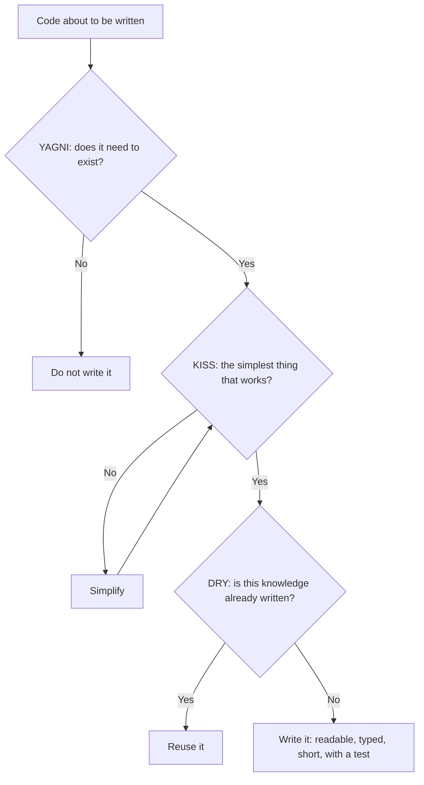

> Up: [[README.md]]

# Code Standard

> [!important]
> YAGNI, KISS, and DRY as the three tests every piece of code passes before it is written.

## Core Requirement

Code is read far more often than it is written, usually by someone who has forgotten writing it. Optimize for the reader.

Three principles decide every judgement call, in this order:

| Principle | The question it answers |
| :- | :- |
| **YAGNI** | Does this need to exist at all? |
| **KISS** | Is this the simplest thing that works? |
| **DRY** | Is this knowledge written down more than once? |

They are ordered on purpose. Code that does not exist cannot be complex, and code that is not complex rarely needs deduplicating.

## Workflow



## YAGNI: You Are Not Going To Need It

Build what the task needs today. Not what it might need.

- No abstraction with one implementation. No interface for one class, no factory for one product, no plugin system for one plugin.
- No configuration option for a value that has never changed.
- No parameter no caller passes. No branch no caller reaches.
- No "we might want to swap the database later." Swap it later, when later arrives and you know what it swaps to.
- Delete dead code instead of commenting it out. Git remembers it.

The cost of a wrong abstraction is higher than the cost of writing the thing twice. Two duplicated blocks are easy to merge once you can see what they share; one wrong abstraction has to be unpicked from every caller.

> [!warning]
> Two blocks that look alike but change for different reasons are not duplication. Merging them is how a shared helper grows four boolean flags to serve four callers.

## KISS: Keep It Simple

The simplest solution that works is the correct one.

Climb this ladder and stop at the first rung that holds:

1. Does it need to exist? Skip it.
2. Does something in this project already do it? Reuse it.
3. Does the standard library do it? Use it.
4. Does an already-installed dependency do it? Use it.
5. Can it be one function? Write one function.

Never add a dependency for something a few lines of standard library covers. Never write fifty lines for something the standard library already solved.

Concretely:

- Prefer a function to a class. Prefer a class to a class hierarchy.
- Prefer a flat sequence of steps to nested conditionals. Return early instead of nesting an `else`.
- Prefer an explicit loop to a clever comprehension nobody can read at a glance.
- A function does one thing. If the name needs "and", it is two functions.
- Keep a function short enough to read without scrolling. This is a smell test, not a line count.
- Boring beats clever. Clever is what somebody decodes at 3am while something is broken.

## DRY: Do Not Repeat Yourself

DRY is about **knowledge**, not about characters.

- One piece of knowledge lives in one place: a business rule, a magic number, a validation, a configuration value, a type, a file path convention.
- Two blocks that look alike but change for different reasons are **not** duplication. Leave them apart.
- Two blocks that look different but must change together **are** duplication. Merge them.
- A constant used twice is a named constant. A constant used once is fine where it is.

The test is not "do these lines match" but "if this rule changed, how many places would I have to edit?" More than one is the problem.

Do not apply DRY so hard that it fights KISS. A shared helper with four boolean flags to serve four callers is worse than four small functions.

## Readability

The rules above shape the structure. These shape the surface.

- **Names say what a thing is.** `active_users` not `au`, not `data`, not `temp`. A long clear name beats a short cryptic one.
- **A boolean reads as a statement.** `is_valid`, `has_permission`, `should_retry`.
- **A function name says what it does.** `calculate_total` not `process`. `process` means nothing.
- **Comments say why, never what.** The code already says what. If a comment explains what, rewrite the code instead.
- **A comment that explains a non-obvious decision is worth keeping.** A workaround, a chosen trade-off, a reason a naive approach fails; write those down, they are the ones nobody can reconstruct.
- **One line is the default and three is the ceiling**, per "Documentation in Code" below. A comment is a label, not a paragraph, and a docstring never repeats the signature.
- **No commented-out code.** Delete it.
- **Consistent formatting is not negotiable.** Match the style of the surrounding code.
- **Type hints on every public function.** They are documentation the interpreter checks.

### Short Enough to Read in One Go

Length is the symptom the other rules on this page are treating. These are the thresholds at which to stop and look.

- **A function fits on one screen, roughly 40 lines.** Past that it is doing more than one thing, and the second thing has a name worth giving it.
- **Three levels of nesting is the ceiling.** Return early instead of deepening an `else`, per the flat-sequence rule above.
- **A file past a few hundred lines has grown a second responsibility.** Split it by what it does, never to hit a number.
- **A parameter list past four is a signature asking for an object.** Pass a dataclass instead of five positional arguments nobody can order correctly.
- **Never split a function just to make it short.** Two functions only ever called together, in order, are one function with a confusing seam in the middle. That is KISS losing to a line count.
- **The comment above it has its own ceiling**: one line by default, three at most, per "Documentation in Code" below.

A long function is not a style complaint. It is where a bug hides, because nobody holds forty lines of branching in their head while reading the forty-first.

## Documentation in Code

**Every code file documents itself in short lines: one line saying what the file is for, one line saying what each public function, class, or component does, and a one-line comment wherever the why is not obvious.** Nothing longer.

Documentation in code is written for any reader: a junior developer, someone reading English as a second language, or you in six months. Plain words, and no jargon where a simple word works. **Every comment, docstring, and configuration label is written in English**, like every identifier.

### What Every File Carries

| Where | What | Length |
| :- | :- | :- |
| The first line of every code file | A comment or module docstring saying what the file is for | One line |
| Every public function, class, and component | A docstring or JSDoc saying what it does | One line. Three at most, adding the parameters, the return value, or what it raises only when the names and types do not already say it |
| An inline comment | Why the code is this way, or a behaviour nobody would guess | One line each |

```python
"""Sales summary service: aggregates daily sales per branch."""


def daily_total(branch_id: str, day: date) -> Decimal:
    """Return total paid sales for one branch on one day."""
    # Refunds are stored as negative rows, so a plain SUM is correct.
    return repo.sum_paid(branch_id, day)
```

```ts
/** Fetch one page of orders; cursor is null on the first page. */
export async function listOrders(cursor: string | null) { ... }
```

- **A docstring says what the thing does, never how its signature reads.** The parameter names and types are already there.
- **A private helper whose name and signature already say what it does needs no docstring**, and a test's name is its documentation.
- **A to-do is one line in the form `TODO(<owner>): <action>`**, such as `TODO(backend-engineer): drop the v1 route once every client has moved`.
- **Never a multi-paragraph comment block, a banner, commented-out code, or a changelog.** Git keeps the history.

### A Comment Is a Label, Not a Paragraph

**One line is the default, and three is the hard ceiling.** A comment that runs longer is almost always restating what the code already says, and a reader stops reading comments at all once a few of them have wasted their time.

**Write the label, not the sentence.** Name the thing and stop. A comment needs no article, no verb, and no full stop to be clear:

```bash
# API key for Ollama
OLLAMA_AI_KEY=

# Ollama model
OLLAMA_MODEL=
```

- **Never restate the identifier.** `# This variable holds the API key used to authenticate against the Ollama service` says nothing the key name does not, at eleven times the length.
- **One short label per key in a configuration file**, and no paragraph above the group explaining the group.
- **No comment on an obvious line.** An assignment, a getter, an import, and a loop over a named collection need none.
- **Length is earned only by what nobody can reconstruct**: a workaround, a rejected approach, a value that came from measurement. Even then it stays within three lines and names the reason rather than narrating the investigation.
- **The ceiling counts the comment, not a usage example inside it.** A snippet keeps its own lines, per the exception below.
- **Every file opens with its one-line header**, per the table above. A template meant to be copied may run its header to ten lines, saying what the file is and how to fill it in; past that it is documentation and belongs in the README that the template's repository carries.

| Do | Do not |
| :- | :- |
| `# Ollama model` | `# The name of the Ollama model this application uses when it sends a prompt` |
| `# Retry budget, tuned against the provider's 429 rate` | Four lines explaining what a retry is |
| Say why a value is what it is | Say what the line does |
| Delete a comment the code made obvious | Keep it because it was already written |

### No Decoration

Do not use a special character as a decorator, border, or separator inside a code comment. This includes, but is not limited to, a repeated `=`, `-`, `*`, `+`, `#`, `$`, `~`, `_`, `^`, `/`, `\`, or `|` arranged into a line, a box, a banner, or a divider. Do not use extra blank lines or padding spaces to box a comment either.

A code comment states its purpose directly, in plain language, with no surrounding decoration. Readability comes from clear wording, not visual styling.

The one exception is a short code snippet inside a comment showing how something is called. That snippet keeps its own natural formatting and line breaks.

Correct:

```text
// Validates the token and returns the decoded claims
function verifyToken(token) { ... }
```

Correct, the exception:

```text
// Usage:
// const result = verifyToken(token);
function verifyToken(token) { ... }
```

Incorrect:

```text
// ==========================
// Validates the token
// ==========================
function verifyToken(token) { ... }
```

## Python

Python 3.13. Written in **English**: every identifier, every comment, every docstring, every commit, every document.

### Environment

Two managers, and the project decides which one:

| Use | When |
| :- | :- |
| **Conda (Miniconda)** | Any machine-learning or data project. Native dependencies, CUDA, and scientific packages install correctly through conda and break through pip alone |
| **`.venv`** | A plain Python project with pure-Python dependencies: a script, a CLI, a small API |

Conda is the default for this stack, since these are ML projects. Reach for `.venv` when a project genuinely has no native dependency.

Rules:

- **Never install into the base environment.** One environment per project, named after the project.
- A conda project commits an `environment.yml`. A `.venv` project commits a `pyproject.toml` or a `requirements.txt`.
- Inside a conda environment, install through conda first; use pip only for packages conda does not carry, and record them in the same `environment.yml` under a `pip:` block.
- Pin the Python version in the environment file. Pin the major version of every direct dependency; do not float on latest.
- `.venv/`, `__pycache__/`, `.ipynb_checkpoints/`, and model weights never enter git.
- The project README states the exact activation command, so setup is copy and paste.

```yaml
# environment.yml
name: my-project
channels: [conda-forge]
dependencies:
  - python=3.13
  - numpy
  - pandas
  - pip
  - pip:
      - some-package-conda-lacks
```

### Style

- Follow PEP 8, blank lines included, per "Blank Lines Follow PEP 8" below.
- `snake_case` for functions and variables, `PascalCase` for classes, `SCREAMING_SNAKE_CASE` for constants.
- Type hints on public functions. `list[str]`, not `List[str]`; the builtin generics are standard now.
- A one-line docstring on every module and every public function and class, per "Documentation in Code" above.
- Prefer `pathlib.Path` to string paths, f-strings to `%` and `.format()`, and a `dataclass` to a dictionary of fixed keys.
- Never use a mutable default argument. `def f(x: list | None = None)` and default it inside.
- Never catch bare `except:`. Catch the exception you can actually handle.
- Never leave `print()` in library code; use `logging`.

### Blank Lines Follow PEP 8

**Two blank lines around a top-level function or class, one around a method, and never two inside a function or a class body.** Inside a function, a single blank line separates the logical steps, used sparingly.

`ruff format` applies this on every run, and `ruff format --check .` lists every file that breaks it, so the rule is checked rather than remembered.

### Machine Learning

An AI project follows [[ai/README.md]] in addition to this file. That folder owns the environment, reproducibility, data handling, experiments, and evaluation, because those rules are specific enough to be worth their own place and long enough to bury the general ones if kept here.

The one line worth repeating in both: **a model is quietly wrong rather than broken.** Ordinary code errors; a model returns a plausible number and says nothing. Everything in [[ai.rules.md]] exists to make that silence impossible.

## Testing

A test is what lets you change code without fear.

- Test behaviour, not implementation. A test that breaks when you rename a private method is a liability.
- Test the non-obvious: a branch, a boundary, a parser, a calculation. A one-line passthrough does not need a test.
- One failing assertion should say what broke. Prefer several small tests to one that asserts twelve things.
- Use `pytest`. No fixtures, no factories, and no test base classes until plain functions genuinely stop being enough.
- A bug fix comes with the test that would have caught it.

YAGNI applies to tests too. Full coverage of trivial code is work that buys nothing.

## Where Performance and Security Live

This file covers how code is written and read. Three other places cover what it must achieve, and a project or a review links to them rather than copying them:

- **Backend performance and testing:** [component/backend/](../component/backend/README.md).
- **Frontend performance, testing, and the UI components:** [component/frontend/](../component/frontend/README.md).
- **Security:** [[security.rules.md]].

## Do and Do Not

Do:

- Delete more than you add.
- Reuse what the project already has before writing something new.
- Name things so the next reader does not have to guess.
- Write the comment that explains why a decision was made.
- Pin dependencies and commit the environment file.
- Set and record every random seed.

Do not:

- Build an abstraction for a second case that does not exist yet.
- Add a dependency for what the standard library already does.
- Merge two blocks that merely look alike.
- Leave commented-out code, dead branches, or unused parameters.
- Install into the base conda environment.
- Commit data, weights, or checkpoints.
- Let a notebook become the thing that runs in production.

## Definition of Done

- Every new abstraction has more than one caller today.
- No dependency was added for something the standard library already does.
- Every public function carries a type hint.
- Every identifier is English, and no comment carries a decorative border.
- No commented-out code, dead branch, or unused parameter remains.
- No bare `except`, no mutable default, and no `print()` in library code.
- No function runs past one screen, no comment past three lines, and nothing is nested more than three levels deep.
- Every code file opens with a one-line header, and every public function, class, and component carries a one-line docstring.
- Every `.py` file passes `ruff format --check`, so its blank lines follow PEP 8.
- No SQL is built by string formatting, per [[security.rules.md]].
- No absolute path appears in source, per [[path.rules.md]].
- The environment file is committed, the environment is named after the project, and nothing was installed into base.
- Every random seed is set and recorded, and no data, weight, or checkpoint entered git.
- A bug fix ships with the test that would have caught it.

## Conflict Resolution

If another instruction conflicts with this standard, follow this priority:

1. Security and privacy requirements
2. Direct user instructions
3. [[stacks.rules.md]], on what a project is built with
4. This code standard
5. Existing project conventions

A direct user instruction must not override security or privacy requirements. If a request conflicts with this standard, tell the user which standard is affected before proceeding.

## Applies To

- [[docs.rules.md]]
- [[env.rules.md]]
- [[security.rules.md]]
- [[commit.rules.md]]
- [[path.rules.md]]
- [[stacks.rules.md]]
- [[repository.rules.md]]
