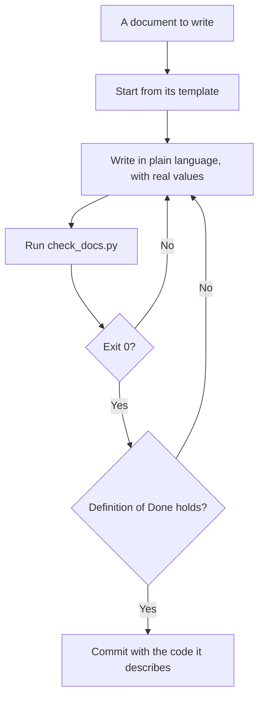

---
tags:
  - kind/rule
  - layer/docs
  - topic/workflow
---

> Up: [[README.md]]

# Documentation Standard

> [!important]
> Every document starts from its template in [template/](../template/), keeps that template's section order, and passes `scripts/harness/check_docs.py`. The rules the script checks are listed once, in "Checked by Script"; the rest of this file is what a script cannot judge.

## Core Requirement

Documentation is written for the reader who arrives with no context, usually the author six months later.

- **Plain language, no filler.** Short sentences, active voice, one idea per sentence. Delete "basically", "simply", "just", "in order to", and "it should be noted that". "Simply" is false whenever the thing is not simple.
- **Examples over adjectives.** Show the command that ran, the error it printed, and the real value. "Fast", "robust", and "easy" give the reader nothing to check.
- **Documentation lives next to the code it describes**, in the same repository, and changes in the same commit as that code.
- **No emoji decoration**: no emoji, no shortcode such as `:rocket:`, and no symbol used as one, such as a check mark, a cross, or a star as a bullet. Emphasis is bold, a warning is a callout per [[callout.rules.md]], and a status is a status indicator.
- **Every output is in English**, per "Language".
- **The work is attributed only to the owner**, per "Attribution".

## Workflow



## Checked by Script

`scripts/harness/check_docs.py` enforces every rule in this table, and the `after-edit` hook runs it on each changed file. Run it by hand with `--changed`, `--all`, or a list of paths. A rule in this table is not repeated below.

| Rule | Check |
| :- | :- |
| No em dash (U+2014), no en dash (U+2013) used as punctuation, no smart quote (U+2018, U+2019, U+201C, U+201D), no Unicode arrow, and no emoji or pictograph. It applies everywhere, fenced code and Mermaid labels included. Write `-`, `"`, `>`, and `<` instead, so a flow reads `Client > API > Database` | `banned-char` |
| No trailing whitespace | `trailing-whitespace` |
| One paragraph is one line, and so is one list item. Markdown reflows a paragraph anyway, and a wrapped one turns a one-word change into a rewritten paragraph in the diff | `hard-wrap` |
| One blank line between blocks, never two | `blank-lines` |
| Every fenced code block carries a language tag | `fence-language` |
| No horizontal rule in the body. Headings already divide, and the frontmatter delimiters are the only `---` allowed | `horizontal-rule` |
| At most three callouts per document. [[callout.rules.md]] owns the types and is itself exempt | `callout-limit` |
| A status indicator is exactly `<code style="color: green">`, with `yellow` or `red` as the only other colors | `status-indicator` |
| Tags come from the closed lists under "Tags": exactly one `kind/`, at most two `topic/`, and `project/` only on a journal | `tags` |
| A tagged document has `> Up: [[...]]` as its first line after the frontmatter | `breadcrumb` |
| A rule, component, runbook, or template has a `## Workflow` section holding a `mermaid` diagram | `workflow` |
| Every `[[wikilink]]` names a file in the vault and carries its extension. Links into `memory/`, `graph/`, `pattern/`, and `report/` are skipped | `wikilink` |
| A project document's Table of Contents links every `##` heading, and every entry names one | `toc` |
| A count badge in the vault `README.md` equals the files it counts. `Rules`: every `.md` in `rules/`. `Components`: every `.md` under `component/`. `Templates`: every `*.template.*` under `template/` and `cloud/`. `Agents`: every `.md` in `.agents/agents/`. `README.md` is never counted | `badge-count` |

Agent prompts under `.agents/`, `.claude/`, and `.codex/`, and the root `AGENTS.md` and `CLAUDE.md`, get `banned-char` only. `memory/`, `graph/`, `pattern/`, and `report/` are never checked. A new mechanical rule goes into the script and this table in one commit, and `--self-test` still passes.

## Language

Every output is in English: documents, headings, comments, commits, identifiers, and reports. A request may arrive in another language; the answer is English.

- **An existing project already written in another language keeps it.** A half-translated repository is worse than either language, so a repository has one language, and a document never mixes two.
- **Converting a repository is one deliberate pass over all of it**, in one change, never file by file.
- **Code is always English**, whatever the documentation uses: identifiers, comments, docstrings, commit messages, and branch names, per [[codes.rules.md]] and [[commit.rules.md]].
- **Two things follow their audience instead.** A `docs/PRD.md` follows its readers, per [[prd.rules.md]], and interface text follows the product's users, per [[stacks.rules.md]].
- **A technical term keeps its original form**: a library, a command, a file name, a field, a route.
- **Dates are absolute**, `YYYY-MM-DD`, in Western Indonesia Time (WIB, Asia/Jakarta). A note's date line keeps its own form, per [[notes.rules.md]].

## Attribution

**The work is attributed only to the owner.** No AI or tool is named as an author, co-author, or generator in a commit message, a pull request, code, a comment, a file header, or a document.

- No "Generated with", "created with", or "written with" line.
- No co-author trailer naming a tool or a model. A human collaborator's trailer is governed by [[commit.rules.md]].
- No session link, and no tool-specific marker or watermark in a generated file.

`scripts/harness/check_attribution.py` and the `commit-msg` git hook enforce it.

**Citing the source of an idea is not attribution, and it is expected.** The README of `rules/`, of `.agents/agents/`, and of `.agents/skills/` carries a `## Citations` section with one BibTeX entry per item:

```bibtex
@misc{conventionalcommits,
  title = {Conventional Commits 1.0.0},
  url = {https://www.conventionalcommits.org/en/v1.0.0/}
}
```

## What Every Project Documents

| File | Holds |
| :- | :- |
| `README.md` | What it is, how to run it, what it needs. The only file most readers open |
| `docs/PRD.md` | The problem, the users, the goal, and the non-goals, per [[prd.rules.md]] |
| `docs/SRS.md` | The numbered, checkable requirements, per [[srs.rules.md]] |
| `docs/PLAN.md` | The timeline, the features with owner and status, and the done log, from [[plan.template.md]] |
| `API.md` | The endpoints, if the project has any |
| `MODEL.md` | The model card, if the project trains one |
| `.env.example` | Every variable name with a placeholder, per [[env.rules.md]] |
| `LICENSE` | `Proprietary`, or the full published license, from [[license.template.md]] |
| `CODE_OF_CONDUCT.md` | How people behave in the project, from [[code-of-conduct.template.md]] |
| `SECURITY.md` | How to report a vulnerability privately, from [[security.template.md]] |
| `CONTRIBUTING.md` | How to set up, branch, commit, and open a pull request, from [[contributing.template.md]] |

The last four are required in every repository, per [[repository.rules.md]], and carry no badge row; only `CONTRIBUTING.md` is long enough to need a Table of Contents. A project that needs a twelfth document usually needs a shorter README.

**An agent report is not a document.** It lives in `~/agentic/report/<project>/`, never in the project, and is never committed, per [[report.rules.md]].

## The README Is the Contract

A reader goes from a clone to a running project using only the README, or the README is incomplete. Required, in this order:

1. Title, then the badge row per [[badge.rules.md]].
2. One paragraph: what this is and why it exists.
3. Setup: the exact commands, including environment activation, in a block that pastes whole.
4. Usage: the smallest example that does something real.
5. Configuration: the variable names, never a real value.
6. Project structure, if the layout is not obvious.

## The Shape of a Project Document

A project document (a README, `API.md`, `MODEL.md`, `docs/PRD.md`) opens with the title, the badge row, the lead paragraph, and the Table of Contents, in that order. **It carries no YAML frontmatter and no `---` at all**; frontmatter belongs to vault documents.

- **The lead paragraph says what it is in one line, then why it exists**, with the claim that matters in bold. The why is the part nobody can rebuild from the code.
- **The Table of Contents is a numbered list of links to the `##` headings**, directly under the lead paragraph, updated in the commit that adds or renames a section. A document that fits on one screen skips it.
- **A heading names the answer, not the category**: `No Chat Model`, not `Architecture Notes`; `Known Limitations`, not `Notes`.
- **A command is the one that ran**, copied from a shell, with real values where they can be shown.
- **Setup is numbered steps with a bold name**: one line saying what the step is, the block that runs, then what to know before the next step. Say up front which steps are already done.
- **A gotcha sits directly under the command that triggers it**, in bold, with the mechanism, the real error text, and why the behaviour is deliberate. Not in a Troubleshooting section the reader finds only after hitting it.
- **Say what is committed and what is not.** A Data section, or a row in Project Structure, marks each location "Gitignored" or "Committed".

Weak and strong lead paragraphs:

```text
Weak: A CLI that reads markdown files and writes them into a vector database.
Strong: A plug-and-play memory for coding agents. Point it at a folder of markdown and that folder becomes a brain the agent searches over MCP. **No chat model anywhere in it**: the agent asking already has one.
```

A gotcha with all three parts:

```markdown
**Step 3 has to come first.** `compose.yaml` declares `.env` as required, so `docker compose up` without it fails with `env file ... not found`. That is deliberate: made optional, the service would start on its defaults and quietly serve the wrong database.
```

### Known Limitations

Every `README.md`, `API.md`, and `MODEL.md` ends with **Known Limitations**: what the thing does not do and the ceiling of each part, each with its reason. A project with none keeps the heading and says so in one line. `docs/PRD.md` has non-goals instead, `docs/SRS.md` gives a requirement a status, and an agent entry point carries none.

```markdown
- **Only markdown is digested.** PDF, docx, and csv are not read. Convert first.
```

> [!warning]
> Never write a deviation from a vault standard in a project document. It tells every reader that the standards exist, what they require, and where the project falls short. Record it as a `decision` note in the vault, per [[memory.rules.md]], and write any real effect on users as a plain limitation: "a restart drops a pending job", never "deviates from the deploy standard".

## Template Usage

- Read the template before writing, and keep its section order, headings, placeholders, and scope exactly. Change a template only when the owner asks.
- Write into the template's sections, and remove instructional placeholder text once real content replaces it.
- Never add a section, appendix, summary, or note the template lacks, never remove a required one, and never invent a detail the repository does not support.
- Read `.env.example` for variables, never a real environment file, per [[env.rules.md]].
- A project's `deploy.cloud.md` uses [[deploy.cloud.md]] as its template: same numbering, names, and order, with an unused section kept and marked by a status indicator.

## Formatting

- ATX headings (`#`), with one casing style per file.
- A table for anything with two or more parallel attributes; a bullet list for items; a numbered list only for ordered steps.
- A path, a file name, a variable, a command, and a value wear backticks.
- Bold the sentence that carries the point. No wall of bold, no ALL CAPS, no macOS-specific symbol, and no decorative Unicode symbol.
- A command names the executable, never its absolute path: `python`, not a path into an environment folder. An absolute path fails on every other machine, leaks a username, and hides a `PATH` problem; fix `PATH` once instead. A variable that takes a path, such as `CLOUDSDK_PYTHON`, gets a placeholder like `C:\path\to\python.exe`, and a path inside the repository stays relative. Other paths follow [[path.rules.md]].
- Comments in code follow [[codes.rules.md]].

## Diagrams Are Mermaid

A diagram is a fenced `mermaid` block, never an image, ASCII art, or an export from another tool, so it diffs and changes with the code.

| Content | Mermaid type |
| :- | :- |
| A flow with branches, or an architecture | `flowchart` |
| A request crossing three or more services | `sequenceDiagram` |
| Tables and their relations | `erDiagram` |
| A record's lifecycle | `stateDiagram-v2` |
| A timeline or a rollout plan | `gantt` |

- **A vault document's workflow diagram** sits in `## Workflow`, directly after `## Core Requirement`, and draws only what its own document governs. A template places it before its copy block. A memory note, a journal entry, an agent entry point, an agent skill or persona, and a slash command carry none.
- **In a project document a diagram earns its place**: a branch, three or more parties, or related tables. A straight line of two or three steps stays a sentence.
- **Labels name the real thing**: the service, the table. Mermaid connectors such as `-->` are syntax, not formatting.

## Tags

A vault document opens with YAML frontmatter carrying its tags, then the breadcrumb. A wikilink says "read that next"; a tag says "same concern", and surfaces the file you did not know to look for.

| Axis | Values | Answers |
| :- | :- | :- |
| `kind/` | `rule`, `component`, `runbook`, `template`, `pattern`, `journal` | What this document is |
| `layer/` | `frontend`, `backend`, `database`, `infra`, `docs` | Where it applies |
| `topic/` | `security`, `accessibility`, `data`, `ux`, `state`, `workflow`, `deploy`, `memory`, `performance` | The concern it belongs to |
| `project/` | The project folder name | Which project a journal touched, per [[journal.rules.md]] |

Most documents carry one `layer/`; one that applies everywhere, such as the commit standard, carries none rather than a wrong one. The lists are closed: a new value is added to this table and to `TAGS` in `check_docs.py` in one commit, never invented in one file, because `topic/auth` beside `topic/security` splits one concern across two names.

## Status Indicators

A documented condition is marked with an HTML `code` element in one of three colors, and the text is in the document's own language.

| Color | Means |
| :- | :- |
| Green | Active, available, complete, enabled, supported |
| Yellow | Pending, partial, optional, under review, needs attention |
| Red | Not used, unavailable, disabled, failed, missing |

```html
<code style="color: yellow">Needs Confirmation</code>
```

Never color a paragraph, a heading, a command, or source code.

## Obsidian

The vault is an Obsidian vault, and so is the local memory, per [[memory.rules.md]].

- A wikilink carries the extension, `[[commit.rules.md]]`, so it still means something outside Obsidian.
- A callout marks the one thing on a page a reader must not miss, per [[callout.rules.md]].
- Badges follow [[badge.rules.md]].

| Block | Where |
| :- | :- |
| Frontmatter | The very first line |
| Breadcrumb, `> Up: [[README.md]]` | Directly under the frontmatter |
| `## Index` | A `README.md` only |
| `## Applies To` | The end of a rules document |
| `## Related` | The end of any other document |

Update a block in place; never append a second one.

## API Documentation

When a project has an `API.md`, every endpoint path, parameter, request and response body, and endpoint-specific status code or error lives only there. The main documentation may describe the API's architecture and links to `API.md`.

## Machine Learning Documents

A `MODEL.md`, from [[model.template.md]], records what the model does and must not be used for, the data (source, version, size, split), the training setup (parameters, seed, hardware, runtime), the metrics against a baseline, and the failure modes. An experiment's result belongs in its pull request, per [[pr.rules.md]], and its durable finding in a memory note.

## When Something Is Missing

- **No template:** say so and ask for it. Never improvise one or copy another project's.
- **No information:** never guess. Write the template's placeholder, or `To be confirmed`, marked `<code style="color: yellow">Needs Confirmation</code>`.
- **No file to reference:** mark it `<code style="color: red">Not Available</code>`.

## Keeping It True

A stale document is worse than none, because it is believed.

- Update the document in the commit that makes it wrong, and delete a section about something that no longer exists.
- A code example that stops working is a bug.
- When the document and the code disagree, the code is right and the document is fixed.
- When editing an existing document, keep what is valid, fix what is not, and remove sections added outside the template.

## Definition of Done

- `python scripts/harness/check_docs.py` exits 0 on the changed files, and `check_attribution.py` passes.
- Written from the right template, in its section order, in plain language with real values.
- A project document opens with title, badge row, lead paragraph, and Table of Contents, and carries no frontmatter.
- Every heading names its answer, and Known Limitations is present where required.
- No deviation from a vault standard is written in a project document.
- The README takes a reader from clone to running with no other source.
- No real value from an environment or configuration file, and no absolute path to an executable.
- No AI or tool attribution anywhere; sources of ideas are cited where required.
- Missing information is marked, not guessed, and nothing contradicts the code.

## Conflict Resolution

1. Security and privacy requirements
2. Direct user instructions
3. The template
4. This documentation standard
5. Existing project documentation
6. General repository conventions

A direct instruction never overrides a security or privacy requirement, and never makes a banned character or format acceptable.

## Applies To

- [[project.template.md]]
- [[api.template.md]]
- [[model.template.md]]
- [[agent.template.md]]
- [[badge.rules.md]]
- [[callout.rules.md]]
- [[codes.rules.md]]
- [[env.rules.md]]
- [[prd.rules.md]]
- [[plan.template.md]]
- [[deploy.cloud.md]]
