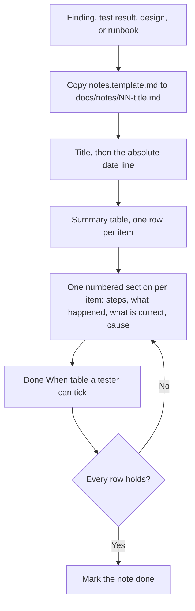

---
tags:
  - kind/rule
  - layer/docs
  - topic/workflow
---

> Up: [[README.md]]

# Notes Standard

> [!important]
> A project note records one brief: what was found or decided, the steps that show it, and the result that closes it. It starts from [[notes.template.md]], carries an absolute date under its title, and numbers every item with digits only.

## Core Requirement

A note is the working record of one brief handed to whoever works on the project next, a person or an agent: a test result, a finding, a design, a runbook, or a set of next steps.

It is not the other two records in this vault:

| Record | Holds | Lives in |
| :- | :- | :- |
| A project note, this file | One brief, with steps and an acceptance table, until it is done | `docs/notes/` in the project repository |
| A journal | What happened on one day of work, with numbers | `journal/`, per [[journal.rules.md]] |
| A memory note | One durable fact or decision | `memory/`, per [[memory.rules.md]] |

- **One note holds one brief.** A second topic with its own steps and its own result is a second note.
- **Every new note starts from [[notes.template.md]]**, copied whole, with the guidance replaced and the sections that do not apply removed.
- **A note is a file named `NN-title.md`** in `docs/notes/`, where `NN` is its number.

## Workflow



## Number and Title

**The numbers stay gapless.** A new note takes the highest number plus one. A reference such as `note 12 item 2` written in another note does not move if a note is renumbered, so check such references after removing one.

The title is the first line, a `#` heading that names the subject:

| Write | Not |
| :- | :- |
| `# Sales Return: Totals Stall After the Fix` | `# 12 · Sales Return` |
| `# Cutover Day: The One-Day Plan` | `# Cutover Day - The One-Day Plan` |
| `# Verifying Note 7` | `# Verifying N7` |

- **No number in the title.** The file name already carries it.
- **No dash as a separator.** A subtitle follows a colon. A hyphen inside a word stays.
- **No item labels in the title.** Name the subject.

## The Date Line

Directly under the title sits one italic line: the date, what kind of note this is, and where the evidence lives.

```markdown
*7 October 2026 - staging test of the fix in note 12 (backend `6cc3bdb`, frontend `3826ff5`) - evidence in `test/browser/03-staging.md`*
```

- **The date is absolute**: day, month name, year. Never "yesterday" or "last week".
- **The kind says how to read the note**: test result, finding, design, decision, runbook, or next steps.
- **The evidence names something a reader can open**: a commit hash, a file, another note.

## Numbering

> [!failure]
> Never label an item with a letter or a prefixed code: no `A`, `B`, `C`, no `A1`, `U1`, `K2`, or `S3`. The same letter means different things in different notes, so a code like `S3` cannot be resolved without knowing which note wrote it.

Items are numbered with digits only, nested by level:

| Level | Heading | In a table or a sentence |
| :- | :- | :- |
| Item | `## 1. Title` | `1`, `item 1` |
| Sub-item | `### 1.1 Title` | `1.1`, `item 1.1` |
| Third level | `#### 1.1.1 Title` | `1.1.1`, `item 1.1.1` |

- **The same item keeps the same number** in the summary table, in its own section, and in every sentence that mentions it.
- **A reference inside the note is `item 2`.** A list is `items 2, 4, and 5`, a range is `items 1 to 17`.
- **A reference to another note is `note 12 item 2`**, so it resolves without guessing.
- **A name that code depends on stays in inline code**, such as a check named `X1` in a script, and is never used as an item number.

## Sections

In this order. Remove a section that does not apply rather than leaving it empty.

| Section | Holds |
| :- | :- |
| Title and date line | The subject, and when, what, and from where |
| Scope | One callout saying how far the work goes: staging only, or through to production |
| Summary table | One row per item: number, one sentence naming the symptom and its effect, and its level, high, medium, or low |
| Context | One short paragraph: what already passed, what was not tested, and why |
| `## 1. Item` | One section per item, in summary order: steps, what happened, what is correct, and the cause or the suspected cause |
| `## Decisions Needed` | For a design or a runbook: each decision and who makes it |
| `## Done When` | The acceptance table: number, case, expected result. A tester can tick every row without asking anyone |
| `## Links` | Where each source lives: the original finding, the test evidence, the related notes |

## Writing an Item

- **Steps are a numbered list a tester can repeat**, with the real menu path, the real record, and the real value typed.
- **What happened quotes the real error text** in inline code, verbatim. A reader searching for the string finds the note; a paraphrase does not match.
- **What is correct carries the real number**, never "should match".
- **A cause not yet proven is labelled.** Start the paragraph with `Suspected, not yet confirmed.` and name the file and function suspected.
- **Bold the sentence that carries the point.**

## Formatting

A note follows [[docs.rules.md]] in full: one language per note, no em dash, no arrows, no emoji, no smart quotes, and no `---` rule. A screen mock-up inside a code block writes an icon as a word in brackets, such as `[calendar]`.

- **No secret in a note**, per [[secret.rules.md]], and no protected value, per [[data.rules.md]]. A note is read by everyone with access to the repository.

## Marking a Note Done

A note is done once every row of `## Done When` holds. Record it in the date line, such as `- done 9 October 2026`, never by editing the title, and keep the file: a done note is the record of why the code is the way it is.

## Do and Do Not

| Do | Do not |
| :- | :- |
| Start from [[notes.template.md]] | Start from an empty page |
| Write the absolute date under the title | Leave the date to the file's timestamp |
| Number items `1`, `1.1`, `1.1.1` | Label them `A`, `U1`, `K2` |
| Write `note 12 item 2` | Write `U2` and expect the reader to know which note |
| Quote the error verbatim | Paraphrase it |
| Give the expected number | Write "should match" |
| Mark done in the date line | Add "DONE" to the title |

## Conflict Resolution

If another instruction conflicts with this standard, follow this priority:

1. Security and privacy requirements
2. Direct user instructions
3. This notes standard
4. [[docs.rules.md]]
5. Existing project conventions

## Applies To

- [[notes.template.md]]
- [[docs.rules.md]]
- [[journal.rules.md]]
- [[memory.rules.md]]
- [[callout.rules.md]]
