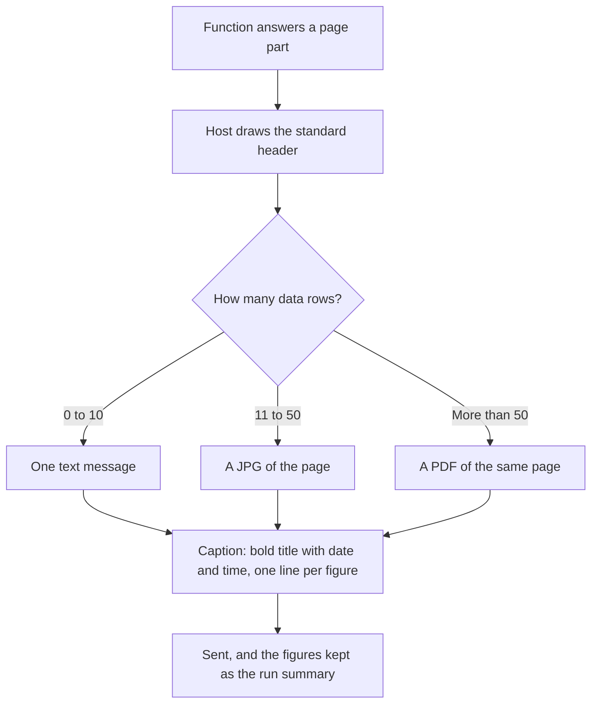

---
tags:
  - kind/rule
  - layer/backend
  - topic/workflow
---

> Up: [[README.md]]

# Report Automation Standard

> [!important]
> Every automated report looks and reads the same way, wherever its data comes from: one header, one caption shape, one number format, one colour per status, and a file type decided by its size.

## Core Requirement

This standard owns what every automated report delivers: the page a function answers, which file it becomes, and how its header, caption, numbers, colours, and tables look. Where its code lives, how it is deployed, and how it is released are [[automation.rules.md]]. Which chart a report may draw is [[analytics.rules.md]].

A reader who opens one report must recognise the next one at a glance. Two reports from two functions arrive looking alike because **a function never draws a caption, picks a file type, or sends**: it answers each page as a page part, and the host turns every part into the same kind of message.

## Workflow



## What a Page Part Carries

| Field | What the host does with it |
| :- | :- |
| `title` | The header title and the caption's first line. A name, such as "Daily Sales Report", never a sentence |
| `period` | What the page covers, in the run log |
| `figures` | One caption line per `[label, value]`, and the run summary. None for a page that says everything |
| `body_html`, `body_css` | The page under the header, rendered once for both the image and the PDF |
| `rows` | The number of data rows, which decides the file type |
| `subtitle` | A line under the title, naming the part when a report sends several |
| `dated` | Set only when the data is of another day than the run |
| `file_name` | The file name without its extension, where the owner named it |

## Which File a Report Becomes

| Data rows | Sent as |
| :-: | :- |
| 0 to 10 | One text message, only for a report that allows text |
| 11 to 50 | A JPG of the page |
| More than 50 | A PDF of the same page |

- **A page with two lists counts the longer one.** Summary tables and charts do not count.
- **The image is always a JPG.** Most messaging apps send a JPG as a photo and a PNG only as a file attachment.
- **One HTML page makes both files**, so the image and the PDF look the same.
- A report that sets no file name goes as `<slug>-<yyyy-mm-dd>`, and a second part adds `-1`.

## The Header

Every report page opens with one header: the project's logo on the left, the title centred, and the full date on the right, with one dark rule under it. A subtitle sits under the title and an optional note under the date, both muted.

The header is drawn by the host from the page part, never by each function, so changing it once changes every report.

## The Caption

The caption is the text under the image or the PDF: the title in bold with the day and time in brackets, then one line per figure.

```text
*Daily Sales Report (11 Nov 2026, 10:40)*
Open orders 28 (2,136 kg, 1,386,356.38)
```

- **The day and time are always in brackets**, and they are when the report was made.
- **Each figure is one line, `<label> <value>`**, with no bullets.
- A message may carry the title line alone when the page says everything.
- **The figures are also the run summary**, so they name what a reader needs without opening the file.

## Language and Numbers

- **One language per report, and one number format per project**, the language the readers use, per [[docs.rules.md]].
- The thousands and decimal separators, the currency prefix, and the date and time format are set once for the project and used in every report.
- A short date such as `11 Nov 2026` and a full date with the day name are the only two date forms.
- Statuses use the same words in every report.

## Colour

**A status has one colour in every report**: on its tile, on the edge of its card, and on its table header.

- A light status colour carries dark text, because white on yellow cannot be read.
- A status card carries its colour as an edge on the card itself, so the edge runs the full height and follows the card's corners.
- A value that needs attention is bold in the danger colour.
- Colours come from the project's chart palette, per [[dashboard.component.md]].

## Tables

- **A header sits like its column**: text left, numbers right.
- **Every number in a table body is black.** Colour belongs to the headers only. A total row keeps its header colour with its numbers in white.
- **A zero is a faint grey `0`**, so the numbers that matter stand out.
- **Rows are white with a line between them**, never coloured by category. A category is a column of its own, never a legend above the table.
- Columns of the same kind are equally wide, and the total row adds up every column it sits under.
- A one-page summary keeps its numbers large enough to read in a chat preview without opening the image.

## Copying a Screen

A report that shows a screen of the project copies that screen's markup and CSS rather than redrawing it. The standard header goes on top, and controls such as date pickers, buttons, and filters become their values.

## What a Report Never Carries

- A phone number, because a report goes to a group.
- A person's name, except where the project's own screen already shows it to the same readers.
- A secret, a key, or a connection string, per [[secret.rules.md]].
- Any value [[data.rules.md]] classes as protected.

## Definition of Done

- It meets the Definition of Done of [[automation.rules.md]].
- Its function answers every page as a page part and draws no caption and picks no file type itself.
- It opens with the standard header, and its caption starts with the bold title line with the date and time in brackets.
- It goes as text, a JPG, or a PDF by its row count.
- Every status uses its one colour, and every table header is aligned like its column.
- It carries no phone number, no secret, and no protected value.

## Conflict Resolution

If another instruction conflicts with this standard, follow this priority:

1. Security and privacy requirements
2. Direct user instructions
3. This report standard
4. [[automation.rules.md]]
5. Existing project conventions

## Applies To

- [[automation.rules.md]]
- [[analytics.rules.md]]
- [[dashboard.component.md]]
- [[table.component.md]]
- [[secret.rules.md]]
- [[data.rules.md]]
