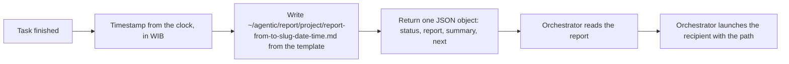

---
tags:
  - kind/rule
  - layer/docs
  - topic/workflow
---

> Up: [[README.md]]

# Report Protocol

> [!important]
> Every agent finishes every task by writing one report file into `~/agentic/report/<project>/`, the vault's report folder, never into the project, then returns one JSON object naming that file and its status. A report is never committed and never passed to a git command.

## Core Requirement

Agents never talk to each other directly. A report is the only channel: one agent writes it, the orchestrator reads it and launches the recipient with its path. A report on disk survives the session that wrote it; a message in a transcript does not.

## Workflow



## Where Reports Live

- `~/agentic/report/<project>/`: the `report/` folder of the vault, one folder per project, flat inside it. Create the folder if it does not exist.
- `<project>` is the name of the project's root folder, such as `~/agentic/report/github-profile-stats/`. Work on the vault itself reports into `~/agentic/report/agentic/`.
- **Never inside the project.** A project holds no `report/` folder and needs no `.gitignore` line for one, so a report cannot be staged by accident, and the reports of every project sit in one place.
- **The owner chose this location**, and only the owner moves it.
- **Never committed, never pushed, and never passed to a git command.** The vault's `.gitignore` lists `report/`, because a report names real projects, files, and findings, as a memory note does.

## The File Name

Agent to agent:

```text
report-<from>-to-<to>-<request-slug>-<YYYYMMDD>-<HH_MM_SS>.md
report-backend-engineer-to-verifier-login-otp-20260711-23_11_09.md
```

Agent to the CTO:

```text
report-<from>-to-user-<request-slug>-<YYYYMMDD>-<HH_MM_SS>.md
report-verifier-to-user-login-otp-20260712-09_02_44.md
```

| Part | Rule |
| :- | :- |
| `<from>`, `<to>` | An agent slug, `orchestrator`, or `user` |
| `<request-slug>` | Kebab-case, 2 to 6 words, `a-z0-9-` only, taken from the CTO's request. Every report about the same request uses the same slug |
| `<YYYYMMDD>-<HH_MM_SS>` | When the report is written, or when the test run it reports started, in WIB, on the 24-hour clock |

## The Timestamp Comes From a Command

**Never type a timestamp by hand.** Take it from the clock, in WIB (UTC+7):

```bash
TZ=UTC-7 date +%Y%m%d-%H_%M_%S
```

```powershell
[TimeZoneInfo]::ConvertTimeBySystemTimeZoneId([datetime]::UtcNow, 'SE Asia Standard Time').ToString('yyyyMMdd-HH_mm_ss')
```

**Not `TZ=Asia/Jakarta`.** Git Bash on Windows ships without the time zone database, so it ignores the name without an error and prints UTC, seven hours early. `UTC-7` is a POSIX offset every `date` understands; POSIX inverts the sign, so it means UTC+7.

## A Result Is Markdown or JSON

**Every file an agent writes into the report folder is Markdown or JSON, and nothing else.**

| A result | Format |
| :- | :- |
| A report, read by a person or by the next agent | Markdown, `.md` |
| The output of a tool: a test run, a scan, a measurement | JSON, `.json` |

- **No XML, CSV, HTML, or plain text file is a result.** Every agent reads Markdown and JSON with the tools it already has; a third format is one the next agent has to parse first, and a result nobody parses is a result nobody checks.
- **Where a tool writes another format by default, ask it for JSON**: `--json-report` for pytest, `--reporter=json` for Playwright, `--output=json` for Lighthouse, `--json` for Locust.
- **Where a tool has no JSON output, its numbers go into the report as a table**, with the command that produced them.
- **What an agent returns to the orchestrator is JSON**: one object with the status, the report's path, a one-line summary, and the next agent, per Rules below.

## Test Evidence Shares the Report's Name

**Every file a test run produces is named after the report that cites it**: the same agent, the same request slug, the same date and time, plus a suffix for the tool that wrote it. In the project's report folder the report and its evidence then sort together, and anyone can see which test run and which performance run happened at the same moment, for the same request.

```bash
DIR="$HOME/agentic/report/$(basename "$PWD")"
mkdir -p "$DIR"
RUN="$DIR/report-verifier-to-user-login-otp-$(TZ=UTC-7 date +%Y%m%d-%H_%M_%S)"
pytest --json-report --json-report-file="$RUN-pytest.json"
PLAYWRIGHT_JSON_OUTPUT_NAME="$RUN-playwright.json" npx playwright test --reporter=json
npx lighthouse https://[staging-host] --only-categories=performance --output=json --output-path="$RUN-lighthouse.json" --quiet --chrome-flags="--headless"
```

```text
report-verifier-to-user-login-otp-20260712-09_02_44.md
report-verifier-to-user-login-otp-20260712-09_02_44-pytest.json
report-verifier-to-user-login-otp-20260712-09_02_44-playwright.json
report-verifier-to-user-login-otp-20260712-09_02_44-lighthouse.json
```

- **Run it from the project root**, so `basename "$PWD"` is the project's name.
- **The timestamp is taken once, when the run starts**, and reused for every file of that run and for the report itself, `"$RUN.md"`.
- The suffix names the tool, and every one ends in `.json`: `-pytest.json`, `-playwright.json`, `-lighthouse.json`, `-locust.json`.
- Evidence lands beside the report, outside the project, and is never committed.

## What a Report Holds

- **It starts from [[report.template.md]]**, the project note shape from [[notes.template.md]] with the routing an agent report needs.
- **Every report is in English**, to an agent and to the CTO alike, per [[agent.rules.md]], with every technical term, path, and error kept in its original form.
- **No secret, token, or real environment value**, per [[secret.rules.md]] and [[env.rules.md]]. Name the file and the line; never paste the value.

Every finding carries one of four levels:

| Level | Means |
| :- | :- |
| `critical` | Exploitable, data loss, or production down |
| `high` | A broken feature or a serious security gap |
| `medium` | Wrong behaviour that has a workaround |
| `low` | A minor issue or polish |

Every report carries one of five statuses, written as a status indicator per [[docs.rules.md]]:

| Status | Color | Means |
| :- | :- | :- |
| Done | Green | The assigned work is finished |
| Pass | Green | A verifier or a reviewer approves |
| Fail | Red | A verifier or a reviewer rejects, with findings |
| Blocked | Yellow | The work cannot continue without something outside the agent's control |
| Needs Decision | Yellow | The CTO has to choose between options |

## Rules

- **One file per recipient.** To copy someone in, write a short separate report to them that names the main report's file.
- **End every report with a Next Action** naming the next agent, `user`, or none, per the loop in [[AGENTS.md]]. The orchestrator launches it at once.
- **Never edit another agent's report.** A follow-up is a new report that names the earlier one under Links.
- **Return one JSON object and nothing after it** to the orchestrator, per [[harness/README.md]]. It carries the status, the report's path, a one-line summary, and the next agent:

```json
{"status": "Fail", "report": "~/agentic/report/shop-backend/report-verifier-to-backend-engineer-login-otp-20260711-23_40_02.md", "summary": "2 high findings", "next": "backend-engineer"}
```

## Related

- [[report.template.md]]
- [[notes.rules.md]]
- [[agent.rules.md]]
- [[docs.rules.md]]
