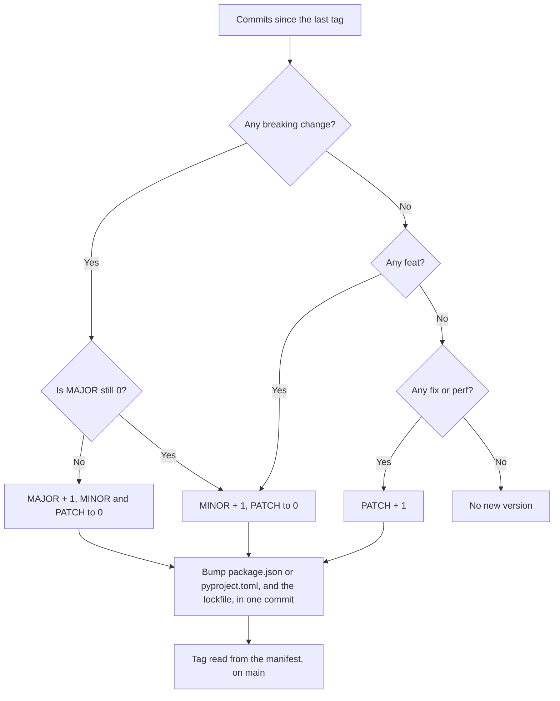

---
tags:
  - kind/rule
  - topic/workflow
  - topic/deploy
---

> Up: [[README.md]]

# Versioning Standard

> [!important]
> Every app and package carries one version, `MAJOR.MINOR.PATCH` per Semantic Versioning 2.0.0, written inside its own manifest. The commits since the last release decide which number moves, every number to its right resets to 0, and the git tag is copied from the manifest, never the other way round.

## Core Requirement

Every repository that ships something carries a version in the form `MAJOR.MINOR.PATCH`, following **Semantic Versioning 2.0.0**. That covers a backend, a frontend, a Node.js service, a CLI, and a library: any project with a `package.json` or a `pyproject.toml`. A repository that never releases, such as this vault or an experiment repository, carries none.

A version is a promise to whoever depends on the app: the next number says whether they can take it without changing anything. A version picked by feel breaks that promise silently, so the number is decided by the commits, not by the size of the work or the mood of the release.

**The version lives inside the project, in its manifest, and everything outside is a copy.** A release that moves only the git tag, the README badge, or a release note, while `package.json` or `pyproject.toml` still says the old number, ships an app that reports the wrong version to everyone who asks it. The manifest moves first, in the bump commit, and the tag is read from it.

The backend and the frontend are separate repositories, per [[repository.rules.md]], and each keeps its own version. A frontend `2.0.0` says nothing about the backend it calls.

## Workflow



## The Three Numbers

| Part | Raised when | Resets | Example |
| :- | :- | :- | :- |
| **MAJOR** | A breaking change: something that worked against the previous version no longer works unchanged. A removed or renamed endpoint or response field, a removed feature, a full redesign of the interface, a newly required environment variable, a changed database contract | MINOR and PATCH to 0 | `1.4.2` > `2.0.0` |
| **MINOR** | A new feature, and the app stays compatible with the previous version | PATCH to 0 | `1.1.5` > `1.2.0` |
| **PATCH** | A bug fix or a minor security fix, with no new feature | Nothing | `1.2.3` > `1.2.4` |

- Each part is a non-negative integer with no leading zero. `1.02.0` is not a version.
- The `v` prefix belongs to the git tag only. The manifest holds `1.2.0`, the tag is `v1.2.0`.
- A security fix that forces a consumer to change something is a breaking change, and raises MAJOR like any other.

> [!warning]
> The parts are integers, not decimals, and every part to the right of the one raised goes back to 0. `1.9.0` > `1.10.0`, never `2.0.0`. `1.1.5` with a new feature is `1.2.0`, never `1.2.5`. `1.4.2` with a breaking change is `2.0.0`, never `2.4.2`. A version that skips the reset tells every reader the release holds fixes it does not hold.

## The Highest Commit Decides the Bump

The commit types in [[commit.rules.md]] already carry their SemVer impact. A release reads every commit since the last tag and takes the highest one. Only one number moves per release, however many commits it holds.

| Commits since the last tag include | Bump |
| :- | :- |
| A `!` marker or a `BREAKING CHANGE` footer, of any type | MAJOR |
| A `feat` | MINOR |
| A `fix` or a `perf` | PATCH |
| Only `docs`, `style`, `refactor`, `test`, `build`, `ci`, `chore`, or `exp` | No new version |

- A `revert` takes the impact of the commit it reverts.
- List what a release holds before choosing the number:

```bash
git log --format='%h %s' v1.2.0..HEAD
```

- A commit counts at its real impact, not its label. A breaking change written as a `fix` without the `!` still raises MAJOR. Pushed history is not rewritten to fix the label, per [[pr.rules.md]].

## Version 0 Is Development

A new app starts at `0.1.0`. While MAJOR is 0, the app is in development and nobody outside the project depends on it yet.

- Whatever a scaffold writes, the first commit sets `0.1.0`. `npm init` writes `1.0.0` and `npm create vite` writes `0.0.0`; neither is a starting version.
- A breaking change raises MINOR instead of MAJOR: `0.3.4` > `0.4.0`.
- A feature raises MINOR and a fix raises PATCH, the same as after `1.0.0`.
- **`1.0.0` is the first version real users depend on**: the first release to production. The owner decides when that is. An agent never cuts `1.0.0` on its own.
- After `1.0.0`, the MAJOR rule applies in full and there is no way back to 0.

## One Version, Written Once

The version is one literal in the project's manifest. Everything else that shows it, inside the code or outside the repository, reads it from there.

| Project | The version lives in | Moves with it in the same commit |
| :- | :- | :- |
| JavaScript or Node.js: a frontend, a Node service, a CLI, a library | `version` in `package.json` | `package-lock.json`, at its root `version` and at `packages[""].version` |
| Python | `version` under `[project]` in `pyproject.toml` | Nothing else |

- **No project releases without a manifest.** A Python project that has only `environment.yml` or `requirements.txt` gets a minimal `pyproject.toml` to hold its version. The version never lives only in a tag.

```toml
[project]
name = "[project-name]"
version = "0.1.0"
requires-python = ">=3.13"
```

- `"private": true` in `package.json` stops a publish to npm. It does not exempt the project from versioning.
- Never a second literal in code or configuration: not in an environment variable, not in a constant, not in `__version__`. The guardrails below show how each stack reads the manifest instead.
- A version badge in the README, where one exists, changes in the bump commit, per [[badge.rules.md]].
- The container image keeps its commit tag, per [[deploy.rules.md]]. The version is not an image tag.
- `pyproject.toml` is the project manifest, not a configuration file, and holds no secret. Reading it is allowed, per [[env.rules.md]].

## Guardrails for JavaScript and Node.js

Bump with npm, never by hand, so the manifest and the lockfile move together:

```bash
npm version minor --no-git-tag-version
```

**Always pass `--no-git-tag-version`.** Plain `npm version` also commits and tags on the branch you are standing on, which is `dev` on a promotion project, and a tag on `dev` is a release nobody verified on `staging`. The flag leaves the commit and the tag to the steps under "The Tag Is Cut on main".

| Never | Instead |
| :- | :- |
| Edit `version` in `package.json` by hand and leave the lockfile behind | `npm version <major\|minor\|patch> --no-git-tag-version`, or `npm install --package-lock-only` right after a hand edit |
| `const VERSION = "1.2.0"` anywhere in the source | The build injects it from `package.json` |
| `import pkg from "../package.json"` in browser code | `define` in `vite.config.ts`, so the bundle carries the version string and not the whole manifest |
| `process.env.npm_package_version` at runtime | Read `package.json` at startup. That variable exists only under `npm run`, and is empty under plain `node` or in a container |
| Type the tag by hand | Read the tag from `package.json`, below |

In a Vite frontend, the version reaches the code at build time, through `vite.config.ts` beside the plugins already there:

```ts
import { readFileSync } from "node:fs";
import { defineConfig } from "vite";

const pkg = JSON.parse(readFileSync(new URL("./package.json", import.meta.url), "utf-8"));

export default defineConfig({
  define: { __APP_VERSION__: JSON.stringify(pkg.version) },
});
```

Then declare `declare const __APP_VERSION__: string;` in `src/vite-env.d.ts`. In a Node service or a CLI, read `package.json` once at startup with the same `readFileSync`, anchored to the module through `import.meta.url` and never to the working directory, per [[path.rules.md]].

Before the bump commit, the lockfile must agree with the manifest. All three numbers print the same:

```bash
node -p "const l = require('./package-lock.json'); [require('./package.json').version, l.version, l.packages[''].version].join(' ')"
```

The tag, read from the manifest:

```bash
V=$(node -p "require('./package.json').version")
git tag -a "v$V" -m "v$V"
```

## Guardrails for Python

The version is a static string under `[project]` in `pyproject.toml`, edited in the bump commit. Where the project's build tool has a bump command, use it, and the result is still that static string.

| Never | Instead |
| :- | :- |
| `dynamic = ["version"]` with `setuptools-scm` or `hatch-vcs`, which derive the version from the git tag | A static `version`: the manifest leads and the tag follows |
| `__version__ = "1.2.0"` in `__init__.py` | Read `pyproject.toml` at startup, below |
| `FastAPI(version="1.2.0")` | `FastAPI(version=VERSION)`, with `VERSION` read from the manifest |
| A version in `setup.py`, `setup.cfg`, or `environment.yml` | `pyproject.toml` only |
| `importlib.metadata.version()` in a deployed app | It raises `PackageNotFoundError`, because the image installs `requirements.txt` and not the project, per [[deploy.rules.md]] |
| Type the tag by hand | Read the tag from `pyproject.toml`, below |

Read the version once at startup, with the standard library, from the `ROOT` anchor that [[path.rules.md]] declares once per project:

```python
import tomllib

VERSION = tomllib.loads((ROOT / "pyproject.toml").read_text(encoding="utf-8"))["project"]["version"]
```

`.dockerignore` must not exclude `pyproject.toml`, or the image builds and then fails on this line at startup.

The tag, read from the manifest:

```bash
V=$(python -c "import tomllib; print(tomllib.load(open('pyproject.toml', 'rb'))['project']['version'])")
git tag -a "v$V" -m "v$V"
```

## The Tag Is Cut on main

1. **The bump is its own commit**, made on the default branch, and it changes the manifest and its lockfile together: `chore(release): bump the version to 1.2.0`, with the body naming what the release holds, per [[commit.rules.md]]. A version bump needs no pull request, per [[pr.rules.md]]. A bump commit that does not touch `package.json` or `pyproject.toml` is not a bump.
2. **The tag is cut on `main`, never on `dev` or `staging`.** On a promotion project the bump commit rides the promotion, and the tag goes on the merge commit of the `staging` > `main` pull request. On a trunk project it goes on the bump commit itself, per [[branch.rules.md]].
3. **The tag is read from the manifest by command, never typed**, with the commands in the two guardrail sections above, and it is annotated.

**A forgotten bump fails at step 3, by design.** If the manifest was never raised, the command reads the previous version, and git refuses with `fatal: tag 'v1.2.0' already exists`. Go back and bump the manifest. Never delete the old tag to make room.

4. **Pushing a tag is a push.** The owner pushes it, or an agent does only on an explicit instruction for that release, per [[pr.rules.md]]. In the agent loop the orchestrator makes the bump commit at a release, and the tag waits for the owner, per [[AGENTS.md]].

> [!danger]
> A pushed tag is never moved, deleted, or reused. Someone has already built, deployed, or pinned against it, and a tag that silently points somewhere new hands them different code under the same number. A wrong release is fixed by the next PATCH, never by rewriting the tag.

## The API Version Is Not the App Version

The `v1` in `api/v1/...` is the version of the API contract, per [[api.rules.md]], and it moves on its own schedule.

- Mounting `api/v2` beside a working `api/v1` breaks no client, so it raises MINOR.
- Removing `api/v1` breaks every client still on it, so it raises MAJOR.
- A breaking change to `api/v1` in place is not a versioning question: [[api.rules.md]] already forbids it.

## Definition of Done

Before treating a release as versioned, confirm:

- The manifest, `package.json` or `pyproject.toml`, holds the new version as three non-negative integers with no leading zero and no `v`.
- The bump commit changed the manifest, and in a JavaScript project `package-lock.json` matches it in both places.
- The bump matches the highest commit impact since the last tag, and every part to its right is 0.
- `1.0.0`, if this is it, was cut on the owner's word.
- No second literal: no `__version__`, no version constant, no version derived from git, no `npm_package_version` at runtime. A README version badge, if any, matches the manifest.
- The tag was read from the manifest, is annotated, and sits on `main`.
- No pushed tag was moved, deleted, or reused.

## Conflict Resolution

If another instruction conflicts with this standard, follow this priority:

1. Security and privacy requirements
2. Direct user instructions
3. This versioning standard
4. Semantic Versioning 2.0.0
5. Existing project conventions

A direct user instruction must not override security or privacy requirements. If a request conflicts with this standard, tell the user which standard is affected before proceeding.

## Applies To

- [[commit.rules.md]]
- [[branch.rules.md]]
- [[pr.rules.md]]
- [[api.rules.md]]
- [[deploy.rules.md]]
- [[repository.rules.md]]
- [[badge.rules.md]]
- [[path.rules.md]]
- [[env.rules.md]]
