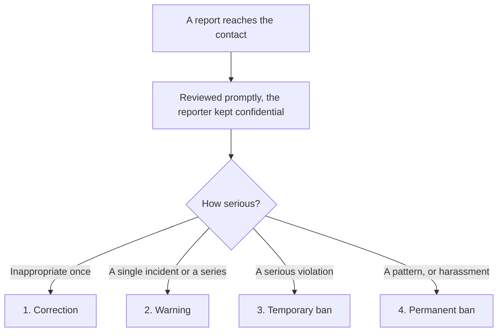

---
tags:
  - kind/template
  - layer/docs
---

> Up: [[README.md]]

# Code of Conduct Template

> [!example]
> Copy the block below into `CODE_OF_CONDUCT.md` at the repository root. Replace `[Project Name]` and `[contact email]`, and change nothing else without a reason.

Every repository carries this file, per [[repository.rules.md]]. It follows the formatting rules in [[docs.rules.md]] but not the README shape: no badge row and no table of contents.

## Workflow



## The Block

````markdown
# Code of Conduct

## Our Commitment

Everyone who takes part in [Project Name], by writing code, reviewing it, reporting an issue, or asking a question, is treated with respect. We commit to a project free of harassment for everyone, regardless of age, body size, disability, ethnicity, gender identity and expression, level of experience, education, nationality, appearance, race, religion, or sexual identity and orientation.

## Expected Behaviour

- Be respectful of differing views and experience.
- Give and accept feedback about the work, never about the person.
- Take responsibility for a mistake, apologise to anyone affected, and learn from it.
- Focus on what is best for the project and the people who use it.

## Unacceptable Behaviour

- Harassment, insults, or derogatory comments, in public or in private.
- Sexualised language or imagery, or unwelcome attention of any kind.
- Publishing someone's private information, such as an address or a phone number, without their explicit permission.
- Personal attacks, trolling, or deliberately disrupting a discussion.
- Any other conduct that would reasonably be considered inappropriate in a professional setting.

## Scope

This code applies in every project space: the repository, its issues, pull requests, and discussions, and anywhere a person represents the project.

## Reporting

Report unacceptable behaviour to [contact email]. Every report is reviewed promptly and fairly, and the reporter's identity is kept confidential.

## Enforcement

| Step | When | Consequence |
| :- | :- | :- |
| 1. Correction | Language or behaviour that is inappropriate once | A private written explanation of why it was inappropriate. A public apology may be requested |
| 2. Warning | A single incident or a series of actions | A warning, with no interaction with the people involved for a set period |
| 3. Temporary Ban | A serious violation | A temporary ban from any interaction with the project |
| 4. Permanent Ban | A pattern of violations, harassment, or aggression toward a group | A permanent ban from any interaction with the project |

## Attribution

This code of conduct is adapted from the [Contributor Covenant](https://www.contributor-covenant.org), version 2.1.
````

## Related

- [[repository.rules.md]]
- [[contributing.template.md]]
- [[docs.rules.md]]
