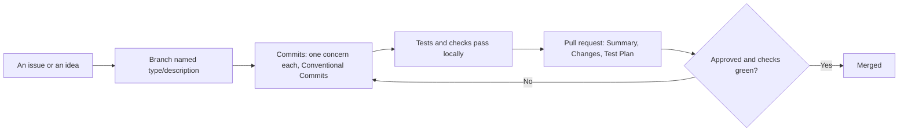

---
tags:
  - kind/template
  - layer/docs
---

> Up: [[README.md]]

# Contributing Template

> [!example]
> Copy the block below into `CONTRIBUTING.md` at the repository root. Replace every `[bracketed]` passage with the project's real commands and choices, and remove the guidance once it is filled.

Every repository carries this file, per [[repository.rules.md]]. **It states the project's conventions in its own words and never names, quotes, or links the standards in this vault**, which is private, per [[docs.rules.md]]. The rules below are the same ones [[branch.rules.md]], [[commit.rules.md]], and [[pr.rules.md]] set, written as the project's own.

## Workflow



## The Block

````markdown
# Contributing to [Project Name]

[One paragraph: who contributes to this project, and that every contribution follows the conventions below so the history stays readable.]

## Table of Contents

1. [Before You Start](#before-you-start)
2. [Setting Up](#setting-up)
3. [Branches](#branches)
4. [Commits](#commits)
5. [Pull Requests](#pull-requests)
6. [Code Style and Tests](#code-style-and-tests)
7. [Reporting a Bug or Requesting a Feature](#reporting-a-bug-or-requesting-a-feature)
8. [Reporting a Security Issue](#reporting-a-security-issue)

## Before You Start

- Read the [README](README.md) for what the project is and how it runs.
- Read the [Code of Conduct](CODE_OF_CONDUCT.md). It applies to every contribution.
- Check the open issues and pull requests, so two people do not build the same thing.

## Setting Up

1. Clone the repository:

   ```bash
   git clone [repository URL]
   cd [repository name]
   ```

2. Create the environment:

   ```bash
   [conda env create -f environment.yml, or python -m venv .venv]
   ```

3. Copy `.env.example` to `.env` and fill in the values you were given. **Never commit `.env`.**
4. Run the tests to confirm the setup:

   ```bash
   [test command]
   ```

## Branches

- [Trunk: branch from `main` and merge back into `main` by pull request.] [Or promotion: branch from `dev`; changes move `dev` to `staging` to `main`, each by pull request.]
- Name a branch `<type>/<description>` in lowercase kebab-case, such as `feat/csv-export` or `fix/session-timeout`. No emoji and no personal names.

## Commits

Every commit follows Conventional Commits, in English:

```text
<type>(<scope>): <description>

- One list item per change, saying what it does and why
```

- The type is one of `feat`, `fix`, `docs`, `style`, `refactor`, `perf`, `test`, `build`, `ci`, `chore`, or `revert`.
- The description is imperative, lowercase, without a trailing period, and about 72 characters.
- One concern per commit.
- No emoji, and no tool or AI attribution of any kind.
- Never commit a secret, a key, an `.env` file, or real data.

## Pull Requests

- One concern per pull request.
- The description carries a **Summary**, a **Changes** list, and a **Test Plan** whose items are ticked with `- [x]` only for steps actually run.
- Every check passes, and the branch is up to date with its base, before review.
- [Who reviews, and how many approvals a merge needs.]

## Code Style and Tests

- [Formatter and linter commands.]
- A public function carries type hints.
- A comment is a short label, one line by default.
- A bug fix ships with the test that would have caught it.

## Reporting a Bug or Requesting a Feature

Open an issue with what you did, what you expected, and what happened, quoting any error verbatim, and the version or commit you used.

## Reporting a Security Issue

Never in a public issue. Follow [SECURITY.md](SECURITY.md).
````

## Related

- [[repository.rules.md]]
- [[branch.rules.md]]
- [[commit.rules.md]]
- [[pr.rules.md]]
- [[code-of-conduct.template.md]]
- [[security.template.md]]
