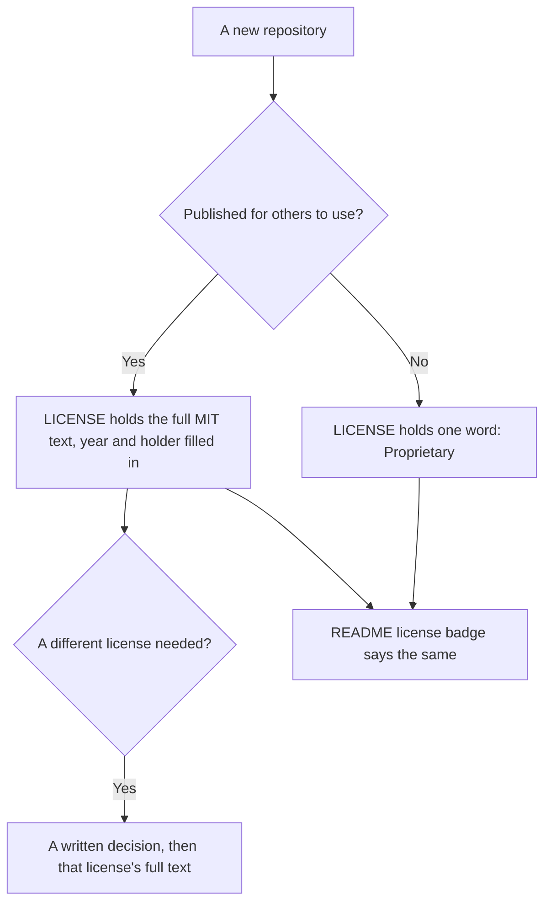

---
tags:
  - kind/template
  - layer/docs
---

> Up: [[README.md]]

# License Template

> [!example]
> Every repository carries a `LICENSE` file at its root. A proprietary project's file holds one word, `Proprietary`. A project published for others to use holds the full text of its license.

Pick one of the two blocks below and save it as `LICENSE`, with no extension, at the repository root, per [[repository.rules.md]]. The license badge in the README states the same license, per [[badge.rules.md]].

## Workflow



## Proprietary

The default for a private repository. The file holds exactly this, and nothing else:

```text
Proprietary
```

A repository with no grant of rights is all rights reserved by its owner. The one word says so on purpose, so nobody reads the absence of a license as an oversight.

## MIT

For a project published for others to use. Replace `[year]` and `[full name]`, and change nothing else: a license is legal text, quoted verbatim, so the formatting restrictions of [[docs.rules.md]] do not apply to it.

```text
MIT License

Copyright (c) [year] [full name]

Permission is hereby granted, free of charge, to any person obtaining a copy
of this software and associated documentation files (the "Software"), to deal
in the Software without restriction, including without limitation the rights
to use, copy, modify, merge, publish, distribute, sublicense, and/or sell
copies of the Software, and to permit persons to whom the Software is
furnished to do so, subject to the following conditions:

The above copyright notice and this permission notice shall be included in all
copies or substantial portions of the Software.

THE SOFTWARE IS PROVIDED "AS IS", WITHOUT WARRANTY OF ANY KIND, EXPRESS OR
IMPLIED, INCLUDING BUT NOT LIMITED TO THE WARRANTIES OF MERCHANTABILITY,
FITNESS FOR A PARTICULAR PURPOSE AND NONINFRINGEMENT. IN NO EVENT SHALL THE
AUTHORS OR COPYRIGHT HOLDERS BE LIABLE FOR ANY CLAIM, DAMAGES OR OTHER
LIABILITY, WHETHER IN AN ACTION OF CONTRACT, TORT OR OTHERWISE, ARISING FROM,
OUT OF OR IN CONNECTION WITH THE SOFTWARE OR THE USE OR OTHER DEALINGS IN THE
SOFTWARE.
```

Any other license is a written decision, recorded as a `decision` note per [[memory.rules.md]], and its file holds that license's full official text.

## Related

- [[repository.rules.md]]
- [[badge.rules.md]]
- [[docs.rules.md]]
