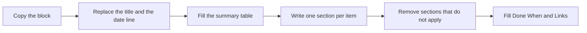

---
tags:
  - kind/template
  - layer/docs
---

> Up: [[README.md]]

# Notes Template

> [!example]
> Copy the block below into a new file `docs/notes/NN-title.md` in the project repository. Every `[bracketed]` passage is guidance to be replaced, and a section that does not apply is removed rather than left empty.

The rules for filling it in are in [[notes.rules.md]]. A note written in another language keeps the same sections and translates the headings, and never mixes two languages.

## Workflow



## The Block

````markdown
# [The subject in one phrase]: [detail if needed]

*[7 October 2026] - [test result, finding, design, decision, runbook, or next steps] - [source: note 12, backend `abc1234`, frontend `def5678`, evidence in `test/browser/03-name.md`]*

> [!info]
> **Release scope:** [staging only, or through to production].

| No | Item | Level |
| :-: | :- | :- |
| 1 | [One sentence: the symptom and its effect, with the key part in **bold**] | [high] |
| 2 | [One sentence for the second item] | [medium] |

[One paragraph of context: what already passed, what was not tested, and why. Refer to another note's item as note 12 item 2.]

## 1. [Title of the first item]

**Steps:**

1. [Menu > submenu > button, with the record and the value typed]
2. [The next step]

**What happened:**

- [What was seen. An error is quoted verbatim: `TypeError: ...`]
- [The effect on the user]

**What is correct:** [the expected number or state, such as a total of **184,788.36** as the saved record shows].

**Suspected, not yet confirmed.** [The file and function suspected, and why. Replace with **Cause:** once proven.]

### 1.1 [Sub-item, when the item has parts]

[The sub-item.]

## 2. [Title of the second item]

**Steps:** [one sentence when the steps are short].

**What happened:** [...]

**What is correct:** [...]

## Decisions Needed

| No | Decision | Decided by |
| :-: | :- | :- |
| 1 | [The question holding the work] | [the owner, or whoever decides it] |

## Done When

| No | Case | Expected result |
| :-: | :- | :- |
| 1 | Steps of item 1 | [A result anyone can tick without asking, with its number] |
| 2 | [A comparison case] | [Still correct] |

## Links

| For | Where |
| :- | :- |
| [Original finding] | [note 12 item 2] |
| [Test evidence] | [`test/browser/03-name.md`] |
````

## Related

- [[notes.rules.md]]
- [[docs.rules.md]]
