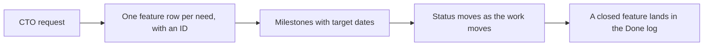

---
tags:
  - kind/template
  - layer/docs
  - topic/workflow
---

> Up: [[README.md]]

# Plan Template

> [!example]
> Copy the block below into `docs/PLAN.md` in the project repository. Every `[bracketed]` passage is guidance to be replaced, and a row that does not apply is removed rather than left empty.

The plan is the project's timeline and its feature list: what is being built, by whom, by when, and what is already done. It names the requirement codes from `docs/SRS.md` instead of repeating the requirements, per [[srs.rules.md]]. The project-manager agent keeps it current, per the [[agents/README.md|agent team]].

## Workflow



## The Block

````markdown
# Plan: [Project Name]

Derived from `docs/PRD.md` and `docs/SRS.md`. Updated [2026-11-22]. Status: [Draft, or Approved by the CTO on 2026-11-23].

## Timeline

| No | Milestone | Features | Target date | Status |
| :-: | :- | :- | :- | :- |
| 1 | [First usable release] | [F-001, F-002] | [2026-12-05] | <code style="color: yellow">Planned</code> |
| 2 | [Second milestone] | [F-003] | [2026-12-19] | <code style="color: yellow">Planned</code> |

## Features

| ID | Feature | Owner | Depends on | Status | Acceptance |
| :- | :- | :- | :- | :- | :- |
| F-001 | [One line: the capability a user sees] | `[backend-engineer]` | [None] | <code style="color: yellow">To Do</code> | [`FR-AUTH-01`, `FR-AUTH-02` in `docs/SRS.md` 3.4] |
| F-002 | [One line] | `[frontend-engineer]` | [F-001] | <code style="color: yellow">In Progress</code> | [`FR-AUTH-03`] |

A status is one of: To Do, In Progress, In QA (yellow), Done (green), or Blocked (red). An ID is never reused; a dropped feature keeps its row with the red status Removed. A bug fix gets a row too, its title starting with `Fix:`. Depends on tells the orchestrator which features can be built in parallel.

## Done Log

| Date | What was finished | Evidence |
| :- | :- | :- |
| [2026-11-22] | [F-001 login with OTP, approved by QA] | [commit `abc1234`] |
````

## Related

- [[srs.rules.md]]
- [[prd.rules.md]]
- [[prd.template.md]]
- [[docs.rules.md]]
