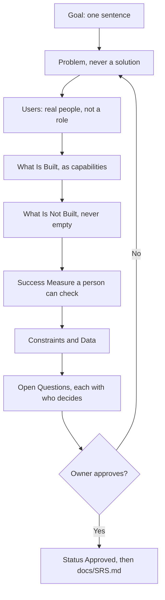

---
tags:
  - kind/template
  - layer/docs
---

> Up: [[README.md]]

# PRD Template

> [!example]
> Copy the block below into `docs/PRD.md` before the first feature commit. Every `[bracketed]` passage is guidance to be replaced. All eight sections are required, and What Is Not Built is never empty.

The rules for filling it in are [[prd.rules.md]]; the requirements that follow it are [[srs.rules.md]]. A repository already written in another language keeps that language and translates the headings only, per [[docs.rules.md]].

## Workflow



## The Block

````markdown
# PRD: [Project or Feature Name]

| Field | Value |
| :- | :- |
| Owner | [The named person who decides] |
| Date | [19 November 2026] |
| Status | <code style="color: yellow">Draft</code> |
| Goal | [One sentence: the outcome the whole product serves] |

## Problem

[What happens today, who it hurts, and what it costs. Not "we need feature X".]

## Users

[Which team, which role, how many people. Name the ones who will use it every day.]

## What Is Built

[What a user will be able to do once this exists. Written as a capability, not as a screen.]

## What Is Not Built

[An explicit list of what is deliberately left out, and why.]

## Success Measure

[How we know this worked. A number or a behavior somebody can check, not "more efficient".]

## Constraints

[What cannot change: the data source, a business rule, compliance, a deadline.]

## Data

[What data is read and written, where it comes from, and whether any of it is personal.]

## Open Questions

[What is undecided, and who has to decide it.]
````

The status moves from `Draft` to `Approved` only when the owner says so, and to `Done` when the feature ships, per [[prd.rules.md]].

## Related

- [[prd.rules.md]]
- [[srs.rules.md]]
- [[repository.rules.md]]
