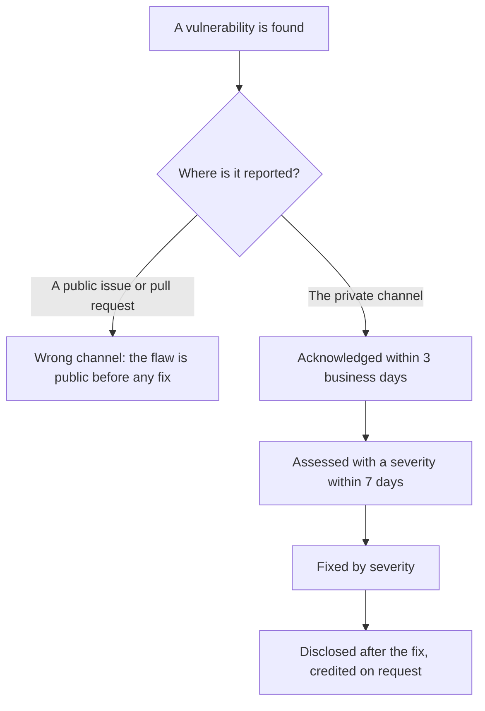

---
tags:
  - kind/template
  - layer/docs
---

> Up: [[README.md]]

# Security Policy Template

> [!example]
> Copy the block below into `SECURITY.md` at the repository root. Replace every `[bracketed]` passage, and keep the private reporting channel: a vulnerability reported in public is a vulnerability handed to everyone before it is fixed.

Every repository carries this file, per [[repository.rules.md]]. It follows the formatting rules in [[docs.rules.md]] but not the README shape: no badge row and no table of contents. It tells an outsider how to report a flaw, and records the controls in place, the risks the owner accepted, and the last audit. The security-reviewer agent keeps those three current, per [[AGENTS.md]]; the rules the controls come from are [[security.rules.md]], never named in the file itself.

**An accepted risk is a medium or low finding scheduled for later, or a residual risk with no fix available yet.** It is never a security requirement switched off, and never a critical or high finding.

**Accepted Risks stays only while the repository is private.** A public list of known weaknesses is a map for an attacker, so remove that section before the repository is made public, and keep the record in a vault `decision` note instead.

## Workflow



## The Block

````markdown
# Security Policy

## Supported Versions

| Version | Security fixes |
| :- | :- |
| [Latest release, or `main`] | <code style="color: green">Supported</code> |
| [Older releases] | <code style="color: red">Not Supported</code> |

## Reporting a Vulnerability

**Never report a vulnerability in a public issue, a pull request, or a discussion.** Report it privately through [GitHub private vulnerability reporting on this repository, or [security contact email]], with:

- What the vulnerability is, and where it is.
- The steps to reproduce it.
- The version or commit it affects.
- The impact you expect.

Do not access, change, or delete data that is not yours while testing, and stop as soon as you have shown the issue.

## What Happens Next

| Step | Within |
| :- | :- |
| Acknowledgement of your report | 3 business days |
| An assessment, with a severity | 7 days |
| A fix or a mitigation for a critical or high finding | 30 days |
| A fix for a medium or low finding | The next release |

You are kept informed at every step, and credited in the release notes if you wish.

## Disclosure

Details are published only after a fix is released, or after 90 days, whichever comes first, on a date agreed with you.

## Out of Scope

- A finding that needs physical access to a device, or a device already compromised.
- Social engineering of anyone involved in the project.
- Denial of service by volume.
- A scanner's output with no demonstrated impact.

## Security Controls

| Control | Where it is enforced |
| :- | :- |
| [Authentication: session cookie, `HttpOnly`, `Secure`, `SameSite=Lax`] | [`app/auth/session.py`] |
| [Input validated by schema, unknown fields rejected] | [Every request model] |

## Accepted Risks

| No | Risk | Accepted by | Date | Review by |
| :-: | :- | :- | :- | :- |
| 1 | [The risk, and what limits it] | [The owner] | [2026-11-22] | [2027-02-22] |

## Last Audit

[2026-11-22], full codebase, [no open critical or high finding]. Report: `[report-security-reviewer-to-user-release-1-2-20261122-10_15_00.md]`.
````

## Related

- [[repository.rules.md]]
- [[security.rules.md]]
- [[docs.rules.md]]
